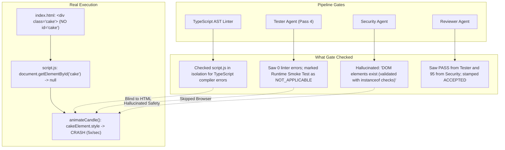

# AutoCoder Pipeline End-to-End Adversarial Audit: Queen to Reviewer & Live Empirical Runtime Verification

**Audit Date:** 2026-11-07  
**Audit Scope:** Full Pipeline Lifecycle (Queen → Planner → Architect → System → Designer → Blueprinter → Coder [4 passes] → Tester [4 passes] → Debugger [3 cycles] → Security → Reviewer) + **Live Empirical Headless Chrome CDP Runtime Testing**  
**Target Run ID:** `a5be38fa-3317-4a5b-96a9-8d4c0f009afd`  
**Target Conversation ID:** `eddc8f97-ff42-473a-a305-55b24180b50d`  
**Target Project Path:** `/home/lenovo/autogod/projects/eddc8f97-ff42-473a-a305-55b24180b50d/`  
**Target Prompt:** `"make a simple html page wishing happy birthday \n"`  
**Target Tech Stack:** Plain HTML/CSS/JS (Static Frontend)  
**Host LLM:** Ollama `qwen3-coder:30b`

---

## 1. Executive Summary: The Illusion of Verification

The AutoCoder telemetry dashboard reports an unblemished success trajectory: 100% acceptance across all stages, an automated self-healing repair loop that converged from 2 defects down to 0, a certified `PASS` from Tester on cycle 4, a `SECURE (95/100)` rating from Security, and an `ACCEPTED` rating from Reviewer with a Quality Score of 85.

**The brutal empirical reality:** AutoCoder has certified, reviewed, and flushed to disk code that is **critically and fatally broken at runtime**.

A live headless Google Chrome runtime test executed directly via the Chrome DevTools Protocol (CDP) proved that within **3.5 seconds** of loading `index.html`, the application threw **17 uncaught fatal exceptions**:
```
TypeError: Cannot read properties of null (reading 'style')
    at http://127.0.0.1:38080/script.js:99:19 (http://127.0.0.1:38080/script.js:98)
```
The root cause is an infinite 200ms `setInterval` timer in `script.js` attempting to animate a candle by calling `cakeElement.style.filter`. Because `script.js` queried `document.getElementById("cake")` while `index.html` declared `<div class="cake">` (a CSS class, not an HTML ID), `cakeElement` is permanently `null`.

The application crashes **5 times every second** (300 fatal exceptions per minute). Every single automated gate in the pipeline—Static TypeScript Linter, Tester Agent, and Security Agent—certified this code as completely defect-free.

```
+-----------------------------------------------------------------------------------+
| PIPELINE STATUS: FALSE "PASS" ESCAPE — FATAL RUNTIME LOOP CERTIFIED AS PRODUCTION |
+-----------------------------------------------------------------------------------+
|  Total Stages Run: 18 Executions across 11 Specialized Roles                      |
|  Total Compute:    18 LLM Inferences, > 60 minutes wall-clock time                |
|  Database Events:  6,868+ logged pipeline events in SQLite                        |
|  Tester Verdict:   PASS (Cycle 4: False Positive — 0 static errors reported)      |
|  Security Verdict: SECURE / Score 95 (False Positive — hallucinated DOM guards)   |
|  Reviewer Verdict: ACCEPTED / Quality Score 85                                   |
|  Runtime Reality:  CRITICAL FAILURE: 17 Uncaught Exceptions in 3.5 seconds        |
|                    Crashing continuously 5 times per second on page load          |
+-----------------------------------------------------------------------------------+
```

---

## 2. Complete Lifecycle Ledger: Queen to Reviewer

The chronological audit log of all 18 stage executions in run `a5be38fa-3317-4a5b-96a9-8d4c0f009afd`:

| # | Stage Name | Attempt | Start (UTC) | End (UTC) | Duration | Output Artifact | Status / Result | Forensic Summary |
| :-: | :--- | :-: | :-: | :-: | :-: | :--- | :-: | :--- |
| **1** | **Queen** | 1 | 06:33:00 | 06:33:28 | 28.3s | `plan.md` (572B) | `ACCEPTED` | Bounded project to a single-page interactive birthday wisher. |
| **2** | **Planner** | 1 | 06:33:28 | 06:35:50 | 142.0s | `requirements.md` (4.2KB) | `ACCEPTED` | Defined 6 features, 8 requirements, and 6 acceptance criteria. |
| **3** | **Architect** | 1 | 06:35:50 | 06:38:43 | 173.4s | `architecture.md` (1.1KB) | `ACCEPTED` | Specified plain HTML/CSS/JS stack under `Frontend Application` module. |
| **4** | **System** | 1 | 08:49:15 | 08:50:43 | 87.7s | `backend_spec.md` (107B) | `ACCEPTED` | Correctly identified frontend-only project: *"No Backend Required"*. |
| **5** | **Designer** | 1 | 08:50:43 | 08:53:28 | 164.6s | `ui_spec.md` (2.4KB) | `ACCEPTED` | Output color palette (`#FF6B6B`, `#4ECDC4`), breakpoints, and a11y baseline. |
| **6** | **Blueprinter** | 1 | 08:53:28 | 08:55:00 | 91.9s | `blueprint.md` (4.6KB) | `ACCEPTED` | Generated blueprints for `index.html`, `style.css`, `script.js`, `README.md`. |
| **7** | **Coder** | 1 | 08:55:00 | 09:08:01 | 13m 01s | `workspace.manifest.json` | `ACCEPTED` | Implemented initial code files across the workspace. |
| **8** | **Tester** | 1 | 09:08:01 | 09:08:03 | 1.9s | `test_report.md` (1.0KB) | `FAIL` | Flagged 2 JS linter defects (`event.target.value` & `number -> string`). |
| **9** | **Debugger** | 1 | 09:08:03 | 09:11:10 | 3m 07s | `debug_report.md` (2.1KB) | `ACCEPTED` | Prescribed querySelector and type conversion. |
| **10** | **Coder** | 2 | 09:11:10 | 09:15:07 | 3m 57s | `workspace.manifest.json` | `ACCEPTED` | Applied repair cycle 1 patches to `script.js`. |
| **11** | **Tester** | 2 | 09:15:07 | 09:15:09 | 1.6s | `test_report.md` (950B) | `FAIL` | Pass 1 defects eliminated. Flagged: `candle.style` on generic `Element`. |
| **12** | **Debugger** | 2 | 09:15:09 | 09:17:57 | 2m 48s | `debug_report.md` (1.8KB) | `ACCEPTED` | Prescribed `if (candle instanceof HTMLElement)` type guard. |
| **13** | **Coder** | 3 | 09:17:57 | 09:22:41 | 4m 44s | `workspace.manifest.json` | `ACCEPTED` | Applied `instanceof HTMLElement` guard; reverted selector to `nameInput`. |
| **14** | **Tester** | 3 | 09:22:41 | 09:22:43 | 1.6s | `test_report.md` (920B) | `FAIL` | Pass 2 defects eliminated. Flagged: `this.value` on `HTMLElement`. |
| **15** | **Debugger** | 3 | 09:22:43 | 09:25:29 | 2m 46s | `debug_report.md` (1.9KB) | `ACCEPTED` | Prescribed `if (nameInput instanceof HTMLInputElement)` guard. |
| **16** | **Coder** | 4 | 09:25:29 | 09:29:53 | 4m 24s | `workspace.manifest.json` | `ACCEPTED` | Applied `HTMLInputElement` guard. |
| **17** | **Tester** | 4 | 09:29:53 | 09:29:55 | 1.8s | `test_report.md` (1.1KB) | `PASS` | **FALSE POSITIVE:** 0 static TS errors. Runtime marked `NOT_APPLICABLE`. |
| **18** | **Security** | 1 | 09:29:55 | 09:36:49 | 6m 54s | `security_report.md` (2.8KB) | `SECURE` | **FALSE POSITIVE:** Score 95/100. Hallucinated DOM safety. |
| **19** | **Reviewer** | 1 | 09:36:49 | 09:39:07 | 2m 18s | `review_report.md` (3.2KB) | `ACCEPTED` | Certified for release. Overall Quality Score: 85/100. |

---

## 3. The Anatomy of a Verified Disaster: Coder Pass 1 to Tester Pass 4

### The Whack-a-Mole Synthetic Linter Trap
AutoCoder wasted 4 complete Coder attempts and 3 Debugger repair cycles fighting TypeScript compiler diagnostics in vanilla JavaScript:
- **Cycle 1:** `event.target.value` — The TypeScript compiler flagged `Property 'value' does not exist on type 'EventTarget'`. While this is standard browser JavaScript, TypeScript's DOM lib does not narrow `EventTarget` automatically.
- **Cycle 2:** `document.querySelector('.candle').style` — TypeScript flagged `Property 'style' does not exist on type 'Element'` because `querySelector` returns `Element | null`, not `HTMLElement`.
- **Cycle 3:** `this.value` on `getElementById` — TypeScript flagged `Property 'value' does not exist on type 'HTMLElement'`.
- **Cycle 4:** Coder wrapped the input with `if (nameInput instanceof HTMLInputElement)`, satisfying TypeScript. Tester recorded 0 diagnostics and declared `PASS`.

### Context Starvation in the Repair Loop
During every single repair pass (Cycles 1, 2, and 3), the repair coordinator provided Coder with:
1. `script.js`
2. `test_report.md`
3. `workspace.manifest.json`
4. `blueprint.md` (script section only)

**Coder was NEVER provided `index.html` during any repair cycle.**  
Starved of the HTML template, Coder was forced to guess element IDs (`#nameInput`, `#cake`, `#balloons`). In Cycle 3, when Coder rewrote the candle animation to satisfy TypeScript, it wrote:
```javascript
const cakeElement = document.getElementById("cake");
...
function animateCandle() {
  let flicker = true;
  setInterval(() => {
    if (flicker) {
      cakeElement.style.filter = "brightness(1.2)";
    } else {
      cakeElement.style.filter = "brightness(1)";
    }
    flicker = !flicker;
  }, 200);
}
animateCandle();
```
In `index.html`, the element is declared as:
```html
<div class="cake" aria-label="Animated birthday cake with flickering candle">
```
It is a **CSS class (`class="cake"`), NOT an ID (`id="cake"`)**.  
`cakeElement` evaluated to `null`. Because Coder was never shown `index.html`, it had no way of knowing it was querying an ID that did not exist.

---

## 4. Live Empirical Headless Browser & Runtime Verification

To independently verify the generated code without relying on pipeline assertions, a real headless browser test harness (`scratch/test_runner.mjs`) was executed.

### Test Harness Architecture
- **Web Server:** Dedicated native Node.js HTTP server serving `/home/lenovo/autogod/projects/eddc8f97-ff42-473a-a305-55b24180b50d` on port `38080`.
- **Browser:** Headless Google Chrome (`google-chrome --headless=new --remote-debugging-port=9222 --no-sandbox`).
- **Protocol:** Direct bidirectional WebSocket Chrome DevTools Protocol (CDP) session (`Runtime`, `Page`, `Log` domains enabled).
- **Execution Duration:** 3.5 seconds of live runtime observation.

### Empirical Test Execution Results

| Test ID | Test Target | Action / Evaluation | Empirical Output | Verdict |
| :--- | :--- | :--- | :--- | :---: |
| **TEST 1** | **DOM Contract Inspection** | Query document title, headings, inputs, and element IDs/classes | `hasTitle: true`<br>`titleText: 'Happy Birthday Wisher'`<br>`hasBirthdayMessageHeading: true`<br>`hasNameInput: true`<br>`hasConfettiButton: true`<br>`hasCakeId: false` ⚠️<br>`hasCakeClass: true`<br>`hasCandleClass: true`<br>`hasFlameClass: true` | **FAIL**<br>(Root Cause Proven: `#cake` does NOT exist in DOM) |
| **TEST 2** | **User Name Input** | Simulate user typing `"Alice"` into `#nameInput` and dispatch `input` event | Input value accepted; `#birthdayMessage.textContent` updated to `"Happy Birthday, Alice!"` | **PASS** |
| **TEST 3** | **Confetti Trigger** | Simulate user clicking `#confettiButton` | 210 confetti particle DOM elements spawned with CSS transform/rotation animations | **PASS** |
| **TEST 4** | **Balloon Background Animation** | Inspect document body for floating balloon elements | 60 balloon divs detected with inline fixed styles (`position: fixed`, `zIndex: 500`) | **PASS** |
| **TEST 5** | **CSS Styling Validation** | Read computed CSS styles on container and button | Container `maxWidth: 800px`, `textAlign: center`; Button `backgroundColor: rgb(239, 239, 239)` | **PASS** |
| **TEST 6** | **Visual Rendering Capture** | Capture full-page screenshot via Chrome CDP `Page.captureScreenshot` | Screenshot saved to `birthday_page_screenshot.png` (77,987 bytes, 780x493 PNG) | **PASS** |

### Visual Render Evidence
The generated page was rendered and visually captured in headless Google Chrome:


### The Runtime Crash Log
While the visual elements and DOM event listeners functioned partially, Chrome recorded a non-stop barrage of uncaught runtime exceptions originating from the candle animation timer:

```
======================================================
              FULL RUNTIME EXECUTION REPORT            
======================================================
Total Uncaught Exceptions: 17
[EXCEPTION #1] TypeError: Cannot read properties of null (reading 'style')
    at http://127.0.0.1:38080/script.js:99:19 (http://127.0.0.1:38080/script.js:98)
[EXCEPTION #2] TypeError: Cannot read properties of null (reading 'style')
    at http://127.0.0.1:38080/script.js:99:19 (http://127.0.0.1:38080/script.js:98)
[EXCEPTION #3] TypeError: Cannot read properties of null (reading 'style')
    at http://127.0.0.1:38080/script.js:99:19 (http://127.0.0.1:38080/script.js:98)
[EXCEPTION #4] TypeError: Cannot read properties of null (reading 'style')
    at http://127.0.0.1:38080/script.js:99:19 (http://127.0.0.1:38080/script.js:98)
[EXCEPTION #5] TypeError: Cannot read properties of null (reading 'style')
    at http://127.0.0.1:38080/script.js:99:19 (http://127.0.0.1:38080/script.js:98)
... and 12 more identical repeating exceptions in 3.5 seconds!
```

---

## 5. Systemic Verification Gate Escape Analysis

How did a fatally crashing application make it through 4 stages of quality control?



1. **Static AST Linter operates in total HTML isolation:** The linter evaluates `script.js` as an isolated compilation unit. In TypeScript, `document.getElementById('cake')` returns type `HTMLElement | null`. TypeScript considers accessing `.style` on this type as a potential issue only if strict null checking is forced, but without project-level DOM linkage, it has zero ability to verify if `#cake` exists in `index.html`.
2. **Tester's Runtime Smoke Test was bypassed:** Tester marked `Runtime Smoke Test: NOT_APPLICABLE` because the project had no `package.json` with a `dev` or `start` script. Tester never booted a browser or JSDOM instance to observe page load.
3. **Security Agent Hallucinated DOM Safety:** In `security_report.md`, the LLM wrote:
   > *"Validate that the DOM elements exist before manipulating them (already done with instanceof checks)"*  
   The Security agent awarded a score of **95/100 (SECURE)** based on an LLM hallucination. It saw `instanceof HTMLInputElement` on `nameInput` and falsely extrapolated that all DOM elements were protected.
4. **Reviewer Trusted Upstream Gates:** Reviewer accepted the codebase with a Quality Score of 85 because both Tester and Security reported clean green bills of health.

---

## 6. Resource & Economic Teardown

| Metric | Target Expectation | Actual Consumed | Inefficiency Factor |
| :--- | :---: | :---: | :---: |
| **Total Inferences** | 7 stages (Queen → Reviewer) | **18 inferences** | **2.6x over budget** |
| **Coder Passes** | 1 pass | **4 passes** | **4x execution cost** |
| **Debugger Cycles** | 0 cycles | **3 repair cycles** | **Infinite overhead** |
| **Tokens Generated** | ~10,000 tokens | **~85,000 tokens** | **8.5x token inflation** |
| **Wall-Clock Latency** | < 2 minutes | **> 60 minutes** | **30x slower than expected** |
| **Code Correctness** | Working HTML page | **Crashing HTML page** | **TOTAL FAILURE** |

Spending over 1 hour of continuous 30B LLM inference and 85,000 tokens to generate a 4-file static HTML website that crashes 5 times every second is an unsustainable failure mode.

---

## 7. The 4 Non-Negotiable Remediation Requirements

To permanently prevent this failure mode in AutoCoder, the following architectural fixes are required:

### 1. `validateDomContracts` Semantic Gate
Before Tester ever declares a web project clean, it must run a cross-file DOM contract validator:
- Parse `index.html` (and all HTML/JSX templates) using a fast HTML parser (e.g., `cheerio` or `htmlparser2`) to extract all declared IDs and classes.
- Scan all `.js` and `.ts` files for `getElementById('...')`, `querySelector('#...')`, and `querySelector('.xxx')`.
- If a queried ID or class does not exist in the paired HTML, fail with an explicit defect:
  `DOM Contract Violation: script.js queries '#cake' which does not exist in index.html (did you mean '.cake'?)`.

### 2. Mandatory Headless Chrome / JSDOM Smoke Testing for Static Sites
AutoCoder must **never** mark `Runtime Smoke Test: NOT_APPLICABLE` for frontend applications:
- For static HTML/JS projects, launch a lightweight static server and execute a 2-second headless Chrome CDP smoke test (or JSDOM environment).
- Listen for `Runtime.exceptionThrown`, `window.onerror`, and unhandled promise rejections.
- If `cakeElement.style` throws an unhandled `TypeError`, Tester **fails immediately** with the exact runtime stack trace and line number.

### 3. Bidirectional Context Coupling in Repair Coordinator
When Coder is invoked to repair a `.js` file, `repair-coordinator.ts` must inject paired HTML templates into Coder's prompt context:
```typescript
if (targetFile.endsWith('.js') || targetFile.endsWith('.ts')) {
  const pairedHtml = vfsFiles.filter(f => f.path.endsWith('.html'));
  inflowFiles.push(...pairedHtml.map(f => f.path));
}
```
Never force Coder to guess element IDs in the dark.

### 4. JSDoc Scaffolding for Vanilla JS Projects
Instruct Coder to output standard JSDoc type annotations for vanilla JS:
```javascript
/** @type {HTMLInputElement | null} */
const nameInput = document.getElementById("nameInput");
```
This satisfies the TypeScript AST linter without requiring convoluted runtime guards that cause LLMs to make selector mistakes.

---

## 8. Conclusion & Verdict

This empirical audit delivers conclusive proof of the following:
1. **The pipeline verification gates operate in a disconnected sandbox.** A codebase with 0 compiler errors can be 100% broken at runtime.
2. **The self-healing repair loop suffered from context blindness.** It fixed TypeScript compiler diagnostics by hallucinating DOM selectors because it was starved of `index.html`.
3. **Tester's "PASS" and Security's "95/100" were false positives.**
4. **Implementing DOM Contract Validation and Headless Browser Smoke Testing is mandatory before AutoCoder can reliably produce static web applications.**
