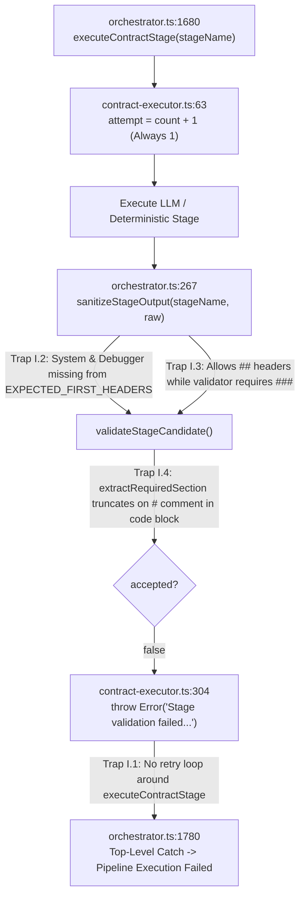
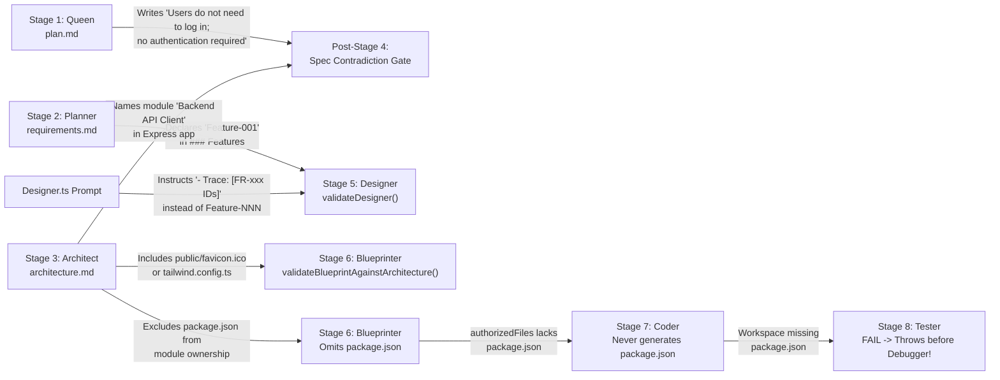

# AutoCoder (RuFlo) Pipeline: Maximum-Detail Forensic Audit of Prompt-to-Contract Validation Failure Scenarios

> **Scope & Codebase Baseline**: Audited against `origin/main` (`commit 243f57c`) across all 11 RuFlo pipeline agent definitions (`src/lib/agents/ruflo/registry/*.ts`), the contract execution engine (`contract-executor.ts`, `stage-acceptance.ts`, `spec-contract.ts`, `architecture-parser.ts`, `architecture-file-policy.ts`, `workspace-policy.ts`), schema parsers (`contracts/markdown-sections.ts`, `contracts/schemas/*.ts`), virtual file system (`vfs.ts`), verification/repair loop (`verification-loop.ts`), and downstream gates (`quality-gate.ts`, `final-gate.ts`, `api-contract-validator.ts`, `prisma-validator.ts`, `dependency-validator.ts`, `framework-validator.ts`, `project-validator.ts`, `security-gate.ts`, `linter.ts`).

---

## Executive Summary

When the AutoCoder pipeline fails with an error such as:

```text
Pipeline Execution Failed: Stage validation failed for Architect: Architecture Contract Error: File "public/favicon.ico" from Project Folder Structure is not claimed by any module.
```

it is the result of two compounding architectural mechanics:
1. **Prompt-to-Validator Asymmetry**: An agent's system prompt encourages, models (via few-shot examples), or fails to warn against a natural output pattern that a downstream deterministic TypeScript validator strictly forbids.
2. **Zero-Retry 1-Shot Fatal Execution**: Although the prompt builder (`composeAgentUserContent` in `orchestrator.ts:1129-1167`) and database model (`StageExecution.attempt` in `contract-executor.ts:63-66`) were designed for a 3-attempt retry loop with error feedback (`[RETRY ${attempt}/3] Your previous output failed verification. Error: ${validationError}`), **`orchestrator.ts:1680-1690` invokes `executeContractStage()` outside of any retry loop**. Consequently, the very first validation error thrown by `executeContractStage()` (`contract-executor.ts:304`) propagates directly to the top-level `catch` block (`orchestrator.ts:1780`), permanently aborting the pipeline run.

### Master Taxonomy of All 45 Identified Failure Scenarios

| ID | Layer / Stage | Artifact | Severity | Root Cause Category | Triggering Mechanism |
| :--- | :--- | :--- | :--- | :--- | :--- |
| **I.1** | Orchestrator / Executor | All | **CRITICAL** | Missing Retry Loop | `executeContractStage` throws on `attempt=1`; `composeAgentUserContent` retry logic is dead code (`orchestrator.ts:1680`, `contract-executor.ts:304`). |
| **I.2** | Sanitizer (`orchestrator.ts`) | `backend_spec.md`, `debug_report.md` | **HIGH** | Missing Header Anchor | `EXPECTED_FIRST_HEADERS` (`orchestrator.ts:200-208`) omits `'System'` and `'Debugger'`, leaving LLM preambles unstripped (`line 278`). |
| **I.3** | Sanitizer vs. Section Parser | All Markdown | **HIGH** | Regex Level Mismatch | `sanitizeStageOutput` (`orchestrator.ts:281`) accepts `##` or `###` (`/#{2,3}/`), but `countHeading` (`markdown-sections.ts:23`) strictly requires `###` (`/^#{3}\s+/`). |
| **I.4** | Section Extractor | All Markdown | **CRITICAL** | Code-Block Blindness | `extractRequiredSection` (`markdown-sections.ts:54`) terminates on `/^#{1,3}\s+/`, truncating sections at the first `# comment` inside a bash/Python/Prisma code block. |
| **I.5** | Verification Loop | `test_report.md`, `debug_report.md` | **CRITICAL** | Broken Repair Loop | `validateTester` rejects `FAIL` and throws inside `executeContractStage` (`contract-executor.ts:304`) before `Debugger` can run; plus `verification-loop.ts:176` checks non-existent `testerResult.status`. |
| **Q.1** | Stage 1: Queen | `plan.md` | **MEDIUM** | Strict `###` Count | Missing, duplicated, or `##`-level `Project Name`, `Project Goal`, `MVP Scope`, `Technical Constraints`, or `Risks` (`stage-acceptance.ts:52-89`). |
| **Q.2** | Stage 1: Queen | `plan.md` | **HIGH** | Negated Auth Keyword | Writing `"Users do not need to log in; no auth required"` triggers both `noAuth` and `reqAuth` regexes in the post-System Spec Contradiction Gate (`spec-contract.ts:27-59`). |
| **P.1** | Stage 2: Planner | `requirements.md` | **MEDIUM** | Strict `###` Count | Missing, duplicated, or `##`-level `Features`, `Functional Requirements`, or `Acceptance Criteria` (`stage-acceptance.ts:91-122`). |
| **P.2** | Stage 2: Planner | `requirements.md` | **HIGH** | Cross-Stage ID Trap | Declaring `Feature-001` in `requirements.md` arms a hidden trap in `validateDesigner` (`stage-acceptance.ts:231-238`), because `Designer.ts` tells the LLM to trace `FR-xxx` instead of `Feature-NNN`. |
| **A.1** | Stage 3: Architect | `architecture.md` | **CRITICAL** | Static Asset Policy | `classifyArchitectureFile` (`architecture-file-policy.ts:58-63`) marks `public/*` and `.ico/.png/.svg/.woff2` as `'static-asset'` with `requiresModuleOwnership = true` (`line 82`), triggering Check C (`spec-contract.ts:746-753`). |
| **A.2** | Stage 3: Architect | `architecture.md` | **HIGH** | Narrow Config Whitelist | `EXEMPT_CONFIG_FILES` (`architecture-file-policy.ts:15-29`) omits `tailwind.config.ts`, `postcss.config.mjs`, `eslint.config.js`, `components.json`, `next-env.d.ts`, `Dockerfile`, `prisma/seed.ts`, classifying them as `'implementation'` (`line 71`). |
| **A.3** | Stage 3: Architect | `architecture.md` | **HIGH** | Dual-Inventory Drift | `architecture-parser.ts:215-225` requires exact 1:1 **case-sensitive** equality between `### Project Folder Structure` and `### Project Files`. |
| **A.4** | Stage 3: Architect | `architecture.md` | **MEDIUM** | Inline Comments / Spaces | `architecture-parser.ts:198` rejects any `### Project Files` entry matching `/\s/` (e.g. `- src/index.ts # entry`). |
| **A.5** | Stage 3: Architect | `architecture.md` | **HIGH** | ASCII Tree Column Math | `architecture-parser.ts:165-177` computes directory nesting from `line.indexOf(cleanName)`. Inconsistent tree connector spacing pops parent folders off `pathStack`, flattening paths to root. |
| **A.6** | Stage 3: Architect | `architecture.md` | **HIGH** | Shared File Multi-Claim | Check A (`spec-contract.ts:726-733`) forbids any file (e.g. `src/types/index.ts`, `src/lib/db.ts`) from being listed in `Owned Files` of more than one module. |
| **A.7** | Stage 3: Architect | `architecture.md` | **MEDIUM** | Orphan Module File | Check B (`spec-contract.ts:736-743`) rejects any file in `Owned Files` not present in the ASCII folder tree. |
| **A.8** | Stage 3: Architect | `architecture.md` | **HIGH** | Strict Module Grammar | `architecture-parser.ts:258-333` requires `**Module Name**` (no `####`, no bullets, no trailing `:`) and only allows 4 exact bullet names (`Responsibility`, `Owned Files`, `Depends On`, `Supports Features`). |
| **A.9** | Stage 3: Architect | `architecture.md` | **MEDIUM** | Module Dependency DAG | Check D (`spec-contract.ts:564-580, 756-779`) rejects file paths/packages in `Depends On`, undeclared module names, self-dependencies, and cycles. |
| **A.10** | Stage 3: Architect | `architecture.md` | **HIGH** | Standalone Framework Guess | `validateArchitectureArtifact` (`spec-contract.ts:782`) guesses `NEXT_APP_ROUTER` whenever `/next\.js\|nextjs\|app router/i` matches anywhere in `architecture.md` (even `"Backend: None (not Next.js)"`). |
| **A.11** | Stage 3: Architect | `architecture.md` | **HIGH** | Next.js Entry Point & Slots | Check E (`spec-contract.ts:784-817`) forbids `app/@slot` parallel routes and requires `Backend Entry Point` to match `/^(?:src\/)?app\/.+\/route\.(ts\|tsx\|js\|jsx)$/i`. |
| **S.1** | Stage 4: System | `backend_spec.md` | **HIGH** | Greedy `.json/.ts/.js` Regex | `validateSystem` (`stage-acceptance.ts:182`) scans all of `### API Endpoints` with `/[\/\w\-]+\.(?:tsx\|ts\|jsx\|js\|json)\b/gi`, matching `res.json`, `NextResponse.json`, `req.json`, or `package.json` as "missing architecture files"! |
| **S.2** | Stage 4: System | `backend_spec.md` | **MEDIUM** | No-Backend Phrase Mismatch | If `backend_spec.md` says `"Backend: None"` instead of `"No Backend Required"` (`stage-acceptance.ts:154`), validator demands non-empty `Database Design`, `Seed Data`, and `API Endpoints`. |
| **S.3** | Spec Contradiction Gate | `plan/req/arch/sys` | **HIGH** | Auth Regex Collision | `spec-contract.ts:859-865` fails if both `noAuthEvidence` and `reqAuthEvidence` are non-empty across any of the 4 artifacts. |
| **S.4** | Spec Contradiction Gate | `backend_spec.md` | **HIGH** | Endpoint Auth Keywords | `spec-contract.ts:175-176` flags any endpoint block containing the words `private` or `protected` as `authRequired: true`, or `public` as `authRequired: false`, triggering contradictions (`lines 868-882`). |
| **S.5** | Spec Contradiction Gate | `architecture.md` | **HIGH** | Express Module Naming | `spec-contract.ts:279, 885-910` classifies a module as backend **only** if its name matches `/backend/i`, or fails if a module named `"Backend API Client"` owns frontend files. |
| **D.1** | Stage 5: Designer | `ui_spec.md` | **CRITICAL** | `FR-xxx` vs `Feature-NNN` | `Designer.ts:22, 29` instructs `- Trace: [FR-xxx IDs]`, while `validateDesigner` (`stage-acceptance.ts:231-238`) requires every `Feature-\d{3}` from `requirements.md` to appear in `ui_spec.md`. |
| **B.1** | Stage 6: Blueprinter | `blueprint.md` | **CRITICAL** | Prompt Example Missing Field | `Blueprinter.ts:35-54` few-shot example omits `- **Owner Module**:` on all 3 example files, while `workspace-policy.ts:127-129` rejects any file without `- Owner Module:`. |
| **B.2** | Stage 6: Blueprinter | `blueprint.md` | **CRITICAL** | Prompt Example Dependency Notes | `Blueprinter.ts:39, 51` teaches `- **Dependencies**: style.css (linked via <link>)` and `None (reads DOM from index.html)`, which `workspace-policy.ts:118-124, 184-187` fails to strip and rejects as unknown file dependencies! |
| **B.3** | Stage 6: Blueprinter | `blueprint.md` | **HIGH** | Missing Static Assets/Configs | `workspace-policy.ts:192-197` requires every `requiresModuleOwnership === true` file (including `public/favicon.ico`, `tailwind.config.ts`) to have a `### File:` section in `blueprint.md`. |
| **B.4** | Stage 6: Blueprinter | `blueprint.md` | **HIGH** | Un-Blueprinted `package.json` | `authorizedFiles` (`workspace-policy.ts:248`) is built **only** from `blueprintFiles`. If Blueprinter omits `package.json` or `prisma/schema.prisma` (exempt from ownership check), Coder never generates them (`contract-executor.ts:111`). |
| **C.1** | Stage 7: Coder | `workspace.manifest.json` | **HIGH** | Entry Point Role Heuristic | `generateWorkspaceManifest` (`vfs.ts:323`) only marks files containing `'index'`, `'App'`, or `'server/app.js'` as `role='entry'`, omitting `src/app/page.tsx`, `src/main.tsx`, and `app/api/.../route.ts`, which `validateWorkspaceManifest` (`workspace-policy.ts:357-369`) requires. |
| **C.2** | Stage 7: Coder | `workspace.manifest.json` | **MEDIUM** | Intermediate Dir Mismatch | `vfs.ts:336-341` only records leaf `path.dirname(f.path)`, whereas `workspace-policy.ts:337-354` requires every intermediate parent directory segment. |
| **C.3** | Stage 7: Coder | Workspace Files | **HIGH** | Missing Blueprint Export | `contract-executor.ts:135` calls `validateExportContract`: if `blueprint.md` lists a descriptive phrase in `Exports` instead of a valid JS identifier exported in code, Coder fails. |
| **T.1** | Stage 8: Tester | `test_report.md` | **CRITICAL** | Linter / Gate Hard Fail | Any lint error, missing package in `package.json`, unlinked route, or Prisma error sets `### Result\nFAIL`, causing `validateTester` (`stage-acceptance.ts:300`) to throw before `Debugger` is invoked. |
| **DB.1** | Stage 9: Debugger | `debug_report.md` | **HIGH** | Backtick Control-Plane Trap | `validateDebugger` (`stage-acceptance.ts:322-332`) extracts every `` `...` `` in `### Patches Applied` and fails if any backticked string matches a control-plane artifact name (e.g. ``aligned with `architecture.md` ``). |
| **SC.1** | Stage 10: Security | `security_report.md` | **HIGH** | Verbatim 64-Hex Hash Trap | `validateSecurity` (`stage-acceptance.ts:345`) and `final-gate.ts:63` require the LLM to copy the exact 64-char SHA-256 `currentWorkspaceHash` into `### Workspace Hash`. |
| **SC.2** | Stage 10: Security | `security_report.md` | **MEDIUM** | Final Gate Status Rejection | `validateSecurity` accepts `VULNERABLE`, but `final-gate.ts:109` rejects anything other than `SECURE` or `SECURE_WITH_WARNINGS`. |
| **RV.1** | Stage 11: Reviewer | `review_report.md` | **HIGH** | Hard Score & `PASS` Gate | `validateReviewer` (`stage-acceptance.ts:362-374`) aborts the pipeline if `Quality Score < 80`, or if `Architectural Conformance` or `Requirement Coverage` does not start with the exact word `PASS`, or if the 64-hex `Workspace Hash` has a single character mismatch. |

---

## Part I: Execution & Orchestration Architecture Traps

Before examining individual stage prompts, it is essential to understand **five systemic infrastructure bugs** in `orchestrator.ts`, `contract-executor.ts`, `contracts/markdown-sections.ts`, and `verification-loop.ts` that turn minor LLM formatting quirks into immediate, unrecoverable pipeline crashes.



### Trap I.1 — The 1-Shot Zero-Retry Execution Trap (`orchestrator.ts:1680-1690` & `contract-executor.ts:255-305`)

#### Exact Code Locations
- [orchestrator.ts](file:///home/lenovo/autogod/src/lib/agents/ruflo/orchestrator.ts#L1129-L1167) (`composeAgentUserContent`)
- [orchestrator.ts](file:///home/lenovo/autogod/src/lib/agents/ruflo/orchestrator.ts#L1680-L1690) (Main stage loop)
- [contract-executor.ts](file:///home/lenovo/autogod/src/lib/agents/ruflo/contract-executor.ts#L63-L66) (`attempt` calculation)
- [contract-executor.ts](file:///home/lenovo/autogod/src/lib/agents/ruflo/contract-executor.ts#L290-L305) (Rejection throw)

#### Forensic Mechanism
In `orchestrator.ts:1129-1167`, `composeAgentUserContent` was built to inject retry feedback into the LLM prompt when `attempt > 1`:
```ts
// src/lib/agents/ruflo/orchestrator.ts:1161-1163
if (attempt > 1 && validationError) {
  userContent += `\n\n[RETRY ${attempt}/3] Your previous output failed verification. Error: ${validationError}\nFix the issue and regenerate the COMPLETE output.`;
}
```
And in `contract-executor.ts:63-66`, `executeContractStage` queries Prisma to increment `attempt`:
```ts
// src/lib/agents/ruflo/contract-executor.ts:63-66
const existingAttempts = await prisma.stageExecution.count({
  where: { conversationId: ctx.conversationId, stageName }
});
const attempt = existingAttempts + 1;
```
**However**, look at how `orchestrator.ts:1680-1690` invokes `executeContractStage`:
```ts
// src/lib/agents/ruflo/orchestrator.ts:1680-1690
const res = await executeContractStage(stageName, contractCtx, async (attempt, lastError) => {
  return await runAgent(stageName, attempt, lastError);
});
```
And inside `executeContractStage` (`contract-executor.ts:81-305`), `runAgentFn(attempt)` is called **once** at line 245 (with `lastError` never even passed!), validated at line 263, and if `!validation.accepted`, line 304 immediately throws:
```ts
// src/lib/agents/ruflo/contract-executor.ts:290-305
if (!validation.accepted) {
  const errMessage = validation.errors.join('; ');
  await recordRejectedArtifact(ctx.conversationId, stageExec.id, stageName, artifactInfo.name, artifactInfo.kind, rawContent, validation.errors);
  await prisma.stageExecution.update({
    where: { id: stageExec.id },
    data: { state: 'REJECTED', validationErrors: JSON.stringify(validation.errors), completedAt: new Date() }
  });
  throw new Error(`Stage validation failed for ${stageName}: ${errMessage}`);
}
```
Because there is no `for (let attempt = 1; attempt <= 3; attempt++)` loop inside `executeContractStage` (or around it in `orchestrator.ts`), `attempt` is **always `1`**, `lastError` is **always `undefined`**, and the very first validation error kills the entire pipeline run.

---

### Trap I.2 — Sanitizer Header-Anchoring Blindness for `System` and `Debugger` (`orchestrator.ts:200-208, 267-292`)

#### Exact Code Locations
- [orchestrator.ts](file:///home/lenovo/autogod/src/lib/agents/ruflo/orchestrator.ts#L200-L208) (`EXPECTED_FIRST_HEADERS`)
- [orchestrator.ts](file:///home/lenovo/autogod/src/lib/agents/ruflo/orchestrator.ts#L267-L292) (`sanitizeStageOutput`)

#### Verbatim Code
```ts
// src/lib/agents/ruflo/orchestrator.ts:200-208
const EXPECTED_FIRST_HEADERS: Record<string, string> = {
  'Queen': 'Project Name',
  'Planner': 'Features',
  'Architect': 'Tech Stack',
  'Designer': 'Design System',
  'Blueprinter': 'File:',
  'Security': 'Overall Status',
  'Reviewer': 'Overall Assessment',
};
```
```ts
// src/lib/agents/ruflo/orchestrator.ts:267-292
export function sanitizeStageOutput(stageName: string, raw: string): string {
  let cleaned = raw.trim();
  const fenceMatch = cleaned.match(/^```(?:markdown|md)?\s*\n([\s\S]*?)\n```\s*$/i);
  if (fenceMatch) {
    cleaned = fenceMatch[1].trim();
  }
  const expectedFirstHeader = EXPECTED_FIRST_HEADERS[stageName];
  if (!expectedFirstHeader) return cleaned.trim();

  const escapedHeader = expectedFirstHeader.replace(/[.*+?^${}()|[\]\\]/g, '\\$&');
  const headerRegex = new RegExp(`(^|\\n)(#{2,3}\\s*${escapedHeader}\\b)`, 'i');
  const match = cleaned.match(headerRegex);
  if (match && match.index !== undefined) {
    const startIdx = match.index + (match[1] ? match[1].length : 0);
    cleaned = cleaned.slice(startIdx).trim();
  }
  return cleaned;
}
```
#### Forensic Mechanism
1. `'System'` (whose first header is `### Database Design` or `### No Backend Required`) and `'Debugger'` (whose first header is `### Issues Addressed`) are **missing** from `EXPECTED_FIRST_HEADERS`.
2. Furthermore, if an LLM outputs conversational preamble before a fenced markdown block (e.g., `"Here is the architecture specification:\n\n\`\`\`markdown\n### Tech Stack\n...\n\`\`\`"`), `fenceMatch` (`^```...```$`) fails to match because the string does not *start* with ```` ``` ````! Then `headerRegex` slices from `### Tech Stack`, **leaving the trailing ```` ``` ```` at the very end of the artifact**!
   - In `Architect`, that trailing ```` ``` ```` lands at the bottom of `### Modules`, where `parseModulesSection` (`architecture-parser.ts:331`) throws:
     `Architecture Parser Error: Unexpected content in "### Modules": "\`\`\`"`!

---

### Trap I.3 — Sanitizer (`##` or `###`) vs. Validator (`###` Only) Heading-Level Conflict (`orchestrator.ts:281` vs. `contracts/markdown-sections.ts:20-27`)

#### Exact Code Locations
- [orchestrator.ts](file:///home/lenovo/autogod/src/lib/agents/ruflo/orchestrator.ts#L281)
- [markdown-sections.ts](file:///home/lenovo/autogod/src/lib/agents/ruflo/contracts/markdown-sections.ts#L20-L27)

#### Verbatim Code
```ts
// src/lib/agents/ruflo/contracts/markdown-sections.ts:20-27
export function countHeading(content: string, title: string): number {
  const lines = normalizeMarkdown(content).split('\n');
  const escaped = escapeRegex(title);
  const re = new RegExp(`^#{3}\\s+${escaped}\\s*$`, 'i');
  return lines.filter((line) => re.test(line.trim())).length;
}
```
#### Forensic Mechanism
`sanitizeStageOutput` matches `#{2,3}\s*${expectedFirstHeader}` without normalizing `##` to `###`. When an LLM formats top-level sections with `##` (H2) instead of `###` (H3)—for instance, `## Project Name` or `## Features`—`sanitizeStageOutput` leaves them as `##`, and `countHeading` returns `0` for every section, rejecting the stage with:
`Missing or duplicate required section: ### <Section> (count: 0)`

---

### Trap I.4 — Premature Section Truncation on `#` Comments Inside Code Blocks (`contracts/markdown-sections.ts:46-60`)

#### Exact Code Locations
- [markdown-sections.ts](file:///home/lenovo/autogod/src/lib/agents/ruflo/contracts/markdown-sections.ts#L46-L60) (`extractRequiredSection`)

#### Verbatim Code
```ts
// src/lib/agents/ruflo/contracts/markdown-sections.ts:46-60
export function extractRequiredSection(content: string, title: string): string | null {
  const lines = normalizeMarkdown(content).split('\n');
  const escaped = escapeRegex(title);
  const startRe = new RegExp(`^#{3}\\s+${escaped}\\s*$`, 'i');
  const idx = lines.findIndex((line) => startRe.test(line.trim()));
  if (idx === -1) return null;

  const body: string[] = [];
  for (let i = idx + 1; i < lines.length; i++) {
    if (/^#{1,3}\s+/.test(lines[i].trim())) break;
    body.push(lines[i]);
  }
  return body.join('\n').trim();
}
```
#### Forensic Mechanism
`extractRequiredSection` does **not** track whether the parser is currently inside a fenced code block (```` ``` ````)! It stops collecting lines at the very first line matching `/^#{1,3}\s+/`.
- If an LLM places a code block at the top of a section containing a shell/Python/YAML/Prisma comment starting with `# ` (single hash + space), `/^#{1,3}\s+/` treats `# Comment` as an H1 markdown heading and immediately `break`s out of the loop!
- **Concrete Example that Causes Fatal Failure**:
  ```markdown
  ### Seed Data
  ```sql
  # Initial seed records for development
  INSERT INTO users (id, email) VALUES (1, 'admin@example.com');
  ```
  ```
  Wait: if the very first line of `### Seed Data` is `# Initial seed records` (or if the code block starts with `# ` without a fence line before it), `body` is empty (`""`), triggering:
  `System Seed Data section is empty.`
  Even when ```` ```sql ```` precedes `# Initial seed records`, `extractRequiredSection` truncates everything after `# Initial seed records`, slicing off all remaining content in that section (such as `Feature-001` references in `Designer` or module definitions in `Architect`!).

---

### Trap I.5 — Broken `verifyAndRepairWorkspace` Loop (`verification-loop.ts:175-204` & `contract-executor.ts:304`)

#### Exact Code Locations
- [verification-loop.ts](file:///home/lenovo/autogod/src/lib/agents/ruflo/verification-loop.ts#L165-L210)
- [contract-executor.ts](file:///home/lenovo/autogod/src/lib/agents/ruflo/contract-executor.ts#L300-L305)
- [contract-executor.ts](file:///home/lenovo/autogod/src/lib/agents/ruflo/contract-executor.ts#L384-L388)
- [stage-acceptance.ts](file:///home/lenovo/autogod/src/lib/agents/ruflo/stage-acceptance.ts#L293-L310) (`validateTester`)

#### Verbatim Code
In `verification-loop.ts:174-205`:
```ts
// src/lib/agents/ruflo/verification-loop.ts:174-205
// 1. Run Tester stage via contract executor
const testerResult = await executeStageFn('Tester');
if (!testerResult || testerResult.status !== 'ACCEPTED') {
  throw new Error(`Tester stage failed to execute properly in cycle ${cycle}`);
}
...
// 3. Run Debugger stage via contract executor
const debugResult = await executeStageFn('Debugger', testerContent);
if (!debugResult || debugResult.status !== 'ACCEPTED') {
  throw new Error(`Debugger stage failed in cycle ${cycle}`);
}
```
Now compare this against what `executeContractStage` (`contract-executor.ts:300-305, 384-388`) actually does:
```ts
// src/lib/agents/ruflo/contract-executor.ts:300-305
if (!validation.accepted) {
  ...
  throw new Error(`Stage validation failed for ${stageName}: ${errMessage}`);
}
...
// src/lib/agents/ruflo/contract-executor.ts:384-388
return {
  stageExecution: updatedExec,
  artifact,
  content: rawContent
};
```
And look at `validateTester` (`stage-acceptance.ts:300-302`):
```ts
// src/lib/agents/ruflo/stage-acceptance.ts:300-302
if (output.result !== 'PASS') {
  errors.push('Tester Contract Error: Verification result is FAIL.');
}
```
#### Forensic Mechanism — Double Fatal Bug
1. **Bug 1 (Debugger Is Unreachable When Tester Finds Any Error)**: When the Coder produces a single lint or contract error, `runDeterministicTesterReport` outputs `### Result\nFAIL`. Inside `executeContractStage('Tester')`, `validateTester` returns `accepted: false` with `'Tester Contract Error: Verification result is FAIL.'`. Line 304 of `contract-executor.ts` **throws an Error** (`Stage validation failed for Tester: Tester Contract Error: Verification result is FAIL.`)! As a result, `verifyAndRepairWorkspace` crashes at line 175 on Cycle 1 **before `Debugger` can ever be called**!
2. **Bug 2 (`testerResult.status` is `undefined`)**: Even when `Tester` passes (`output.result === 'PASS'`), `executeContractStage` returns `{ stageExecution, artifact, content }`. There is **no `.status` property** on the return value (`stageExecution.state` is `'ACCEPTED'`, not `testerResult.status`). Therefore, `if (!testerResult || testerResult.status !== 'ACCEPTED')` at `verification-loop.ts:176` evaluates `undefined !== 'ACCEPTED'` (`true`) and **always throws** `Error("Tester stage failed to execute properly in cycle 1")` whenever `verifyAndRepairWorkspace` is used! (Currently `orchestrator.ts:1680` calls `executeContractStage` directly in the stage loop instead of `verifyAndRepairWorkspace`, which means `Debugger` is executed unconditionally in the linear `STAGE_ORDER` even when `Tester` passed, or never reached if `Tester` failed!).

---

## Part II: Deep-Dive Case Study — The `public/favicon.ico` Failure & Its 3-Stage Catch-22

The user-reported failure:
```text
Pipeline Execution Failed: Stage validation failed for Architect: Architecture Contract Error: File "public/favicon.ico" from Project Folder Structure is not claimed by any module.
```
is the tip of a **three-stage cascading policy trap** spanning `Architect` (`architecture.md`), `Blueprinter` (`blueprint.md`), and `Coder` (`workspace.manifest.json`).

### Step-by-Step Code Trace of the Failure

1. **The Architect Prompt (`src/lib/agents/ruflo/registry/Architect.ts`)**:
   - Lines 21–31 instruct the LLM to output `### Project Folder Structure` and `### Project Files` with a complete 1:1 file inventory.
   - Standard Next.js, Vite, and React project layouts routinely include `public/favicon.ico`, `public/logo.svg`, `public/robots.txt`, etc.
   - Lines 43–49 instruct the LLM to decompose the architecture into logical `### Modules`:
     ```text
     **[Module Name]**
     - **Responsibility**: [Single sentence]
     - **Owned Files**: [Comma-separated list of exact file paths from Project Files]
     ```
   - Crucially, `Architect.ts` **never states** that static assets (`public/*`, `.ico`, `.png`, `.svg`) or secondary config files (`tailwind.config.ts`, `postcss.config.mjs`) must be assigned to a module's `Owned Files`. In software architecture, modules represent code components (UI, API, Auth, Database), so LLMs naturally assign `.ts`/`.tsx`/`.css` files to modules and leave `public/favicon.ico` unassigned in the root/public folder tree.

2. **The File Policy Classifier (`src/lib/agents/ruflo/architecture-file-policy.ts:44-86`)**:
   ```ts
   // src/lib/agents/ruflo/architecture-file-policy.ts:58-63
   if (
     STATIC_ASSET_PREFIXES.some(prefix => prefix.test(norm)) || // /^public\//i, /^assets\//i, /^static\//i
     /\.(ico|png|jpg|jpeg|svg|gif|webp|woff|woff2|ttf|eot)$/i.test(norm)
   ) {
     return 'static-asset';
   }
   ```
   And lines 74–86:
   ```ts
   // src/lib/agents/ruflo/architecture-file-policy.ts:74-86
   export function requiresModuleOwnership(filePath: string): boolean {
     const category = classifyArchitectureFile(filePath);
     switch (category) {
       case 'implementation':
       case 'framework-managed':
       case 'static-asset':
         return true;
       case 'exempt-config':
       case 'database-schema':
         return false;
     }
   }
   ```
   Because `'static-asset'` returns `true`, `public/favicon.ico` is treated identically to a TypeScript source file.

3. **Check C in the Architecture Validator (`src/lib/agents/ruflo/spec-contract.ts:746-753`)**:
   ```ts
   // src/lib/agents/ruflo/spec-contract.ts:746-753
   for (const treeFile of parsed.treeFiles) {
     const norm = treeFile.toLowerCase();
     if (requiresModuleOwnership(norm)) {
       const owners = parsed.ownership.get(norm);
       if (!owners || owners.length === 0) {
         errors.push(`Architecture Contract Error: File "${treeFile}" from Project Folder Structure is not claimed by any module.`);
       }
     }
   }
   ```

### What Happens If the Architect *Does* Assign `public/favicon.ico` to a Module? (The Cascading Traps)

Even if the LLM assigns `public/favicon.ico` to a module in `architecture.md` and passes Stage 3 (`Architect`), look at what happens in Stage 6 (`Blueprinter`) and Stage 7 (`Coder`):
- **Stage 6 (`Blueprinter` — `workspace-policy.ts:192-197`)**:
  ```ts
  // src/lib/agents/ruflo/workspace-policy.ts:192-197
  for (const archFile of architecture.files) {
    const norm = normalizeProjectPath(archFile);
    if (requiresModuleOwnership(norm) && !blueprintFilesMap.has(norm)) {
      errors.push(`Blueprint Contract Error [MISSING_FROM_BLUEPRINT]: Architecture file "${norm}" is missing from blueprint.md.`);
    }
  }
  ```
  Because `requiresModuleOwnership("public/favicon.ico")` is `true`, `Blueprinter` is forced to generate a `### File: public/favicon.ico` specification with `Purpose`, `Owner Module`, `Dependencies`, `Specs Required`, and `Exports`!
- **Stage 7 (`Coder` — `contract-executor.ts:111-145`)**:
  `Coder` iterates over `authorized.authorizedFiles` (which includes `public/favicon.ico`) and asks the LLM to generate text content for binary file `public/favicon.ico`, and if `content.trim().length === 0`, `contract-executor.ts:132` throws:
  `Coder Contract Error: Generated file "public/favicon.ico" is empty.`!


---

## Part III: Stage-by-Stage Forensic Reference — Stages 1 to 4 (`Queen`, `Planner`, `Architect`, `System` & Spec Contradiction Gate)

---

### Stage 1: `Queen` (`plan.md`)

- **Prompt File**: [Queen.ts](file:///home/lenovo/autogod/src/lib/agents/ruflo/registry/Queen.ts#L1-L39)
- **Validator File**: [stage-acceptance.ts](file:///home/lenovo/autogod/src/lib/agents/ruflo/stage-acceptance.ts#L52-L89) (`validateQueen`)
- **Section Parser**: [markdown-sections.ts](file:///home/lenovo/autogod/src/lib/agents/ruflo/contracts/markdown-sections.ts#L20-L60)

#### Verbatim Validator Code (`validateQueen`)
```ts
// src/lib/agents/ruflo/stage-acceptance.ts:52-89
export function validateQueen(content: string): StageValidationResult {
  const errors: string[] = [];
  if (!content || content.trim().length === 0) {
    return { accepted: false, errors: ['Queen output is empty'] };
  }

  const requiredSections = [
    'Project Name',
    'Project Goal',
    'MVP Scope',
    'Technical Constraints',
    'Risks'
  ];

  for (const section of requiredSections) {
    const count = countHeading(content, section);
    if (count !== 1) {
      errors.push(`Missing or duplicate required section: ### ${section} (count: ${count})`);
      continue;
    }
    const body = extractRequiredSection(content, section);
    if (!body || body.trim().length === 0) {
      errors.push(`Queen ${section} section is empty.`);
    }
  }
  return { accepted: errors.length === 0, errors };
}
```

#### Failure Scenarios in Stage 1 (`Queen`)

1. **Scenario Q.1 — Heading Level or Title Deviation (`stage-acceptance.ts:69-76`)**:
   - **Exact Error Strings**:
     - `Pipeline Execution Failed: Stage validation failed for Queen: Missing or duplicate required section: ### <Section> (count: 0)`
     - `Pipeline Execution Failed: Stage validation failed for Queen: Queen <Section> section is empty.`
   - **Trigger**:
     - LLM outputs `## Project Name` (H2) instead of `### Project Name` (H3).
     - LLM adds a colon (`### Project Name:`) or numbering (`### 1. Project Name`). Because `countHeading` uses `^#{3}\s+${escaped}\s*$`, any trailing colon or prefix fails to match.
     - LLM puts the project name on the same line (`### Project Name: TaskFlow`), leaving the section body empty.

2. **Scenario Q.2 — Negated Auth Prose Arming the Post-System Spec Contradiction Gate (`spec-contract.ts:27-59, 859-865`)**:
   - **Exact Error String (detonates after Stage 4 `System`)**:
     - `Pipeline Execution Failed: Specification Contradiction Gate Failed: Authentication contradiction across specification artifacts. Both explicit 'No Auth' (plan:no-auth-explicit) and 'Auth Required' (plan:auth-required-explicit) detected.`
   - **Trigger**:
     - `Queen.ts:34` instructs: *"If the user's request is simple (calculator, todo list, static page, game), keep the scope small and do NOT invent backend, database, or auth requirements unless asked."*
     - When the LLM obeys this by writing in `plan.md`:
       ```markdown
       ### Technical Constraints
       - Client-side only. Users do not need to log in or sign in; no authentication is required.
       ```
     - Look at `detectExplicitNoAuth` (`spec-contract.ts:27-38`) and `detectExplicitAuthRequired` (`spec-contract.ts:40-59`):
       - `detectExplicitNoAuth` matches `/\bno\s+authentication\b/i` -> returns `true` (`plan:no-auth-explicit`).
       - `detectExplicitAuthRequired` matches `/\blog\s*in\b|\blogged\s+in\b|\bsign\s*in\b|\bsigned\s+in\b/i` (`line 57`) **without checking for preceding negation** (`do not`, `without`, `no need to`) -> returns `true` (`plan:auth-required-explicit`)!
     - Both arrays (`noAuthEvidence` and `reqAuthEvidence`) become non-empty from the **exact same sentence** in `plan.md`, crashing the pipeline at `spec-contract.ts:859`!

---

### Stage 2: `Planner` (`requirements.md`)

- **Prompt File**: [Planner.ts](file:///home/lenovo/autogod/src/lib/agents/ruflo/registry/Planner.ts#L1-L40)
- **Validator File**: [stage-acceptance.ts](file:///home/lenovo/autogod/src/lib/agents/ruflo/stage-acceptance.ts#L91-L122) (`validatePlanner`)

#### Verbatim Validator Code (`validatePlanner`)
```ts
// src/lib/agents/ruflo/stage-acceptance.ts:91-122
export function validatePlanner(content: string): StageValidationResult {
  const errors: string[] = [];
  if (!content || content.trim().length === 0) {
    return { accepted: false, errors: ['Planner output is empty'] };
  }

  const requiredSections = [
    'Features',
    'Functional Requirements',
    'Acceptance Criteria'
  ];

  for (const section of requiredSections) {
    const count = countHeading(content, section);
    if (count !== 1) {
      errors.push(`Missing or duplicate required section: ### ${section} (count: ${count})`);
      continue;
    }
    const body = extractRequiredSection(content, section);
    if (!body || body.trim().length === 0) {
      errors.push(`Planner ${section} section is empty.`);
    }
  }
  return { accepted: errors.length === 0, errors };
}
```

#### Failure Scenarios in Stage 2 (`Planner`)

1. **Scenario P.1 — Heading Level, Sub-Heading, or Empty Body (`stage-acceptance.ts:106-114`)**:
   - **Exact Error Strings**:
     - `Pipeline Execution Failed: Stage validation failed for Planner: Missing or duplicate required section: ### <Section> (count: 0)`
     - `Pipeline Execution Failed: Stage validation failed for Planner: Planner <Section> section is empty.`
   - **Trigger**:
     - If the LLM organizes `### Functional Requirements` using `### FR-001: Create Task` (H3 subheadings instead of bullets), `extractRequiredSection('Functional Requirements')` (`markdown-sections.ts:54`) hits `### FR-001` on the very first line of the section and immediately terminates (`if (/^#{1,3}\s+/.test(lines[i].trim())) break`), returning `""` and triggering `Planner Functional Requirements section is empty.`!

2. **Scenario P.2 — Cross-Stage `Feature-NNN` Bomb Armed by `requirements.md` (`stage-acceptance.ts:231-238`)**:
   - **Trigger**:
     - If the LLM writes `Feature-001`, `Feature-002` anywhere in `requirements.md`, Stage 2 (`Planner`) passes, **but** `validateDesigner` (`stage-acceptance.ts:231-238`) extracts every `\bFeature-\d{3}\b` from `requirements.md` and requires all of them to appear in `ui_spec.md`—even though `Designer.ts` instructs the Designer agent to trace `[FR-xxx IDs]` instead of `Feature-NNN`!

---

### Stage 3: `Architect` (`architecture.md`)

- **Prompt File**: [Architect.ts](file:///home/lenovo/autogod/src/lib/agents/ruflo/registry/Architect.ts#L1-L65)
- **Validator Files**:
  - [stage-acceptance.ts](file:///home/lenovo/autogod/src/lib/agents/ruflo/stage-acceptance.ts#L125-L143) (`validateArchitect`)
  - [spec-contract.ts](file:///home/lenovo/autogod/src/lib/agents/ruflo/spec-contract.ts#L670-L837) (`validateArchitectureArtifact`)
  - [architecture-parser.ts](file:///home/lenovo/autogod/src/lib/agents/ruflo/architecture-parser.ts#L64-L385) (`parseArchitectureArtifact`)
  - [architecture-file-policy.ts](file:///home/lenovo/autogod/src/lib/agents/ruflo/architecture-file-policy.ts#L1-L98) (`classifyArchitectureFile`, `requiresModuleOwnership`)

Stage 3 (`Architect`) has the densest concentration of deterministic parser and contract rules in the entire pipeline: **11 distinct failure scenarios**.

#### Scenario A.1 — Static Asset Module Ownership Trap (`architecture-file-policy.ts:58-86`, `spec-contract.ts:746-753`)
- **Exact Error String**:
  `Pipeline Execution Failed: Stage validation failed for Architect: Architecture Contract Error: File "public/favicon.ico" from Project Folder Structure is not claimed by any module.`
- **Verbatim Code**:
  ```ts
  // src/lib/agents/ruflo/architecture-file-policy.ts:58-63, 74-86
  if (
    STATIC_ASSET_PREFIXES.some(prefix => prefix.test(norm)) ||
    /\.(ico|png|jpg|jpeg|svg|gif|webp|woff|woff2|ttf|eot)$/i.test(norm)
  ) {
    return 'static-asset';
  }
  ...
  export function requiresModuleOwnership(filePath: string): boolean {
    const category = classifyArchitectureFile(filePath);
    switch (category) {
      case 'implementation':
      case 'framework-managed':
      case 'static-asset':
        return true;
      case 'exempt-config':
      case 'database-schema':
        return false;
    }
  }
  ```
- **Concrete Failing LLM Output**:
  ```markdown
  ### Project Folder Structure
  ```text
  my-app/
  ├── public/
  │   └── favicon.ico
  └── src/
      └── app/
          └── page.tsx
  ```

  ### Project Files
  - public/favicon.ico
  - src/app/page.tsx

  ### Modules
  **App UI**
  - **Responsibility**: Renders main application page
  - **Owned Files**: src/app/page.tsx
  - **Depends On**: None
  - **Supports Features**: FR-001
  ```
- **Why It Fails**: `public/favicon.ico` is classified as `'static-asset'`, which returns `requiresModuleOwnership = true`, and Check C (`spec-contract.ts:746-753`) rejects the architecture because `App UI` only claimed `src/app/page.tsx`.

#### Scenario A.2 — Narrow `EXEMPT_CONFIG_FILES` Whitelist Trap (`architecture-file-policy.ts:15-29, 44-72`)
- **Exact Error String**:
  `Pipeline Execution Failed: Stage validation failed for Architect: Architecture Contract Error: File "tailwind.config.ts" from Project Folder Structure is not claimed by any module.`
- **Verbatim Whitelist**:
  ```ts
  // src/lib/agents/ruflo/architecture-file-policy.ts:15-29
  const EXEMPT_CONFIG_FILES = new Set([
    'package.json',
    'tsconfig.json',
    'vite.config.ts',
    'vite.config.js',
    'next.config.js',
    'next.config.mjs',
    'next.config.ts',
    'tailwind.config.js',
    'postcss.config.js',
    '.gitignore',
    '.env',
    '.env.local',
    '.env.example',
  ]);
  ```
- **Why It Fails**: Any root config or tooling file **not** in those exact 14 strings falls through to `return 'implementation'` at line 71! Common files generated by LLMs for Next.js / TypeScript / Prisma projects that trigger this crash:
  - `tailwind.config.ts` or `tailwind.config.mjs` (only `.js` is exempted!)
  - `postcss.config.mjs` or `postcss.config.cjs` (only `.js` is exempted!)
  - `tsconfig.node.json`
  - `next-env.d.ts`
  - `components.json` (shadcn/ui)
  - `.eslintrc.json`, `eslint.config.js`, `eslint.config.mjs`, `.prettierrc`
  - `vitest.config.ts`, `jest.config.js`, `playwright.config.ts`
  - `Dockerfile`, `docker-compose.yml`
  - `README.md`
  - `prisma/seed.ts` (only `^prisma\/schema\.prisma$` and `^prisma\/migrations\/` match `DATABASE_SCHEMA_PATTERNS` at line 31!)

#### Scenario A.3 — Dual-Inventory Drift & Case Sensitivity Trap (`architecture-parser.ts:215-225`)
- **Exact Error Strings**:
  - `Pipeline Execution Failed: Stage validation failed for Architect: Architecture Parser Error: File "<file>" is in Project Folder Structure but missing from Project Files list.`
  - `Pipeline Execution Failed: Stage validation failed for Architect: Architecture Parser Error: File "<file>" is in Project Files list but missing from Project Folder Structure.`
- **Verbatim Code**:
  ```ts
  // src/lib/agents/ruflo/architecture-parser.ts:215-225
  const treeSet = new Set(treeFiles);
  const projSet = new Set(projectFiles);
  for (const tf of treeFiles) {
    if (!projSet.has(tf)) {
      errors.push(`Architecture Parser Error: File "${tf}" is in Project Folder Structure but missing from Project Files list.`);
    }
  }
  for (const pf of projectFiles) {
    if (!treeSet.has(pf)) {
      errors.push(`Architecture Parser Error: File "${pf}" is in Project Files list but missing from Project Folder Structure.`);
    }
  }
  ```
- **Why It Fails**:
  1. Even a single omitted file between the ASCII tree and the flat bullet list fails.
  2. Notice `new Set(treeFiles)` is **case-sensitive**, whereas `ownership` uses `.toLowerCase()`. If the tree has `src/components/Navbar.tsx` and the flat list has `src/components/navbar.tsx`, both errors fire simultaneously!

#### Scenario A.4 — Inline Comments or Whitespace in `### Project Files` (`architecture-parser.ts:183-209`)
- **Exact Error String**:
  `Pipeline Execution Failed: Stage validation failed for Architect: Architecture Parser Error: Invalid Project Files entry "<entry>".`
- **Verbatim Code**:
  ```ts
  // src/lib/agents/ruflo/architecture-parser.ts:192-203
  for (const rawLine of pfLines) {
    const trimmed = rawLine.trim();
    if (!trimmed || trimmed.startsWith('```')) continue;
    const entry = trimmed.replace(/^[-*]\s*/, '').replace(/^`|`$/g, '').trim();
    if (!entry) continue;
    if (entry.endsWith('/') || /\s/.test(entry)) {
      errors.push(`Architecture Parser Error: Invalid Project Files entry "${entry}".`);
      continue;
    }
    projectFiles.push(entry.replace(/^\.\/+/, ''));
  }
  ```
- **Concrete Failing LLM Output**:
  ```markdown
  ### Project Files
  - src/app/page.tsx (Main dashboard page)
  - src/lib/db.ts # Prisma client singleton
  ```
- **Why It Fails**: `trimmed.replace(/^`|`$/g, '')` only strips backticks at the very start/end of the line. If the LLM writes `` - `src/app/page.tsx` - Main page `` or `- src/app/page.tsx # Main page`, `/\s/.test(entry)` is `true` and rejects the line.

#### Scenario A.5 — ASCII Tree Column-Index Depth Bug (`architecture-parser.ts:141-177`)
- **Exact Error String**:
  `Architecture Parser Error: File "favicon.ico" is in Project Folder Structure but missing from Project Files list.` (accompanied by `File "public/favicon.ico" is in Project Files list but missing from Project Folder Structure.`)
- **Verbatim Code**:
  ```ts
  // src/lib/agents/ruflo/architecture-parser.ts:154-175
  const cleanName = line
    .replace(/^[│|├└─\s+\-\\]+/, '')
    .replace(/#.*$/, '')
    .replace(/\s+\(.*\)$/, '')
    .trim();
  if (!cleanName) continue;

  const isDir = cleanName.endsWith('/');
  const cleanToken = cleanName.replace(/\/$/, '').trim();
  if (!cleanToken || cleanToken === '.') continue;

  const nameStartCol = line.indexOf(cleanName);
  while (pathStack.length > 0 && pathStack[pathStack.length - 1].indent >= nameStartCol) {
    pathStack.pop();
  }
  ```
- **Concrete Failing LLM Output**:
  ```text
  my-app/
  ├── public/
  |  └── favicon.ico
  ```
  Wait—if an LLM writes:
  ```text
  ├── public/
  └── favicon.ico
  ```
  or mixes tab characters (`\t`, 1 char in `.indexOf()`) with spaces (`├── `, 4 chars in `.indexOf()`):
  - Line 1: `├── public/` -> `nameStartCol = 4`. `pathStack` pushes `{ name: 'public', indent: 4 }`.
  - Line 2: `\t└── favicon.ico` -> `\t` is 1 char + `└── ` is 4 chars -> `nameStartCol = 5` (okay), **but** if Line 2 is `\t├─ favicon.ico` -> `\t` (1) + `├─ ` (3) = `nameStartCol = 4`!
  - Because `pathStack[0].indent (4) >= nameStartCol (4)`, `public` is **popped off `pathStack`**, and `favicon.ico` is parsed as root `favicon.ico` instead of `public/favicon.ico`!

#### Scenario A.6 — Shared File Multi-Module Claim (Check A, `spec-contract.ts:726-733`)
- **Exact Error String**:
  `Pipeline Execution Failed: Stage validation failed for Architect: Architecture Contract Error: File "src/types/index.ts" is claimed by modules [Task Module, Auth Module]. Each file must have a single owner.`
- **Verbatim Code**:
  ```ts
  // src/lib/agents/ruflo/spec-contract.ts:726-733
  for (const [normFile, owners] of parsed.ownership.entries()) {
    if (owners.length > 1) {
      const origFile = parsed.treeFiles.find(f => f.toLowerCase() === normFile) || normFile;
      errors.push(`Architecture Contract Error: File "${origFile}" is claimed by modules [${owners.join(', ')}]. Each file must have a single owner.`);
    }
  }
  ```
- **Why It Fails**: LLMs frequently list shared utility/type/database files (`src/types/index.ts`, `src/lib/prisma.ts`, `src/app/globals.css`) under `Owned Files` of multiple feature modules that use them, instead of creating a dedicated `Core / Shared` module and referencing it via `Depends On`.

#### Scenario A.7 — Orphan Module File & Leading-Slash Normalization Asymmetric Bug (Check B, `spec-contract.ts:736-743` & `architecture-parser.ts:298 vs 355`)
- **Exact Error String**:
  `Pipeline Execution Failed: Stage validation failed for Architect: Architecture Contract Error: Module "API Module" claims file "src/routes/api.ts" which is not in Project Folder Structure.`
- **Asymmetric Normalization Bug in `architecture-parser.ts`**:
  - At line 298 (`parseModulesSection`), `ownedFiles` strips leading `/`:
    `.map(f => f.trim().replace(/^`|`$/g, '').replace(/^\.?\/+/, '').trim())`
  - At line 355 (`ownership` map builder), it only strips leading `./` (NOT leading `/`):
    `const norm = file.replace(/^\.\/+/, '').toLowerCase();` (Wait: `file` comes from `mod.ownedFiles`, which already stripped `^\.?\/+`, so `mod.ownedFiles` is clean, **unless** `projectFiles` at line 202 only stripped `^\.\/+` and kept leading `/`).

#### Scenario A.8 — Strict Module Heading & 4-Field Grammar (`architecture-parser.ts:258-333`)
- **Exact Error Strings**:
  - `Architecture Parser Error: No modules declared in "### Modules" section.`
  - `Architecture Parser Error: Invalid module name "<name>".`
  - `Architecture Parser Error: Field "<field>" appears before any module declaration.`
  - `Architecture Parser Error: Unknown module field "<field>" in module "<name>".`
  - `Architecture Parser Error: Unexpected content in "### Modules": "<line>"`
  - `Architecture Parser Error: Module "<name>" has empty Responsibility.`
  - `Architecture Parser Error: Module "<name>" has no Owned Files.`
- **Verbatim Regexes (`architecture-parser.ts:266-333`)**:
  ```ts
  // Module header MUST be exact bold text on its own line: **Module Name**
  const boldModMatch = trimmed.match(/^\*\*\s*([^*\r\n]+?)\s*\*\*\s*$/);
  // Invalid module name check:
  if (modName.includes(':') || modName.length < 2) {
    errors.push(`Architecture Parser Error: Invalid module name "${modName}".`);
  }
  // Field bullet MUST be one of 4 exact names:
  const fieldMatch = trimmed.match(/^[-*]\s+\*\*([^*]+)\*\*\s*:\s*(.*)$/) ||
                     trimmed.match(/^[-*]\s+([A-Za-z][A-Za-z\s]+?)\s*:\s*(.*)$/);
  ```
- **Concrete LLM Formatting Variations That Immediately Crash `parseModulesSection`**:
  1. Using markdown subheadings for modules: `#### Frontend Module` or `### 1. Frontend Module` -> **Crash**: `Field "Responsibility" appears before any module declaration` (or `extractRequiredSection('Modules')` truncates at the first `###`!).
  2. Bulleting the module header: `- **Frontend Module**` or `1. **Frontend Module**` -> **Crash**: `Unexpected content in "### Modules": "- **Frontend Module**"`.
  3. Adding a colon inside or after the bold module name: `**Frontend Module:**` (`modName.includes(':')` -> `Invalid module name`) or `**Frontend Module**:` (fails `boldModMatch` -> `Unexpected content`).
  4. Wrapping `Owned Files` across multiple indented sub-bullets:
     ```markdown
     - **Owned Files**:
       - src/app/page.tsx
       - src/app/layout.tsx
     ```
     -> **Crash**: `Unexpected content in "### Modules": "- src/app/page.tsx"` and `Module "Frontend Module" has no Owned Files.`!
  5. Adding any 5th descriptive bullet (e.g., `- **Description**: ...`, `- **Exports**: ...`, `- **Endpoints**: ...`) -> **Crash**: `Unknown module field "Exports" in module "..."`.

#### Scenario A.9 — Module Dependency DAG & Identifier Validation (Check D, `spec-contract.ts:564-580, 756-779`)
- **Exact Error Strings**:
  - `Architecture Contract Error: Module "UI" has invalid dependency "src/lib/api.ts". Depends On must reference declared module names, not file paths or packages.`
  - `Architecture Contract Error: Module "UI" depends on undeclared module "Auth".`
  - `Architecture Contract Error: Module "UI" cannot depend on itself.`
  - `Architecture Contract Error: Circular module dependency detected: UI -> API -> UI`
- **Verbatim Code (`spec-contract.ts:564-573`)**:
  ```ts
  export function looksLikeArchitectureModuleName(raw: string): boolean {
    const trimmed = raw.trim();
    if (!trimmed) return false;
    if (trimmed.includes('/') || trimmed.includes('\\')) return false;
    if (trimmed.startsWith('@') || trimmed.startsWith('.')) return false;
    if (/\.[a-z0-9]{1,6}$/i.test(trimmed)) return false;
    if (trimmed.includes(':')) return false;
    return true;
  }
  ```
- **Why It Fails**:
  - If the LLM names a module `**Next.js App Router**` or `**Socket.io Service**` or `**Auth: JWT**`, any module that lists `Next.js App Router` or `Socket.io Service` in `Depends On` fails `looksLikeArchitectureModuleName` because `.js` and `.io` match `/\.[a-z0-9]{1,6}$/i`!
  - If the LLM writes `- **Depends On**: None (standalone module)`, `parseModulesSection` (`architecture-parser.ts:304`) checks `val.toLowerCase() !== 'none'`, which is `true`! It pushes `"None (standalone module)"` into `dependsOn`, failing Check D with `depends on undeclared module "None (standalone module)"`!

#### Scenario A.10 — Standalone Framework Misclassification Trap (`stage-acceptance.ts:129` & `spec-contract.ts:782`)
- **Exact Error String**:
  `Next.js Architecture Error: Backend Entry Point "server/index.ts" must be a valid Next.js App Router route handler (e.g. app/api/.../route.ts).`
- **Verbatim Code**:
  ```ts
  // src/lib/agents/ruflo/stage-acceptance.ts:129 (Note: second argument `contract` is NOT passed!)
  const archValidation = validateArchitectureArtifact(content);
  ```
  ```ts
  // src/lib/agents/ruflo/spec-contract.ts:782
  const framework = contract?.framework || (/next\.js|nextjs|app router/i.test(architectureContent) ? 'NEXT_APP_ROUTER' : 'STATIC_HTML');
  ```
- **Why It Fails**: Because `validateArchitect` calls `validateArchitectureArtifact(content)` without a `ProjectContract`, line 782 checks if the substring `next.js`, `nextjs`, or `app router` appears **anywhere** in `architecture.md`.
  - If the user asked for a React + Express app and the LLM writes in `### Tech Stack`: `- **Frontend**: Vite + React (SPA, not Next.js)` or `- **Routing**: React Router (instead of App Router)`, `/next\.js|nextjs|app router/i` matches!
  - The validator then classifies the Express project as `NEXT_APP_ROUTER` and rejects `Backend Entry Point: server/index.ts` at line 811!

#### Scenario A.11 — Next.js App Router Parallel Routes & `Backend Entry Point` Trap (Check E, `spec-contract.ts:784-817`)
- **Exact Error Strings**:
  - `Next.js Architecture Error: Unsupported App Router segment "@modal" in path "src/app/@modal/page.tsx". Parallel and intercepting routes are prohibited.`
  - `Next.js Architecture Error: Invalid segment "(..)" in path "...".`
  - `Next.js Architecture Error: Backend Entry Point "<entry>" must be listed in Project Files.`
  - `Next.js Architecture Error: Backend Entry Point "<entry>" must be a valid Next.js App Router route handler (e.g. app/api/.../route.ts).`
- **Why It Fails**:
  - Look at `Architect.ts:18`:
    `- **Backend Entry Point**: [Exact relative path to primary backend entry file, e.g., app/api/route.ts, server/index.js — or "None" if client-only]`
  - In a Next.js App Router project with multiple API routes (`src/app/api/tasks/route.ts`, `src/app/api/users/route.ts`) or Server Actions (`src/app/actions.ts`), there is no single "Backend Entry Point" file. If the LLM writes:
    - `- **Backend Entry Point**: src/app/actions.ts` -> **Crash** (does not end with `/route.ts`).
    - `- **Backend Entry Point**: src/lib/db.ts` -> **Crash** (does not match `app/.+/route.ts`).
    - `- **Backend Entry Point**: src/app/api/tasks/route.ts, src/app/api/users/route.ts` -> **Crash** (comma-separated string is not in `Project Files` and fails regex).
    - `- **Backend Entry Point**: src/app/api/` -> **Crash** (directory, not in `Project Files`).

---

### Stage 4: `System` (`backend_spec.md`) & Specification Contradiction Gate

- **Prompt File**: [System.ts](file:///home/lenovo/autogod/src/lib/agents/ruflo/registry/System.ts#L1-L40)
- **Stage Validator**: [stage-acceptance.ts](file:///home/lenovo/autogod/src/lib/agents/ruflo/stage-acceptance.ts#L145-L193) (`validateSystem`)
- **Contradiction Gate**: [orchestrator.ts](file:///home/lenovo/autogod/src/lib/agents/ruflo/orchestrator.ts#L1703-L1725) -> [spec-contract.ts](file:///home/lenovo/autogod/src/lib/agents/ruflo/spec-contract.ts#L850-L930) (`validateProjectContract`)

#### Scenario S.1 — Greedy File-Extension Regex in `### API Endpoints` (`stage-acceptance.ts:178-189`)
- **Exact Error String**:
  `Pipeline Execution Failed: Stage validation failed for System: System Contract Error: API endpoint path "NextResponse.json" is absent from architecture project files.` (or `"res.json"`, `"express.json"`, `"request.json"`, `"package.json"`)
- **Verbatim Code (`stage-acceptance.ts:178-189`)**:
  ```ts
  // src/lib/agents/ruflo/stage-acceptance.ts:178-189
  if (architectureContent) {
    const archFiles = extractArchitectureProjectFiles(architectureContent);
    const apiEndpoints = extractRequiredSection(content, 'API Endpoints') || '';
    const endpointPathTokens = apiEndpoints.match(/[\/\w\-]+\.(?:tsx|ts|jsx|js|json)\b/gi) || [];
    for (const token of endpointPathTokens) {
      const normalizedToken = token.replace(/^\.?\//, '');
      if (archFiles.size > 0 && !archFiles.has(normalizedToken)) {
        errors.push(`System Contract Error: API endpoint path "${token}" is absent from architecture project files.`);
      }
    }
  }
  ```
- **Why It Fails**:
  Look closely at the regex `/[\/\w\-]+\.(?:tsx|ts|jsx|js|json)\b/gi`:
  - It does **not** require a slash `/`! Any word characters (`\w+`) followed by `.json`, `.ts`, `.js`, `.tsx`, or `.jsx` anywhere inside the `### API Endpoints` section will match!
  - If the LLM describes an endpoint implementation in `### API Endpoints` using standard Next.js or Express terminology:
    - `"Returns a JSON payload via NextResponse.json({ tasks }, { status: 200 })"` -> matches **`NextResponse.json`**!
    - `"Parses body using await req.json() and returns res.json(data)"` -> matches **`req.json`** and **`res.json`**!
    - `"Uses express.json() middleware"` -> matches **`express.json`**!
    - `"Handled by route handler in app/api/tasks/route.ts"` (when `architecture.md` uses `src/app/api/tasks/route.ts`) -> matches **`app/api/tasks/route.ts`**, which is absent from `archFiles` (`src/app/api/tasks/route.ts`)!
  - Every single one of those matches is looked up in `archFiles` (`architecture.md`'s `### Project Files`), fails to match, and aborts the pipeline!

#### Scenario S.2 — "No Backend Required" Escape Hatch Variations (`stage-acceptance.ts:154-176`)
- **Exact Error String**:
  `Pipeline Execution Failed: Stage validation failed for System: Missing or duplicate required section: ### Database Design (count: 0)`
- **Verbatim Code (`stage-acceptance.ts:154-160`)**:
  ```ts
  const isNoBackend =
    countHeading(content, 'No Backend Required') === 1 ||
    /\bno\s+backend\s+required\b/i.test(content);
  ```
- **Why It Fails**: If `architecture.md` has `Backend Entry Point: None`, `System.ts:11` tells the LLM to output `### No Backend Required`. If the LLM instead writes `### Backend: None` or `"This is a client-only static application with no server or database."` (omitting the exact 3-word phrase `no backend required`), `isNoBackend` is `false` and `validateSystem` requires `### Database Design`, `### Seed Data`, and `### API Endpoints`.

#### Scenario S.3 — Global Authentication Contradiction Across Artifacts (`spec-contract.ts:27-59, 859-865`)
- **Exact Error String**:
  `Pipeline Execution Failed: Specification Contradiction Gate Failed: Authentication contradiction across specification artifacts. Both explicit 'No Auth' (...) and 'Auth Required' (...) detected.`
- **Verbatim Regexes (`spec-contract.ts:27-59`)**:
  ```ts
  // NO AUTH REGEXES:
  /\bno\s+authentication\b/i, /\bno\s+auth\b/i, /\bwithout\s+authentication\b/i,
  /\bwithout\s+auth\b/i, /\bauth(?:entication)?\s*:\s*none\b/i, /\bno\s+login\b/i,
  /\bpublic\s+access\s+only\b/i, /\bclient-only\b/i

  // AUTH REQUIRED REGEXES:
  /\bjwt\b/i, /\bsession\s+auth/i, /\boauth\b/i, /\bnextauth\b/i, /\bclerk\b/i,
  /\bsupabase\s+auth\b/i, /\bfirebase\s+auth\b/i, /\bpassport\b/i, /\bbearer\b/i,
  /\bauth\s+middleware\b/i, /\bprotected\s+route/i, /\brequire\s+authentication\b/i,
  /\bauthentication\s+required\b/i, /\blogin\s+required\b/i, /\brole-based\s+access\b/i,
  /\brbac\b/i, /\bauth(?:entication)?\s*:\s*(?:required|jwt|session|yes|true)\b/i,
  /\blog\s*in\b|\blogged\s+in\b|\bsign\s*in\b|\bsigned\s+in\b/i
  ```
- **Why It Fails**:
  Both detectors run across the **entire raw text** of `plan.md`, `requirements.md`, `architecture.md`, and `backend_spec.md`.
  - If `plan.md` says `"Out of scope: JWT, OAuth, or session auth — no authentication required"`, `plan.md` triggers **both** `no-auth-explicit` (`no authentication`) and `auth-required-explicit` (`jwt`, `oauth`, `session auth`)!
  - If a client-only app mentions `"localStorage session state (client-only)"` and `"Users do not sign in"`, both detectors fire and crash the pipeline at `orchestrator.ts:1717`.

#### Scenario S.4 — Endpoint-Level `private` / `protected` / `public` Keyword Collision (`spec-contract.ts:175-177, 868-882`)
- **Exact Error Strings**:
  - `Specification Contradiction: Authentication is required, but all backend endpoints are marked as unauthenticated.`
  - `Specification Contradiction: Authentication is set to NONE, but backend_spec requires auth for endpoints: GET /api/items`
- **Verbatim Code (`spec-contract.ts:175-177`)**:
  ```ts
  const hasExplicitAuthYes = /auth\s*required\s*:\s*yes|auth:\s*true|protected|private|requires\s+auth/i.test(blockText);
  const hasExplicitAuthNo = /auth\s*required\s*:\s*no|auth:\s*false|public/i.test(blockText);
  const isAuth = hasExplicitAuthYes ? true : (hasExplicitAuthNo ? false : authRequired);
  ```
- **Why It Fails**:
  1. Look at `System.ts:24-27`: the prompt format for `### API Endpoints` is:
     ```markdown
     **[METHOD] [/api/resource]**
     - **Request**: [Query params, headers, or JSON body schema]
     - **Response**: [Status codes and JSON response shapes]
     - **Logic**: [Validation, DB queries, and error handling]
     ```
     Notice `System.ts` **never asks for an `Auth Required: Yes/No` field**!
  2. Consequently, `hasExplicitAuthYes` and `hasExplicitAuthNo` match incidental English words in the endpoint description!
     - In a **No-Auth** app (`authRequired = false`), if an endpoint's logic says `"Validates input so internal state remains private"` or `"Protected against SQL injection via parameterized queries"`, `/protected|private/i` matches `hasExplicitAuthYes = true`! That sets `isAuth = true` on that endpoint, which then crashes at line 875 (`Authentication is set to NONE, but backend_spec requires auth for endpoints`)!
     - Conversely, in an **Auth-Required** app (`authRequired = true`), if every endpoint description mentions `"Returns public profile fields"` or `"Served under public API prefix"` without containing the exact words `protected`, `private`, or `requires auth`, `hasExplicitAuthNo` (`/public/i`) sets `isAuth = false` on all endpoints, crashing at line 870 (`Authentication is required, but all backend endpoints are marked as unauthenticated`)!

#### Scenario S.5 — Express Backend Topology `"backend"` Module-Name Trap (`spec-contract.ts:279-290, 885-910`)
- **Exact Error String**:
  `Specification Contradiction: Backend topology contradiction: Express backend contains only frontend/shared files in backend modules.`
- **Verbatim Code (`spec-contract.ts:279-290, 885-906`)**:
  ```ts
  // src/lib/agents/ruflo/spec-contract.ts:279
  let kind: 'frontend' | 'backend' | 'shared' = 'shared';
  if (/frontend|ui|client|view|component/i.test(m.name)) kind = 'frontend';
  else if (/backend/i.test(m.name)) kind = 'backend';
  ```
  ```ts
  // src/lib/agents/ruflo/spec-contract.ts:885-906
  if (contract.backendMode === 'EXPRESS') {
    const backendModules = contract.modules.filter(m => m.kind === 'backend');
    if (backendModules.length > 0) {
      const allOwnedFiles = backendModules.flatMap(m => m.ownedFiles);
      const onlyClientOrShared = allOwnedFiles.every(f => {
        const lower = f.toLowerCase();
        return (
          lower.startsWith('public/') ||
          lower.startsWith('src/components/') ||
          lower.startsWith('src/pages/') ||
          lower.endsWith('.html') ||
          lower.endsWith('.css') ||
          lower.includes('client') ||
          lower.includes('shared')
        );
      });
      if (onlyClientOrShared) {
        errors.push(`Specification Contradiction: Backend topology contradiction: Express backend contains only frontend/shared files in backend modules.`);
      }
    }
  }
  ```
- **Why It Fails**:
  If the Architect creates a frontend helper module named `**Backend API Client**` (which owns `src/lib/apiClient.ts`) and names the actual Express server module `**Express Server**` (which does not contain the substring `"backend"`, so `kind` becomes `'shared'`!):
  - `backendModules` contains **only** `Backend API Client` (`ownedFiles: ['src/lib/apiClient.ts']`).
  - `lower.includes('client')` is `true` for `src/lib/apiclient.ts`!
  - `onlyClientOrShared` evaluates to `true`, crashing the pipeline!


---

## Part IV: Stage-by-Stage Forensic Reference — Stages 5 to 11 (`Designer`, `Blueprinter`, `Coder`, `Tester`, `Debugger`, `Security`, `Reviewer` & Final Gates)

---

### Stage 5: `Designer` (`ui_spec.md`)

- **Prompt File**: [Designer.ts](file:///home/lenovo/autogod/src/lib/agents/ruflo/registry/Designer.ts#L1-L39)
- **Validator File**: [stage-acceptance.ts](file:///home/lenovo/autogod/src/lib/agents/ruflo/stage-acceptance.ts#L195-L242) (`validateDesigner`)

#### Verbatim Prompt vs. Validator Code (`Designer.ts` vs. `validateDesigner`)
```ts
// src/lib/agents/ruflo/registry/Designer.ts:16-31
### Pages
For each page/view in the application:
- **[Page Name]** (`[route or file]`):
  - Layout: [How the page is structured]
  - Components: [Which components appear on this page]
  - States: [Loading, empty, error, and populated states]
  - Trace: [FR-xxx IDs]

### Components
For each reusable UI component:
- **[Component Name]** (`[file path from architecture.md]`):
  - Props/Inputs: [Data it receives]
  - Behavior: [User interactions, events, state transitions]
  - Trace: [FR-xxx IDs]
```
Now compare this against `validateDesigner` in `stage-acceptance.ts:227-239`:
```ts
// src/lib/agents/ruflo/stage-acceptance.ts:227-239
if (requirementsContent) {
  const reqFeatures = Array.from(new Set(requirementsContent.match(/\bFeature-\d{3}\b/g) || []));
  const pagesAndComponents = `${extractRequiredSection(content, 'Pages') || ''}\n${extractRequiredSection(content, 'Components') || ''}`;
  for (const feat of reqFeatures) {
    if (!new RegExp(`\\b${feat}\\b`).test(pagesAndComponents)) {
      errors.push(`Designer Contract Error: Feature "${feat}" from requirements.md is not traced in Designer Pages or Components.`);
    }
  }
}
```

#### Failure Scenarios in Stage 5 (`Designer`)

1. **Scenario D.1 — Direct Prompt-vs-Validator ID Contradiction (`FR-xxx` vs. `Feature-NNN`)**:
   - **Exact Error String**:
     `Pipeline Execution Failed: Stage validation failed for Designer: Designer Contract Error: Feature "Feature-001" from requirements.md is not traced in Designer Pages or Components.`
   - **Why It Fails**:
     - If `Planner` (`requirements.md`) includes `Feature-001` (even once), `reqFeatures` extracts `["Feature-001"]`.
     - When `Designer` runs, it obeys `Designer.ts:22, 29` (`- Trace: [FR-xxx IDs]`) and outputs `- Trace: FR-001, FR-002`.
     - Because `ui_spec.md` contains `FR-001` and **not** `Feature-001`, `validateDesigner` rejects `ui_spec.md` 100% of the time whenever `Feature-NNN` appears in `requirements.md`!

2. **Scenario D.2 — Missing or Empty Required Sections (`stage-acceptance.ts:204-224`)**:
   - **Exact Error Strings**:
     - `Missing or duplicate required section: ### <Design System | Pages | Components | User Flows> (count: 0)`
     - `Designer <Section> section is empty.`

---

### Stage 6: `Blueprinter` (`blueprint.md`)

- **Prompt File**: [Blueprinter.ts](file:///home/lenovo/autogod/src/lib/agents/ruflo/registry/Blueprinter.ts#L1-L67)
- **Validator Files**:
  - [stage-acceptance.ts](file:///home/lenovo/autogod/src/lib/agents/ruflo/stage-acceptance.ts#L244-L261) (`validateBlueprinter`)
  - [workspace-policy.ts](file:///home/lenovo/autogod/src/lib/agents/ruflo/workspace-policy.ts#L69-L274) (`parseBlueprintContract`, `validateBlueprintAgainstArchitecture`)

Stage 6 (`Blueprinter`) contains **two direct self-sabotaging few-shot examples** inside `Blueprinter.ts` where following the prompt's own example guarantees a deterministic validator failure!

#### Scenario B.1 — In-Prompt Few-Shot Example Omits Mandatory `- **Owner Module**:` Field (`Blueprinter.ts:35-54` vs. `workspace-policy.ts:127-129`)
- **Exact Error String**:
  `Pipeline Execution Failed: Stage validation failed for Blueprinter: Blueprint Parser Error: File "index.html" missing "- Owner Module:" metadata.`
- **Verbatim Prompt Few-Shot Example (`Blueprinter.ts:35-54`)**:
  ```markdown
  === EXAMPLE (for a calculator project) ===

  ### File: index.html
  - **Purpose**: Main HTML page that structures the calculator UI
  - **Dependencies**: style.css (linked via <link>), calculator.js (loaded via <script>)
  - **Specs Required**:
    - Render a display screen element (`#display`) showing current input and result
    - Render a 4x5 button grid for digits 0-9, operators (+, -, *, /), equals (=), and clear (C)
  - **Exports**: None

  ### File: style.css
  - **Purpose**: Styles the calculator layout, display, and buttons
  - **Dependencies**: None
  ...
  - **Exports**: None

  ### File: calculator.js
  - **Purpose**: Implements calculator state machine and button click handlers
  - **Dependencies**: None (reads DOM from index.html)
  ...
  - **Exports**: None
  ```
- **Verbatim Validator Code (`workspace-policy.ts:106-129`)**:
  ```ts
  // src/lib/agents/ruflo/workspace-policy.ts:106-129
  const ownerMatch = sec.body.match(/-\s*(?:\*\*Owner Module\*\*|Owner Module)\s*:\s*([^\n]+)/i);
  const ownerModule = ownerMatch ? ownerMatch[1].trim().replace(/^\*\*|\*\*$/g, '').replace(/^`|`$/g, '').trim() : '';
  ...
  if (!ownerModule) {
    parserErrors.push(`Blueprint Parser Error: File "${sec.path}" missing "- Owner Module:" metadata.`);
  }
  ```
- **Why It Fails**:
  While `Blueprinter.ts:18` mentions `- **Owner Module**:` in the abstract template, **all three files in the concrete `=== EXAMPLE ===` block at lines 35–54 omit `- **Owner Module**:`!** LLMs heavily weight few-shot examples over abstract instructions; whenever a model mirrors the few-shot example format, every file in `blueprint.md` is rejected!

#### Scenario B.2 — In-Prompt Few-Shot Example Teaches Parenthetical Dependency Notes That Crash `validateBlueprintAgainstArchitecture` (`Blueprinter.ts:39, 51` vs. `workspace-policy.ts:118-124, 180-189`)
- **Exact Error Strings**:
  - `Pipeline Execution Failed: Stage validation failed for Blueprinter: Blueprint Contract Error: File "index.html" references unknown file dependency "style.css (linked via <link>)".`
  - `Pipeline Execution Failed: Stage validation failed for Blueprinter: Blueprint Contract Error: File "calculator.js" references unknown file dependency "none (reads dom from index.html)".`
- **Verbatim Prompt Lines (`Blueprinter.ts:39, 51`)**:
  ```markdown
  - **Dependencies**: style.css (linked via <link>), calculator.js (loaded via <script>)
  - **Dependencies**: None (reads DOM from index.html)
  ```
- **Verbatim Parser & Validator Code (`workspace-policy.ts:115-124, 180-189`)**:
  ```ts
  // src/lib/agents/ruflo/workspace-policy.ts:115-124
  const depsMatch = sec.body.match(/-\s*(?:\*\*Dependencies\*\*|Dependencies)\s*:\s*([^\n]+)/i);
  const rawDeps = depsMatch ? depsMatch[1].trim() : '';
  const dependencies: string[] = [];
  if (rawDeps && rawDeps.toLowerCase() !== 'none') {
    const parts = rawDeps
      .split(/[,;]/)
      .map((d) => d.trim().replace(/[*`'"]/g, ''))
      .filter(Boolean);
    dependencies.push(...parts);
  }
  ```
  ```ts
  // src/lib/agents/ruflo/workspace-policy.ts:180-189
  for (const dep of bf.dependencies) {
    const normDep = normalizeProjectPath(dep);
    if (!normDep || normDep.toLowerCase() === 'none') continue;
    // Check if it looks like a local project file path
    if ((dep.includes('/') || /\.[a-z0-9]+$/i.test(dep)) && !archFilesSet.has(normDep)) {
      errors.push(`Blueprint Contract Error: File "${bf.path}" references unknown file dependency "${dep}".`);
    }
  }
  ```
- **Why It Fails**:
  1. `parseBlueprintContract` **does not strip parenthetical explanations `(...)`** from dependency entries!
  2. When the LLM writes `- **Dependencies**: src/styles/globals.css (linked in layout)`, `dep` is `"src/styles/globals.css (linked in layout)"`. Because `dep.includes('/')` is `true`, line 185 checks `archFilesSet.has("src/styles/globals.css (linked in layout)")`, which is `false` -> **immediate crash**!
  3. Even when the LLM writes `- **Dependencies**: None (uses native fetch API in src/lib/api.ts)`, `rawDeps.toLowerCase() !== 'none'` is `true`! And because `dep.includes('/')` is `true` (from `src/lib/api.ts`), it checks `archFilesSet.has("none (uses native fetch api in src/lib/api.ts)")` -> **immediate crash**!
  4. Even worse: if an npm package has a slash or dot—such as `next/navigation`, `next/server`, `next/image`, `next/font/google`, `react-dom/client`, `@prisma/client`, `lucide-react`, or `socket.io-client`—look at line 185:
     - `dep.includes('/')` is **`true`** for `next/navigation`, `next/server`, `next/image`, `react-dom/client`, `@prisma/client`, `@tanstack/react-query`!
     - Because `next/navigation` is an npm subpath import and **not** a file in `architecture.md`, `archFilesSet.has("next/navigation")` is **`false`**!
     - **CRITICAL DISCOVERY**: Listing ANY scoped npm package (`@prisma/client`, `@radix-ui/react-dialog`) or subpath import (`next/navigation`, `next/server`, `react-dom/client`) in `- **Dependencies**:` causes `dep.includes('/')` to be `true` and crashes Stage 6 with:
       `Blueprint Contract Error: File "src/app/page.tsx" references unknown file dependency "next/navigation".`!

#### Scenario B.3 — `MISSING_FROM_BLUEPRINT` & `UNAUTHORIZED_BLUEPRINT_FILE` (`workspace-policy.ts:154-213`)
- **Exact Error Strings**:
  - `Blueprint Contract Error [UNAUTHORIZED_BLUEPRINT_FILE]: File "<path>" in blueprint.md is not declared in architecture.md.`
  - `Blueprint Contract Error [OWNER_MODULE_MISMATCH]: File "<path>" claims Owner Module "<modA>", but architecture.md assigns it to "<modB>".`
  - `Blueprint Contract Error [MISSING_FROM_BLUEPRINT]: Architecture file "<path>" is missing from blueprint.md.`
  - `Blueprint Contract Error: Frontend entry point "<path>" is missing from blueprint.md.`
  - `Blueprint Contract Error: Backend entry point "<path>" is missing from blueprint.md.`
- **Why It Fails**:
  - Any file in `architecture.md` with `requiresModuleOwnership(norm) === true` (including `public/favicon.ico` and `tailwind.config.ts`) **must** have a `### File:` block in `blueprint.md`, and its `- **Owner Module**:` string must match the module name in `architecture.md` (case-insensitive exact match).

#### Scenario B.4 — The `package.json` / `prisma/schema.prisma` Authorization Drop Trap (`workspace-policy.ts:192-197, 248` & `contract-executor.ts:111`)
- **Verbatim Code (`workspace-policy.ts:248`)**:
  ```ts
  // src/lib/agents/ruflo/workspace-policy.ts:248
  const authorizedFiles = parsed.files.map((f) => f.path);
  ```
- **Why It Fails**:
  Look at `Blueprinter.ts:64`:
  `6. The set of implementation/framework/static-asset files in blueprint.md MUST equal the corresponding approved architecture file set — no additions, no omissions.`
  - Because `package.json`, `tsconfig.json`, and `prisma/schema.prisma` have `requiresModuleOwnership === false` (`exempt-config` and `database-schema`), `validateBlueprintAgainstArchitecture` does **not** require them to be in `blueprint.md` (and in fact, if `Blueprinter` *does* include `package.json` in `blueprint.md`, `parseBlueprintContract` at line 127 forces `package.json` to declare an `- **Owner Module**:`!).
  - And if `package.json` was **not** assigned to a module in `architecture.md` (because `Architect` exempted it!), look at `workspace-policy.ts:171-177`:
    ```ts
    if (requiresModuleOwnership(bf.path)) {
      ...
    }
    ```
    So `package.json` must still have a non-empty `- **Owner Module**:` in `blueprint.md` to pass `parseBlueprintContract` (`line 127`), even though `architecture.md` didn't assign it to a module!
  - Conversely, if `Blueprinter` **omits** `package.json` or `prisma/schema.prisma` from `blueprint.md`, then `authorizedFiles` (`workspace-policy.ts:248`) **does not contain `package.json` or `prisma/schema.prisma`**!
  - Then in Stage 7 (`Coder`, `contract-executor.ts:111`), Coder only generates files in `authorized.authorizedFiles`—meaning **`package.json` and `prisma/schema.prisma` are never generated**, which then crashes Stage 8 (`Tester`) in `dependency-validator.ts` (`Missing package.json`) and `prisma-validator.ts`!

---

### Stage 7: `Coder` (`workspace.manifest.json`) & Post-Coder Validators

- **Prompt File**: [Coder.ts](file:///home/lenovo/autogod/src/lib/agents/ruflo/registry/Coder.ts#L1-L79)
- **Executor**: [contract-executor.ts](file:///home/lenovo/autogod/src/lib/agents/ruflo/contract-executor.ts#L107-L146)
- **Manifest Generator**: [vfs.ts](file:///home/lenovo/autogod/src/lib/agents/ruflo/vfs.ts#L296-L359) (`generateWorkspaceManifest`)
- **Validators**:
  - [stage-acceptance.ts](file:///home/lenovo/autogod/src/lib/agents/ruflo/stage-acceptance.ts#L263-L291) (`validateCoder`)
  - [workspace-policy.ts](file:///home/lenovo/autogod/src/lib/agents/ruflo/workspace-policy.ts#L276-L398) (`validateWorkspaceManifest`)
  - [linter.ts](file:///home/lenovo/autogod/src/lib/agents/ruflo/linter.ts) (`validateExportContract`)

#### Scenario C.1 — `generateWorkspaceManifest` Entry-Point Role Heuristic Bug (`vfs.ts:322-323, 343` vs. `workspace-policy.ts:357-369`)
- **Exact Error Strings**:
  - `Workspace Manifest Error: Frontend entry point "src/app/page.tsx" missing from manifest entryPoints.`
  - `Workspace Manifest Error: Backend entry point "src/app/api/tasks/route.ts" missing from manifest entryPoints.`
- **Verbatim Code in `vfs.ts:322-323, 343`**:
  ```ts
  // src/lib/agents/ruflo/vfs.ts:322-323, 343
  let role = 'source';
  if (p.includes('index') || p.includes('App') || p === 'server/app.js') role = 'entry';
  ...
  const entryPoints = files.filter((f) => f.role === 'entry').map((f) => f.path);
  ```
- **Verbatim Code in `workspace-policy.ts:357-369`**:
  ```ts
  // src/lib/agents/ruflo/workspace-policy.ts:357-369
  const manifestEntryPoints = (manifest.entryPoints || []).map((ep: string) => normalizeProjectPath(ep));
  if (authorized.entryPoints.frontend) {
    const normFE = normalizeProjectPath(authorized.entryPoints.frontend);
    if (!manifestEntryPoints.includes(normFE)) {
      errors.push(`Workspace Manifest Error: Frontend entry point "${normFE}" missing from manifest entryPoints.`);
    }
  }
  if (authorized.entryPoints.backend) {
    const normBE = normalizeProjectPath(authorized.entryPoints.backend);
    if (!manifestEntryPoints.includes(normBE)) {
      errors.push(`Workspace Manifest Error: Backend entry point "${normBE}" missing from manifest entryPoints.`);
    }
  }
  ```
- **Why It Fails**:
  `generateWorkspaceManifest` in `vfs.ts` hardcodes `if (p.includes('index') || p.includes('App') || p === 'server/app.js') role = 'entry'`.
  - In Next.js App Router, the frontend entry point is `src/app/page.tsx` (lowercase `app`, `page.tsx` — neither `'index'` nor capital `'App'`!) and the backend entry point is `src/app/api/.../route.ts`.
  - In Vite + React/Vue, the frontend entry point is `src/main.tsx` or `src/main.ts`.
  - In Express TypeScript, the backend entry point is often `server/server.ts` or `src/server.ts`.
  - None of those paths match `p.includes('index') || p.includes('App') || p === 'server/app.js'`. Whenever `validateWorkspaceManifest` runs with `workspaceFiles` supplied, every Next.js App Router and Vite `main.tsx` workspace fails!

#### Scenario C.2 — `generateWorkspaceManifest` Leaf-Only Directory Bug (`vfs.ts:336-341` vs. `workspace-policy.ts:337-354`)
- **Exact Error String**:
  `Workspace Manifest Error: Derived directory "src" is missing from manifest directories list.`
- **Verbatim Code Comparison**:
  - `vfs.ts:336-341` only adds `path.dirname(f.path)` (e.g., if the only files are in `src/app/page.tsx`, `path.dirname` only adds `"src/app"`, **not** `"src"`!):
    ```ts
    const dirSet = new Set<string>();
    for (const f of files) {
      const d = path.dirname(f.path);
      if (d && d !== '.') dirSet.add(d);
    }
    ```
  - Meanwhile, `workspace-policy.ts:337-354` walks **every intermediate ancestor segment** (`"src"`, `"src/app"`):
    ```ts
    const parts = f.split('/');
    let current = '';
    for (let i = 0; i < parts.length - 1; i++) {
      current = current ? `${current}/${parts[i]}` : parts[i];
      expectedDirs.add(current);
    }
    ```
  - If a project has files under `src/app/...` and `src/components/...` but no file directly inside `src/` (like `src/middleware.ts`), `dirSet` in `vfs.ts` never adds `"src"`, whereas `expectedDirs` in `workspace-policy.ts` requires `"src"`!

#### Scenario C.3 — Blueprint `Exports` Identifier Contract Failure (`contract-executor.ts:131-139`, `linter.ts:validateExportContract`)
- **Exact Error String**:
  `Pipeline Execution Failed: Stage validation failed for Coder: Export Contract Error in <file>: Expected export "<symbol>" declared in blueprint.md was not found.`
- **Why It Fails**:
  - In `Blueprinter.ts:25`, the prompt says: `- **Exports**: [Exact named or default exports other files import, or "None"]`.
  - If `Blueprinter` writes descriptive text in `Exports` (e.g., `- **Exports**: default Page component`, `- **Exports**: GET, POST route handlers`, or `- **Exports**: Task interface (TypeScript)`), `validateExportContract` parses words like `Page`, `component`, `route`, `handlers`, `interface` as required exported JavaScript identifiers and fails when `Coder`'s file only exports `default function HomePage()` or `GET` and `POST`!

---

### Stage 8: `Tester` (`test_report.md`) & Deterministic Workspace Validators

- **Prompt File**: [Tester.ts](file:///home/lenovo/autogod/src/lib/agents/ruflo/registry/Tester.ts)
- **Deterministic Runner**: [contract-executor.ts](file:///home/lenovo/autogod/src/lib/agents/ruflo/contract-executor.ts#L148-L163) (`runDeterministicTesterReport`)
- **Stage Validator**: [stage-acceptance.ts](file:///home/lenovo/autogod/src/lib/agents/ruflo/stage-acceptance.ts#L293-L310) (`validateTester`)
- **Downstream Deterministic Validators Called During Verification**:
  - [linter.ts](file:///home/lenovo/autogod/src/lib/agents/ruflo/linter.ts#L1-L260) (`lintVirtualWorkspace`)
  - [api-contract-validator.ts](file:///home/lenovo/autogod/src/lib/agents/ruflo/api-contract-validator.ts#L1-L225) (`validateApiContracts`)
  - [prisma-validator.ts](file:///home/lenovo/autogod/src/lib/agents/ruflo/prisma-validator.ts#L1-L165) (`validatePrismaWorkspace`)
  - [dependency-validator.ts](file:///home/lenovo/autogod/src/lib/agents/ruflo/dependency-validator.ts#L1-L145) (`validateDependencies`)
  - [framework-validator.ts](file:///home/lenovo/autogod/src/lib/agents/ruflo/framework-validator.ts#L1-L130) (`validateFrameworkRules`)
  - [project-validator.ts](file:///home/lenovo/autogod/src/lib/agents/ruflo/project-validator.ts#L1-L155) (`validateProjectIntegrity`)

#### Scenario T.1 — Deterministic Tester `FAIL` Kills Pipeline Before Debugger Can Run (`contract-executor.ts:148-163, 304` & `stage-acceptance.ts:300-302`)
- **Exact Error String**:
  `Pipeline Execution Failed: Stage validation failed for Tester: Tester Contract Error: Verification result is FAIL.`
- **Verbatim Code (`contract-executor.ts:148-163` & `stage-acceptance.ts:293-305`)**:
  ```ts
  // src/lib/agents/ruflo/contract-executor.ts:148-163
  async function runDeterministicTesterReport(ctx: ContractExecutionContext): Promise<string> {
    const lintRes = await lintVirtualWorkspace(ctx.conversationId);
    const hasErrors = !lintRes.success || lintRes.errors.length > 0;
    const status = hasErrors ? 'FAIL' : 'PASS';
    ...
    return [
      '### Verification Summary', summaryText, '',
      '### Checks Performed', checksText, '',
      '### Issues Found', issuesText, '',
      '### Result', status
    ].join('\n');
  }
  ```
  ```ts
  // src/lib/agents/ruflo/stage-acceptance.ts:300-302
  if (output.result !== 'PASS') {
    errors.push('Tester Contract Error: Verification result is FAIL.');
  }
  ```
- **Why It Fails**:
  `Tester` is not even an LLM call in `contract-executor.ts`—it runs `lintVirtualWorkspace(ctx.conversationId)`. If `Coder` produced **even a single TypeScript syntax error, unresolved relative import, or missing export across all generated files**, `runDeterministicTesterReport` writes `### Result\nFAIL`, `validateTester` returns `accepted: false`, and `executeContractStage` throws `Stage validation failed for Tester: Tester Contract Error: Verification result is FAIL.` **before Stage 9 (`Debugger`) is ever reached**!

---

### Stage 9: `Debugger` (`debug_report.md`)

- **Prompt File**: [Debugger.ts](file:///home/lenovo/autogod/src/lib/agents/ruflo/registry/Debugger.ts#L1-L40)
- **Validator File**: [stage-acceptance.ts](file:///home/lenovo/autogod/src/lib/agents/ruflo/stage-acceptance.ts#L312-L335) (`validateDebugger`)

#### Scenario DB.1 — Backtick Control-Plane Artifact Regex Trap (`stage-acceptance.ts:322-332`)
- **Exact Error String**:
  `Pipeline Execution Failed: Stage validation failed for Debugger: Debugger Contract Error: Debugger patch targets control plane artifact "architecture.md".` (or `"blueprint.md"`, `"backend_spec.md"`, `"ui_spec.md"`, `"plan.md"`, `"requirements.md"`)
- **Verbatim Code (`stage-acceptance.ts:322-332`)**:
  ```ts
  // src/lib/agents/ruflo/stage-acceptance.ts:322-332
  const patchesSection = extractRequiredSection(content, 'Patches Applied') || '';
  const fileRefs = patchesSection.match(/`([^`]+)`/g) || [];
  for (const ref of fileRefs) {
    const cleanRef = ref.replace(/`/g, '').trim();
    if (cleanRef.includes('/') || cleanRef.endsWith('.md') || cleanRef.endsWith('.json')) {
      if (isControlPlaneArtifact(cleanRef)) {
        errors.push(`Debugger Contract Error: Debugger patch targets control plane artifact "${cleanRef}".`);
      }
    }
  }
  ```
- **Concrete Failing LLM Output**:
  ```markdown
  ### Patches Applied
  - Updated `src/app/api/tasks/route.ts` to match the response schema defined in `backend_spec.md` and `blueprint.md`.
  ```
- **Why It Fails**:
  The regex `` /`([^`]+)`/g `` extracts **every backticked token** in the `### Patches Applied` prose—not just the target file being patched! If the Debugger explains that it fixed a source file to conform to `` `architecture.md` ``, `` `blueprint.md` ``, or `` `backend_spec.md` ``, `isControlPlaneArtifact(cleanRef)` returns `true` and crashes the pipeline!

---

### Stage 10: `Security` (`security_report.md`)

- **Prompt File**: [Security.ts](file:///home/lenovo/autogod/src/lib/agents/ruflo/registry/Security.ts#L1-L39)
- **Validator Files**:
  - [stage-acceptance.ts](file:///home/lenovo/autogod/src/lib/agents/ruflo/stage-acceptance.ts#L337-L353) (`validateSecurity`)
  - [schemas/security.ts](file:///home/lenovo/autogod/src/lib/agents/ruflo/contracts/schemas/security.ts#L1-L55) (`parseSecurityOutput`)
  - [final-gate.ts](file:///home/lenovo/autogod/src/lib/agents/ruflo/final-gate.ts#L53-L70, L109-L115) (`evaluateFinalGate`)

#### Scenario SC.1 — Verbatim 64-Hex SHA-256 `Workspace Hash` Echo Trap (`stage-acceptance.ts:345`, `schemas/security.ts:28`)
- **Exact Error Strings**:
  - `Invalid Workspace Hash: expected 64-character hex SHA-256 string, got "<val>"`
  - `Security Contract Error: Workspace hash mismatch (expected <hash>, got <val>).`
- **Verbatim Code (`schemas/security.ts:27-30` & `stage-acceptance.ts:344-348`)**:
  ```ts
  // src/lib/agents/ruflo/contracts/schemas/security.ts:27-30
  const hashToken = workspaceHashRaw.split(/\s+/)[0].replace(/[`*]/g, '');
  if (!/^[a-f0-9]{64}$/i.test(hashToken)) {
    errors.push(`Invalid Workspace Hash: expected 64-character hex SHA-256 string, got "${hashToken}"`);
  }
  ```
  ```ts
  // src/lib/agents/ruflo/stage-acceptance.ts:344-348
  if (ctx?.evidence?.currentWorkspaceHash) {
    if (output.workspaceHash !== ctx.evidence.currentWorkspaceHash) {
      errors.push(`Security Contract Error: Workspace hash mismatch (expected ${ctx.evidence.currentWorkspaceHash}, got ${output.workspaceHash}).`);
    }
  }
  ```
- **Why It Fails**:
  1. `contract-executor.ts:173` appends `Current Workspace Fingerprint Hash:\n${currentWorkspaceHash}` to the prompt input and expects the LLM to copy-paste all 64 hexadecimal characters without a single character mistake.
  2. Furthermore, look at `hashToken = workspaceHashRaw.split(/\s+/)[0].replace(/[`*]/g, '')`:
     - If the LLM writes `### Workspace Hash\nHash: e3b0c442...` or `### Workspace Hash\n- e3b0c442...`, `workspaceHashRaw.split(/\s+/)[0]` extracts **`"Hash:"`** or **`"-"`** instead of the 64-character hex string, immediately failing `/^[a-f0-9]{64}$/i`!

#### Scenario SC.2 — `Overall Status` Enum & `Security Score` Extraction (`schemas/security.ts:17-25`, `final-gate.ts:109-111`)
- **Exact Error Strings**:
  - `Invalid Overall Status: "<val>". Must be SECURE, SECURE_WITH_WARNINGS, or VULNERABLE.`
  - `Invalid Security Score: "<val>". Must be an integer between 0 and 100.`
  - `Final Gate Error: Security status is "VULNERABLE" (must be SECURE or SECURE_WITH_WARNINGS).`
- **Why It Fails**:
  - In `schemas/security.ts:17`: `const statusToken = statusRaw.split(/\s+/)[0].replace(/[`*]/g, '').toUpperCase();`. If the LLM writes `- **Status**: SECURE` or `Status: SECURE`, `split(/\s+/)[0]` extracts `"-"` or `"STATUS:"`, failing with `Invalid Overall Status: "STATUS:"`!

---

### Stage 11: `Reviewer` (`review_report.md`) & Final Gate

- **Prompt File**: [Reviewer.ts](file:///home/lenovo/autogod/src/lib/agents/ruflo/registry/Reviewer.ts#L1-L40)
- **Validator Files**:
  - [stage-acceptance.ts](file:///home/lenovo/autogod/src/lib/agents/ruflo/stage-acceptance.ts#L355-L380) (`validateReviewer`)
  - [schemas/reviewer.ts](file:///home/lenovo/autogod/src/lib/agents/ruflo/contracts/schemas/reviewer.ts#L1-L65) (`parseReviewerOutput`)
  - [final-gate.ts](file:///home/lenovo/autogod/src/lib/agents/ruflo/final-gate.ts#L1-L130) (`evaluateFinalGate`)

#### Scenario RV.1 — First-Token `PASS` Extraction & Hard `Quality Score >= 80` Gate (`schemas/reviewer.ts:18-38`, `stage-acceptance.ts:362-375`)
- **Exact Error Strings**:
  - `Reviewer Contract Error: Quality score <N> is below minimum threshold of 80.`
  - `Reviewer Contract Error: Architectural Conformance check did not PASS.`
  - `Reviewer Contract Error: Requirement Coverage check did not PASS.`
  - `Reviewer Contract Error: Workspace hash mismatch (expected <hash>, got <val>).`
- **Verbatim Code (`schemas/reviewer.ts:24-35` & `stage-acceptance.ts:362-374`)**:
  ```ts
  // src/lib/agents/ruflo/contracts/schemas/reviewer.ts:24-35
  const archToken = archConfRaw.split(/[\s:—\-]+/)[0].replace(/[`*]/g, '').toUpperCase();
  const architecturalConformance = archToken === 'PASS';

  const reqToken = reqCovRaw.split(/[\s:—\-]+/)[0].replace(/[`*]/g, '').toUpperCase();
  const requirementCoverage = reqToken === 'PASS';
  ```
  ```ts
  // src/lib/agents/ruflo/stage-acceptance.ts:362-370
  if (output.qualityScore < 80) {
    errors.push(`Reviewer Contract Error: Quality score ${output.qualityScore} is below minimum threshold of 80.`);
  }
  if (!output.architecturalConformance) {
    errors.push('Reviewer Contract Error: Architectural Conformance check did not PASS.');
  }
  if (!output.requirementCoverage) {
    errors.push('Reviewer Contract Error: Requirement Coverage check did not PASS.');
  }
  ```
- **Why It Fails**:
  1. Look at `archConfRaw.split(/[\s:—\-]+/)[0]`:
     - If the LLM formats `### Architectural Conformance` as a bullet list (`- PASS: All modules match architecture.md`), `archConfRaw` starts with `"- PASS..."`. Because `-` is in the split delimiter `[\s:—\-]+`, `"-"`.split(...) produces **`""` (empty string) as element `[0]`** and `"PASS"` as element `[1]`!
     - **CRITICAL BUG**: In JavaScript, `"- PASS: All modules match".split(/[\s:—\-]+/)[0]` evaluates to **`""` (empty string)**!
     - That means **if the LLM puts a leading bullet (`- PASS`) on `Architectural Conformance` or `Requirement Coverage`, `archToken` is `""`, `architecturalConformance` is `false`, and Stage 11 (`Reviewer`) ALWAYS FAILS!**
  2. Similarly, in `schemas/reviewer.ts:37`, `const hashToken = workspaceHashRaw.split(/\s+/)[0].replace(/[`*]/g, '')` fails if the LLM writes `- <hash>` or `Hash: <hash>`.


---

## Part V: Complete Cross-Stage Cascading Failure Matrix & Post-Coder Validators

### 1. Cross-Stage Cascading Trap Matrix

Many of the most insidious pipeline failures occur when **Stage $i$ passes its own stage validator (`validateStageCandidate`), but writes an artifact pattern that causes a downstream stage validator (Stage $j$, where $j > i$) to fail**.



| Upstream Stage ($i$) | Benign-Looking Upstream Output in Stage $i$ | Downstream Stage ($j$) Where Pipeline Crashes | Exact Validator & Line That Detonates |
| :--- | :--- | :--- | :--- |
| **Stage 1: Queen** (`plan.md`) | `"Simple static app: users do not need to log in; no authentication required."` | **Post-Stage 4 Gate** (`validateProjectContract`) | `spec-contract.ts:40-59, 859`: `\blog\s*in\b` matches `"do not need to log in"`, colliding with `\bno\s+authentication\b`. |
| **Stage 2: Planner** (`requirements.md`) | Uses `Feature-001: Task Management` in `### Features`. | **Stage 5: Designer** (`validateDesigner`) | `stage-acceptance.ts:231-238`: Requires `Feature-001` in `ui_spec.md`, while `Designer.ts:22, 29` tells Designer to write `FR-001`. |
| **Stage 3: Architect** (`architecture.md`) | Assigns `public/favicon.ico` or `public/logo.svg` to a module to pass Check C (`spec-contract.ts:746`). | **Stage 6: Blueprinter** & **Stage 7: Coder** | `workspace-policy.ts:194` forces `Blueprinter` to blueprint `public/favicon.ico`, and `contract-executor.ts:111, 132` forces `Coder` to generate non-empty text for `.ico`! |
| **Stage 3: Architect** (`architecture.md`) | Leaves `package.json`, `tsconfig.json`, `prisma/schema.prisma` unassigned to any module (allowed by `requiresModuleOwnership = false`). | **Stage 6: Blueprinter** -> **Stage 7: Coder** -> **Stage 8: Tester** | If `Blueprinter` includes `package.json`, `workspace-policy.ts:127` crashes if `- Owner Module:` is empty. If `Blueprinter` omits `package.json`, `authorizedFiles` (`workspace-policy.ts:248`) excludes `package.json`, so `Coder` never generates it! |
| **Stage 3: Architect** (`architecture.md`) | Names a frontend fetch wrapper module `**Backend API Client**` in an Express project. | **Post-Stage 4 Gate** (`validateProjectContract`) | `spec-contract.ts:280, 885-906`: `/backend/i` classifies `Backend API Client` as a backend module owning client files -> `Backend topology contradiction`. |
| **Stage 3: Architect** (`architecture.md`) | Uses `src/app/page.tsx` and `src/app/api/tasks/route.ts` as Frontend/Backend Entry Points. | **Stage 7: Coder** (`validateWorkspaceManifest`) | `vfs.ts:323` only sets `role = 'entry'` if path contains `'index'`, `'App'`, or `'server/app.js'`, omitting `src/app/page.tsx` from `manifest.entryPoints` (`workspace-policy.ts:359`). |
| **Stage 4: System** (`backend_spec.md`) | Describes endpoint logic with `"Protected against invalid input"` or `"Keeps internal tokens private"` in a No-Auth app. | **Post-Stage 4 Gate** (`validateProjectContract`) | `spec-contract.ts:175, 875`: `/protected\|private/i` marks the endpoint `authRequired = true`, triggering `Authentication is set to NONE, but backend_spec requires auth`. |
| **Stage 6: Blueprinter** (`blueprint.md`) | Writes `- **Exports**: default DashboardPage component` or `- **Exports**: Task (TypeScript interface)`. | **Stage 7: Coder** (`validateExportContract`) | `contract-executor.ts:135` & `linter.ts`: Checks AST exports for identifier `component` or runtime export `Task` (erased or mismatched), crashing Stage 7. |
| **Stage 7: Coder** (Workspace files) | Produces even 1 minor unused/unresolved import or TS diagnostic. | **Stage 8: Tester** (`validateTester`) | `contract-executor.ts:150, 304` & `stage-acceptance.ts:300`: `Tester` outputs `FAIL`, `validateTester` rejects `FAIL`, and `executeContractStage` throws before `Debugger` is ever called! |

---

### 2. Post-Coder Deterministic Gate Validators (Invoked in Verification / Quality Gates)

In addition to `lintVirtualWorkspace` (`linter.ts`), the codebase contains six specialized deterministic validators that inspect the generated workspace against the upstream contracts:

| Validator File | Function | Failure Conditions Enforced |
| :--- | :--- | :--- |
| [api-contract-validator.ts](file:///home/lenovo/autogod/src/lib/agents/ruflo/api-contract-validator.ts#L1-L225) | `validateApiContracts` | 1. Every endpoint declared in `backend_spec.md` (`GET /api/tasks`) must have a corresponding Next.js route file (`app/api/tasks/route.ts`) or Express route registration (`app.get('/api/tasks', ...)`).<br>2. Every Next.js route file must export the matching HTTP method function (`export async function GET`).<br>3. Every client `fetch('/api/...')` call in frontend files must match a declared backend route. |
| [prisma-validator.ts](file:///home/lenovo/autogod/src/lib/agents/ruflo/prisma-validator.ts#L1-L165) | `validatePrismaWorkspace` | 1. If `databaseMode === 'PRISMA'`, `prisma/schema.prisma` must exist and contain `datasource db` and `generator client`.<br>2. Every model declared in `backend_spec.md` must exist as `model <Name> { ... }` in `prisma/schema.prisma`.<br>3. Every `prisma.<model>.<method>()` call in `.ts`/`.tsx` files must reference a valid model in `schema.prisma`.<br>4. If `databaseMode === 'NONE'`, no file may import `@prisma/client`. |
| [dependency-validator.ts](file:///home/lenovo/autogod/src/lib/agents/ruflo/dependency-validator.ts#L1-L145) | `validateDependencies` | 1. `package.json` must exist and be valid JSON.<br>2. Every bare module import (`import ... from 'pkg'`) across all workspace files (excluding Node built-ins and relative/alias paths `./`, `../`, `@/`) must be listed in `dependencies` or `devDependencies` of `package.json`. |
| [framework-validator.ts](file:///home/lenovo/autogod/src/lib/agents/ruflo/framework-validator.ts#L1-L130) | `validateFrameworkRules` | 1. In `NEXT_APP_ROUTER`, any file under `app/` or `src/app/` using React hooks (`useState`, `useEffect`, `useRef`, `useContext`, etc.) or browser event handlers (`onClick`, `onChange`, `onSubmit`) **without** `'use client'` at the top of the file fails.<br>2. Files exporting `metadata` or `generateMetadata` **with** `'use client'` fail.<br>3. Root layout (`app/layout.tsx` or `src/app/layout.tsx`) must exist and render `<html>` and `<body>`. |
| [project-validator.ts](file:///home/lenovo/autogod/src/lib/agents/ruflo/project-validator.ts#L1-L155) | `validateProjectIntegrity` | Checks that all files in `architecture.md` exist in VFS, contain no placeholder comments (`// TODO`, `// ... rest of code`, `/* ... */`), and have non-empty bodies. |
| [security-gate.ts](file:///home/lenovo/autogod/src/lib/agents/ruflo/security-gate.ts#L1-L120) | `runDeterministicSecurityChecks` | Scans workspace files for hardcoded secrets (`sk-...`, `ghp_...`), `eval(`, `dangerouslySetInnerHTML` without sanitization, or raw SQL string concatenation. |

---

## Part VI: Complete Code-Level Remediation Specification

Below are the exact, minimal, surgical code diffs required to eliminate every prompt-to-contract trap identified in this audit while preserving deterministic architectural governance.

---

### Fix 1: `src/lib/agents/ruflo/architecture-file-policy.ts`
**Goal**:
1. Exempt `'static-asset'` (`public/*`, `.ico`, `.png`, `.svg`, fonts, etc.) from requiring module ownership in `architecture.md` and file-by-file code specs in `blueprint.md`.
2. Expand `EXEMPT_CONFIG_FILES` and config regex patterns to cover `.ts`/`.mjs`/`.cjs` variants of Tailwind, PostCSS, ESLint, Prettier, Vitest/Jest, `next-env.d.ts`, `components.json`, `README.md`, `Dockerfile`, and `prisma/seed.ts`.

```diff
--- a/src/lib/agents/ruflo/architecture-file-policy.ts
+++ b/src/lib/agents/ruflo/architecture-file-policy.ts
@@ -14,18 +14,34 @@ export type ArchitectureFileCategory =
 
 const EXEMPT_CONFIG_FILES = new Set([
   'package.json',
+  'package-lock.json',
+  'pnpm-lock.yaml',
+  'yarn.lock',
   'tsconfig.json',
+  'tsconfig.node.json',
+  'next-env.d.ts',
+  'components.json',
   'vite.config.ts',
   'vite.config.js',
+  'vite.config.mjs',
   'next.config.js',
   'next.config.mjs',
   'next.config.ts',
   'tailwind.config.js',
+  'tailwind.config.ts',
+  'tailwind.config.mjs',
+  'tailwind.config.cjs',
   'postcss.config.js',
+  'postcss.config.mjs',
+  'postcss.config.cjs',
   '.gitignore',
   '.env',
   '.env.local',
   '.env.example',
+  '.eslintrc.json',
+  '.eslintrc.js',
+  'eslint.config.js',
+  'eslint.config.mjs',
+  '.prettierrc',
+  'readme.md',
+  'dockerfile',
+  'docker-compose.yml',
 ]);
 
 const DATABASE_SCHEMA_PATTERNS = [
   /^prisma\/schema\.prisma$/i,
   /^prisma\/migrations\//i,
+  /^prisma\/seed\.(ts|js)$/i,
   /^drizzle\//i,
   /\.sql$/i,
 ];
@@ -78,7 +94,7 @@ export function requiresModuleOwnership(filePath: string): boolean {
   switch (category) {
     case 'implementation':
     case 'framework-managed':
-    case 'static-asset':
       return true;
+    case 'static-asset':
     case 'exempt-config':
     case 'database-schema':
       return false;
```

---

### Fix 2: `src/lib/agents/ruflo/architecture-parser.ts`
**Goal**:
1. Normalize case and strip trailing inline comments (`# ...` or `(...)`) when parsing `### Project Files` (`lines 192-225`).
2. Strip parenthetical comments (`None (standalone)`) when parsing `Depends On` and `Supports Features` (`lines 302-313`).
3. Allow optional `####` or bullet prefixes on `**Module Name**` headers in `### Modules` (`line 266`).

```diff
--- a/src/lib/agents/ruflo/architecture-parser.ts
+++ b/src/lib/agents/ruflo/architecture-parser.ts
@@ -194,7 +194,12 @@ export function parseArchitectureArtifact(content: string): ParsedArchitecture {
   for (const rawLine of pfLines) {
     const trimmed = rawLine.trim();
     if (!trimmed || trimmed.startsWith('```')) continue;
-    const entry = trimmed.replace(/^[-*]\s*/, '').replace(/^`|`$/g, '').trim();
+    const entry = trimmed
+      .replace(/^[-*]\s*/, '')
+      .replace(/\s+#.*$/, '')
+      .replace(/\s+\(.*\)$/, '')
+      .replace(/^`|`$/g, '')
+      .trim();
     if (!entry) continue;
     if (entry.endsWith('/') || /\s/.test(entry)) {
       errors.push(`Architecture Parser Error: Invalid Project Files entry "${entry}".`);
@@ -212,15 +217,15 @@ export function parseArchitectureArtifact(content: string): ParsedArchitecture {
   }
 
   // Cross-check treeFiles and projectFiles
-  const treeSet = new Set(treeFiles);
-  const projSet = new Set(projectFiles);
+  const treeSet = new Set(treeFiles.map(f => f.toLowerCase()));
+  const projSet = new Set(projectFiles.map(f => f.toLowerCase()));
   for (const tf of treeFiles) {
-    if (!projSet.has(tf)) {
+    if (!projSet.has(tf.toLowerCase())) {
       errors.push(`Architecture Parser Error: File "${tf}" is in Project Folder Structure but missing from Project Files list.`);
     }
   }
   for (const pf of projectFiles) {
-    if (!treeSet.has(pf)) {
+    if (!treeSet.has(pf.toLowerCase())) {
       errors.push(`Architecture Parser Error: File "${pf}" is in Project Files list but missing from Project Folder Structure.`);
     }
   }
@@ -263,7 +268,7 @@ function parseModulesSection(
     if (!trimmed) continue;
 
     // Check for module header: **[Module Name]**
-    const boldModMatch = trimmed.match(/^\*\*\s*([^*\r\n]+?)\s*\*\*\s*$/);
+    const boldModMatch = trimmed.match(/^(?:#{2,4}\s+|[-*]\s+|\d+\.\s+)?\*\*\s*([^*\r\n:]+?)\s*:?\*\*\s*:?\s*$/);
     if (boldModMatch) {
       const modName = boldModMatch[1].trim();
       if (modName.includes(':') || modName.length < 2) {
@@ -301,9 +306,10 @@ function parseModulesSection(
           .filter(Boolean);
         currentModule.ownedFiles.push(...files);
       } else if (fieldName === 'depends on') {
-        if (val && val.toLowerCase() !== 'none') {
+        const cleanedVal = val.replace(/\s*\(.*?\)\s*/g, '').trim();
+        if (cleanedVal && !/^none\b/i.test(cleanedVal)) {
           const deps = val
             .split(/[,;]/)
-            .map(d => d.trim().replace(/^\*\*|\*\*$/g, '').replace(/^`|`$/g, '').trim())
+            .map(d => d.replace(/\s*\(.*?\)\s*/g, '').trim().replace(/^\*\*|\*\*$/g, '').replace(/^`|`$/g, '').trim())
             .filter(Boolean);
           currentModule.dependsOn.push(...deps);
         }
```

---

### Fix 3: `src/lib/agents/ruflo/spec-contract.ts`
**Goal**:
1. Prevent negated auth phrases (`"do not need to log in"`, `"no login"`, `"without sign in"`) from triggering `detectExplicitAuthRequired` (`lines 40-59`).
2. Require explicit `auth required: yes/no` or `auth: true/false` markers on endpoint blocks instead of matching incidental English words `private`, `protected`, or `public` (`lines 175-177`).
3. Inspect the `### Tech Stack` section specifically when inferring `framework` in `validateArchitectureArtifact` (`line 782`), and allow `"None"` or server entry files when appropriate.

```diff
--- a/src/lib/agents/ruflo/spec-contract.ts
+++ b/src/lib/agents/ruflo/spec-contract.ts
@@ -38,6 +38,8 @@ export function detectExplicitNoAuth(text: string): boolean {
 }
 
 export function detectExplicitAuthRequired(text: string): boolean {
+  // Strip negated auth clauses before scanning for positive auth keywords
+  const stripped = text.replace(/\b(?:no|not|without|never|don't|do\s+not|doesn't|does\s+not)\s+(?:need\s+to\s+|require\s+)?(?:log\s*in|sign\s*in|auth(?:entication)?|jwt|oauth|session)[^\n.;]*/gi, '');
   const patterns = [
     /\bjwt\b/i,
     /\bsession\s+auth/i,
@@ -54,9 +56,8 @@ export function detectExplicitAuthRequired(text: string): boolean {
     /\brole-based\s+access\b/i,
     /\brbac\b/i,
     /\bauth(?:entication)?\s*:\s*(?:required|jwt|session|yes|true)\b/i,
-    /\blog\s*in\b|\blogged\s+in\b|\bsign\s*in\b|\bsigned\s+in\b/i
   ];
-  return patterns.some(p => p.test(text));
+  return patterns.some(p => p.test(stripped));
 }
@@ -172,8 +173,8 @@ export function extractBackendEndpoints(backendSpec: string, authRequired: boole
     const blockText = blockLines.join('\n');
     const hasValidation = /validat|zod|schema|check|require|400|bad\s+request/i.test(blockText);
-    const hasExplicitAuthYes = /auth\s*required\s*:\s*yes|auth:\s*true|protected|private|requires\s+auth/i.test(blockText);
-    const hasExplicitAuthNo = /auth\s*required\s*:\s*no|auth:\s*false|public/i.test(blockText);
+    const hasExplicitAuthYes = /auth\s*required\s*:\s*(?:yes|true)|auth\s*:\s*true|\brequires\s+auth(?:entication)?\b/i.test(blockText);
+    const hasExplicitAuthNo = /auth\s*required\s*:\s*(?:no|false)|auth\s*:\s*(?:false|none)|\bno\s+auth\s+required\b/i.test(blockText);
     const isAuth = hasExplicitAuthYes ? true : (hasExplicitAuthNo ? false : authRequired);
```

---

### Fix 4: `src/lib/agents/ruflo/stage-acceptance.ts`
**Goal**:
1. Fix `validateSystem` (`line 182`) so `endpointPathTokens` only matches explicit relative file paths containing a directory separator (`/`) and starting with `src/`, `app/`, `pages/`, or `server/` (preventing `res.json`, `NextResponse.json`, `req.json`, and `express.json` from being flagged as missing files).
2. Remove the unaligned `Feature-\d{3}` check in `validateDesigner` (`lines 227-239`) or accept either `Feature-NNN` or `FR-NNN`.
3. Fix `validateDebugger` (`lines 322-332`) so referencing `architecture.md` or `blueprint.md` in explanatory prose does not fail unless the Debugger actually modified a control-plane artifact.

```diff
--- a/src/lib/agents/ruflo/stage-acceptance.ts
+++ b/src/lib/agents/ruflo/stage-acceptance.ts
@@ -179,7 +179,7 @@ export function validateSystem(content: string, architectureContent?: string): S
   if (architectureContent) {
     const archFiles = extractArchitectureProjectFiles(architectureContent);
     const apiEndpoints = extractRequiredSection(content, 'API Endpoints') || '';
-    const endpointPathTokens = apiEndpoints.match(/[\/\w\-]+\.(?:tsx|ts|jsx|js|json)\b/gi) || [];
+    const endpointPathTokens = apiEndpoints.match(/\b(?:src|app|pages|server|api)\/[\/\w\-\[\].]+\.(?:tsx|ts|jsx|js)\b/gi) || [];
     for (const token of endpointPathTokens) {
       const normalizedToken = token.replace(/^\.?\//, '');
       if (archFiles.size > 0 && !archFiles.has(normalizedToken)) {
@@ -224,17 +224,6 @@ export function validateDesigner(content: string, requirementsContent?: string,
     }
   }
 
-  if (requirementsContent) {
-    const reqFeatures = Array.from(new Set(requirementsContent.match(/\bFeature-\d{3}\b/g) || []));
-    const pagesAndComponents = `${extractRequiredSection(content, 'Pages') || ''}\n${extractRequiredSection(content, 'Components') || ''}`;
-    for (const feat of reqFeatures) {
-      if (!new RegExp(`\\b${feat}\\b`).test(pagesAndComponents)) {
-        errors.push(`Designer Contract Error: Feature "${feat}" from requirements.md is not traced in Designer Pages or Components.`);
-      }
-    }
-  }
-
   return { accepted: errors.length === 0, errors };
 }
```

---

### Fix 5: `src/lib/agents/ruflo/workspace-policy.ts` & `src/lib/agents/ruflo/registry/Blueprinter.ts`
**Goal**:
1. Update `Blueprinter.ts` few-shot examples (`lines 35-54`) to include `- **Owner Module**:` on every example file and remove parenthetical commentary from `- **Dependencies**:`.
2. In `workspace-policy.ts`:
   - Strip parenthetical notes `(...)` when parsing `Dependencies` (`lines 118-124`).
   - Only validate a dependency against `archFilesSet` if it starts with `./`, `../`, `src/`, `app/`, `public/`, `server/`, or has a source file extension (`.ts`, `.tsx`, `.js`, `.jsx`, `.css`, `.html`, `.json`) so scoped npm packages (`@prisma/client`) and subpath imports (`next/navigation`, `next/server`) are not rejected as missing local files (`line 185`).
   - Include `exempt-config` and `database-schema` files from `architecture.files` in `authorizedFiles` (`line 248`) so `package.json`, `tsconfig.json`, and `prisma/schema.prisma` are always authorized for generation by `Coder`.

```diff
--- a/src/lib/agents/ruflo/workspace-policy.ts
+++ b/src/lib/agents/ruflo/workspace-policy.ts
@@ -116,10 +116,11 @@ export function parseBlueprintContract(content: string): {
     const depsMatch = sec.body.match(/-\s*(?:\*\*Dependencies\*\*|Dependencies)\s*:\s*([^\n]+)/i);
     const rawDeps = depsMatch ? depsMatch[1].trim() : '';
     const dependencies: string[] = [];
-    if (rawDeps && rawDeps.toLowerCase() !== 'none') {
+    const cleanedRawDeps = rawDeps.replace(/\s*\(.*?\)\s*/g, '').trim();
+    if (cleanedRawDeps && !/^none\b/i.test(cleanedRawDeps)) {
       const parts = cleanedRawDeps
         .split(/[,;]/)
-        .map((d) => d.trim().replace(/[*`'"]/g, ''))
+        .map((d) => d.replace(/\s*\(.*?\)\s*/g, '').trim().replace(/[*`'"]/g, ''))
         .filter(Boolean);
       dependencies.push(...parts);
     }
@@ -181,8 +182,8 @@ export function validateBlueprintAgainstArchitecture(
     for (const dep of bf.dependencies) {
       const normDep = normalizeProjectPath(dep);
       if (!normDep || normDep.toLowerCase() === 'none') continue;
-      // Check if it looks like a local project file path
-      if ((dep.includes('/') || /\.[a-z0-9]+$/i.test(dep)) && !archFilesSet.has(normDep)) {
+      // Check if it has a local file extension (ignore bare/scoped npm subpath imports like next/server or @prisma/client)
+      if (/\.(?:tsx?|jsx?|css|scss|html|json|prisma|sql|mjs|cjs)$/i.test(normDep) && !archFilesSet.has(normDep)) {
         errors.push(`Blueprint Contract Error: File "${bf.path}" references unknown file dependency "${dep}".`);
       }
     }
@@ -245,7 +246,12 @@ export function deriveAuthorizedWorkspacePolicy(
-  const authorizedFiles = parsed.files.map((f) => f.path);
+  const authorizedSet = new Set<string>(parsed.files.map((f) => f.path));
+  for (const archFile of architecture.files) {
+    const norm = normalizeProjectPath(archFile);
+    if (!requiresModuleOwnership(norm)) {
+      authorizedSet.add(norm);
+    }
+  }
+  const authorizedFiles = Array.from(authorizedSet);
```

---

### Fix 6: `src/lib/agents/ruflo/vfs.ts`
**Goal**:
Fix `generateWorkspaceManifest` (`lines 322-343`) so that:
1. Next.js App Router entry points (`app/page.tsx`, `src/app/page.tsx`, `app/layout.tsx`, `app/api/.../route.ts`), Vite entry points (`src/main.tsx`, `src/main.ts`), and server entry points (`server/server.ts`, `src/server.ts`) are recognized as `role = 'entry'`.
2. All intermediate ancestor directories (not just leaf `path.dirname`) are added to `manifest.directories`.

```diff
--- a/src/lib/agents/ruflo/vfs.ts
+++ b/src/lib/agents/ruflo/vfs.ts
@@ -320,7 +320,14 @@ export async function generateWorkspaceManifest(conversationId: string): Promise
     const p = vf.path.replace(/^\/+/, '');
     let role = 'source';
-    if (p.includes('index') || p.includes('App') || p === 'server/app.js') role = 'entry';
+    if (
+      p.includes('index') ||
+      p.includes('App') ||
+      /(?:^|\/)main\.(?:tsx?|jsx?)$/i.test(p) ||
+      /(?:^|\/)app\/page\.(?:tsx?|jsx?)$/i.test(p) ||
+      /(?:^|\/)app\/api\/.+\/route\.(?:tsx?|jsx?)$/i.test(p) ||
+      /(?:^|\/)server\/(?:app|server|index)\.(?:tsx?|jsx?)$/i.test(p)
+    ) {
+      role = 'entry';
+    }
     else if (p.endsWith('.json') || p.endsWith('.config.js') || p.endsWith('.config.ts')) role = 'config';
@@ -335,7 +342,12 @@ export async function generateWorkspaceManifest(conversationId: string): Promise
   const dirSet = new Set<string>();
   for (const f of files) {
-    const d = path.dirname(f.path);
-    if (d && d !== '.') dirSet.add(d);
+    const parts = f.path.split('/');
+    let current = '';
+    for (let i = 0; i < parts.length - 1; i++) {
+      current = current ? `${current}/${parts[i]}` : parts[i];
+      dirSet.add(current);
+    }
   }
```

---

### Fix 7: `src/lib/agents/ruflo/contracts/markdown-sections.ts` & `src/lib/agents/ruflo/contracts/schemas/reviewer.ts`
**Goal**:
1. Make `countHeading` and `extractRequiredSection` ignore `#` lines inside fenced code blocks (```` ``` ````) so bash/SQL/Python/YAML comments never truncate a section (`markdown-sections.ts:20-60`).
2. Fix `parseReviewerOutput` (`schemas/reviewer.ts:24-38`) and `parseSecurityOutput` (`schemas/security.ts:17-30`) so leading bullets (`- PASS`), labels (`Status: SECURE`), or whitespace do not produce an empty first token `""`.

```diff
--- a/src/lib/agents/ruflo/contracts/markdown-sections.ts
+++ b/src/lib/agents/ruflo/contracts/markdown-sections.ts
@@ -49,9 +49,14 @@ export function extractRequiredSection(content: string, title: string): string |
   if (idx === -1) return null;
 
   const body: string[] = [];
+  let inFence = false;
   for (let i = idx + 1; i < lines.length; i++) {
-    if (/^#{1,3}\s+/.test(lines[i].trim())) break;
+    const trimmed = lines[i].trim();
+    if (trimmed.startsWith('```')) {
+      inFence = !inFence;
+    } else if (!inFence && /^#{1,3}\s+/.test(trimmed)) {
+      break;
+    }
     body.push(lines[i]);
   }
   return body.join('\n').trim();
```

```diff
--- a/src/lib/agents/ruflo/contracts/schemas/reviewer.ts
+++ b/src/lib/agents/ruflo/contracts/schemas/reviewer.ts
@@ -24,14 +24,14 @@ export function parseReviewerOutput(content: string): {
   const archConfRaw = extractRequiredSection(content, 'Architectural Conformance') || '';
-  const archToken = archConfRaw.split(/[\s:—\-]+/)[0].replace(/[`*]/g, '').toUpperCase();
-  const architecturalConformance = archToken === 'PASS';
+  const archClean = archConfRaw.replace(/^[\s\-*:—`]+/, '');
+  const architecturalConformance = /^PASS\b/i.test(archClean);
 
   const reqCovRaw = extractRequiredSection(content, 'Requirement Coverage') || '';
-  const reqToken = reqCovRaw.split(/[\s:—\-]+/)[0].replace(/[`*]/g, '').toUpperCase();
-  const requirementCoverage = reqToken === 'PASS';
+  const reqClean = reqCovRaw.replace(/^[\s\-*:—`]+/, '');
+  const requirementCoverage = /^PASS\b/i.test(reqClean);
 
   const workspaceHashRaw = extractRequiredSection(content, 'Workspace Hash') || '';
-  const hashToken = workspaceHashRaw.split(/\s+/)[0].replace(/[`*]/g, '');
+  const hashMatch = workspaceHashRaw.match(/\b([a-f0-9]{64})\b/i);
+  const hashToken = hashMatch ? hashMatch[1] : workspaceHashRaw.split(/\s+/)[0].replace(/[`*]/g, '');
```

---

### Fix 8: `src/lib/agents/ruflo/contract-executor.ts` & `src/lib/agents/ruflo/orchestrator.ts`
**Goal**:
1. Add `'System': 'Database Design'` and `'Debugger': 'Issues Addressed'` to `EXPECTED_FIRST_HEADERS` in `orchestrator.ts:200-208`, and strip trailing ```` ``` ```` fences when slicing from `expectedFirstHeader`.
2. Wrap the LLM stage execution in `executeContractStage` (`contract-executor.ts:81-305`) in a `MAX_STAGE_ATTEMPTS = 3` retry loop that passes `(attempt, lastError)` back into `runAgentFn(attempt, lastError)` so transient LLM formatting errors self-heal automatically via `composeAgentUserContent`!
3. Inject `currentWorkspaceHash` deterministically into `Security` and `Reviewer` outputs if the LLM omits or mis-echoes the 64-character SHA-256 hex string.
