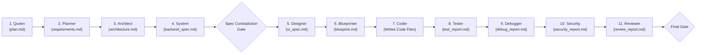

# AutoCoder (RuFlo) Pipeline: Complete Human-Friendly & Forensic Guide to Prompt-vs-Contract Failures

> **Purpose of This Document**: This guide explains **every single reason** why AutoCoder's 11-agent pipeline crashes with `Pipeline Execution Failed: Stage validation failed for ...`.
> It is written for **both humans and engineers**: every failure scenario starts with a plain-English **"What happens, Why it happens, and How it plays out"** explanation, followed immediately by the **exact files, line numbers, verbatim regexes, failing AI outputs, and copy-paste code fixes**.

---

## 1. The Big Picture: How AutoCoder Works & Why It Crashes (In Plain English)

### What Is AutoCoder Doing Under the Hood?
Think of AutoCoder as an **11-station software assembly line**. Each station is an AI agent with a specific job, and each agent produces a Markdown document (an "artifact") that acts as the blueprint for the next station:



Between every single station stands a **strict, rule-based TypeScript inspector** (called a **Contract Validator**).
- The AI agent **does not see** the TypeScript inspector's code.
- The AI agent **only sees** its System Prompt (e.g., `Architect.ts`, `Blueprinter.ts`).
- When the AI finishes writing its document, the TypeScript inspector checks it using strict regular expressions and set-math rules.

### Why Do Valid-Looking Runs Keep Failing?
Almost every `Pipeline Execution Failed` crash happens because **the instructions given to the AI (the Prompt) and the rules enforced by the Inspector (the Contract Validator) do not match**.

Specifically, there are **5 systemic traps** built into the current pipeline:

| Systemic Trap | What It Means in Plain English | Why It Is So Destructive |
| :--- | :--- | :--- |
| **1. The "One-Strike & You're Out" Bug** | The codebase actually has a 3-try retry system built (`[RETRY 2/3] Your previous output failed...`), **but nobody plugged it into a loop**. | If an AI makes even a tiny formatting slip on Try #1 (like forgetting one file or using `##` instead of `###`), the whole pipeline dies immediately instead of asking the AI to fix it. |
| **2. Prompts Literally Teach the AI to Break Rules** | Some prompts (especially `Blueprinter.ts` and `Designer.ts`) show the AI an example format that **violates the validator's rules**. | When the AI obediently copies the prompt's own example, the validator rejects it 100% of the time. |
| **3. Static Files (`favicon.ico`) Are Treated Like Code** | The validator requires **every static image/icon** (`public/favicon.ico`) and **config file** (`tailwind.config.ts`) to be owned by a code module, blueprinted with exports, and written as text by the Coder. | Normal web apps have favicons, logos, and Tailwind configs. The AI naturally leaves `favicon.ico` out of code modules—and the validator crashes. |
| **4. Naive Regexes Misread Normal English** | Validators scan whole paragraphs for words like `login`, `private`, `public`, or `.json`. | Writing `"Users do not need to log in"` triggers the `"Auth Required"` detector! Writing `"Returns res.json()"` triggers the `"Missing File res.json"` detector! |
| **5. Tester Crashes Instead of Calling Debugger** | When Stage 8 (`Tester`) finds a bug in the code, it marks its report `FAIL`. The stage validator treats `FAIL` as an invalid report and **throws an exception**, killing the pipeline before Stage 9 (`Debugger`) can fix the code! | The self-healing `Tester -> Debugger` repair loop can never actually run when a code error is found. |

---

## 2. Deep-Dive Story: Why `public/favicon.ico` Crashed the Pipeline

Let's trace the exact error that triggered this investigation:

```text
Pipeline Execution Failed: Stage validation failed for Architect: Architecture Contract Error: File "public/favicon.ico" from Project Folder Structure is not claimed by any module.
```

### What Happened? (Step-by-Step)
1. **Step 1 — The Architect AI reads its prompt ([`Architect.ts`](file:///home/lenovo/autogod/src/lib/agents/ruflo/registry/Architect.ts#L21-L52))**:
   - The prompt asks the Architect to list all files in `### Project Folder Structure` and `### Project Files`. For a standard Next.js or React app, the AI includes `public/favicon.ico`.
   - Next, the prompt asks the Architect to group the app into logical `### Modules` (like `**Auth Module**`, `**Dashboard UI**`, `**Task API**`) and list each module's `Owned Files`.
2. **Step 2 — Why the AI didn't put `public/favicon.ico` in a module**:
   - In real-world software engineering, a module is a logical unit of code (components, routes, services). `public/favicon.ico` is a binary browser icon, not code.
   - More importantly, [`Architect.ts`](file:///home/lenovo/autogod/src/lib/agents/ruflo/registry/Architect.ts) **never tells the AI** that static assets (`public/*`, `.ico`, `.png`, `.svg`) must be assigned to a code module.
3. **Step 3 — The Validator runs Check C ([`architecture-file-policy.ts`](file:///home/lenovo/autogod/src/lib/agents/ruflo/architecture-file-policy.ts#L58-L86) & [`spec-contract.ts`](file:///home/lenovo/autogod/src/lib/agents/ruflo/spec-contract.ts#L746-L753))**:
   - The validator classifies every file into one of 5 buckets:
     - `'exempt-config'` (`package.json`, `tsconfig.json`, etc.) -> **Does NOT need a module owner.**
     - `'database-schema'` (`prisma/schema.prisma`, `.sql`) -> **Does NOT need a module owner.**
     - `'implementation'` (`.ts`, `.tsx`, `.js`, `.css`) -> **MUST have a module owner.**
     - `'framework-managed'` (`app/layout.tsx`, `app/page.tsx`) -> **MUST have a module owner.**
     - `'static-asset'` (`public/*`, `.ico`, `.png`, `.svg`, `.woff2`) -> **Marked as `requiresModuleOwnership = true`!**
   - Because `'static-asset'` returns `true`, the validator checks who owns `public/favicon.ico`, finds nobody, and crashes the pipeline!

### The 3-Stage Catch-22: What Happens If the AI *Does* Assign `public/favicon.ico` to a Module?
Even if the AI puts `public/favicon.ico` inside a module in Stage 3 (`Architect`), it walks straight into two more traps downstream:
- **Trap in Stage 6 (`Blueprinter` — [`workspace-policy.ts:192-197`](file:///home/lenovo/autogod/src/lib/agents/ruflo/workspace-policy.ts#L192-L197))**:
  Because `requiresModuleOwnership('public/favicon.ico')` is `true`, Stage 6 forces the Blueprinter AI to write a full code specification (`### File: public/favicon.ico` with `Purpose`, `Owner Module`, `Dependencies`, `Specs Required`, and `Exports`) for a binary icon file! If it skips `public/favicon.ico`, Stage 6 crashes with `MISSING_FROM_BLUEPRINT`.
- **Trap in Stage 7 (`Coder` — [`contract-executor.ts:111-145`](file:///home/lenovo/autogod/src/lib/agents/ruflo/contract-executor.ts#L111-L145))**:
  Because `public/favicon.ico` was blueprinted, Stage 7 asks the LLM Coder to generate source code text for `public/favicon.ico`. If the LLM outputs an empty block because `.ico` is binary, Stage 7 crashes with `Coder Contract Error: Generated file "public/favicon.ico" is empty.`!

#### Under the Hood: Verbatim Code Causing the `favicon.ico` Catch-22
```ts
// src/lib/agents/ruflo/architecture-file-policy.ts:58-86
if (
  STATIC_ASSET_PREFIXES.some(prefix => prefix.test(norm)) || // /^public\//i, /^assets\//i, /^static\//i
  /\.(ico|png|jpg|jpeg|svg|gif|webp|woff|woff2|ttf|eot)$/i.test(norm)
) {
  return 'static-asset';
}
...
export function requiresModuleOwnership(filePath: string): boolean {
  const category = classifyArchitectureFile(filePath);
  switch (category) {
    case 'implementation':
    case 'framework-managed':
    case 'static-asset': // <-- BUG: Forces static assets into module ownership, blueprinting & text codegen!
      return true;
    case 'exempt-config':
    case 'database-schema':
      return false;
  }
}
```

---

## 3. Master Quick-Reference Table (All 45 Failure Scenarios)

Use this table to quickly find any error message or stage failure in the pipeline:

| ID | Stage / Gate | What Breaks (In Plain English) | Why It Breaks (Prompt vs. Code Mismatch) | Exact File & Line |
| :--- | :--- | :--- | :--- | :--- |
| **I.1** | All Stages | **No retries on validation failure** — 1st mistake kills the pipeline. | Retry prompt builder exists (`orchestrator.ts:1161`), but `executeContractStage` (`orchestrator.ts:1680`) is never called in a retry loop. | `contract-executor.ts:304`, `orchestrator.ts:1680` |
| **I.2** | System & Debugger | **Intro chat text isn't stripped** for `System` or `Debugger`. | `EXPECTED_FIRST_HEADERS` (`orchestrator.ts:200`) forgot to list `'System'` and `'Debugger'`. Also leaves trailing ```` ``` ```` if preamble precedes a code fence. | `orchestrator.ts:200-208, 267-292` |
| **I.3** | All Markdown | **Using `##` instead of `###` headers** rejects the whole document. | Sanitizer (`orchestrator.ts:281`) accepts `##` or `###`, but validator (`markdown-sections.ts:23`) strictly demands `###`. | `markdown-sections.ts:20-27` |
| **I.4** | All Markdown | **A `# comment` inside a code block cuts off the section!** | `extractRequiredSection` (`markdown-sections.ts:54`) stops at any line starting with `# `, even inside ```` ```sql ```` or ```` ```bash ```` blocks! | `markdown-sections.ts:46-60` |
| **I.5** | Tester & Debugger | **Debugger never runs when Tester finds a code error.** | `validateTester` treats `Result: FAIL` as a stage failure and throws (`contract-executor.ts:304`). Also `verification-loop.ts:176` checks non-existent `testerResult.status`. | `verification-loop.ts:176`, `stage-acceptance.ts:300` |
| **Q.1** | 1. Queen | Missing/duplicate/empty `Project Name`, `Project Goal`, `MVP Scope`, `Technical Constraints`, or `Risks`. | Strict `###` heading count (`=== 1`) and non-empty body check. | `stage-acceptance.ts:52-89` |
| **Q.2** | 1. Queen -> Gate | Writing **"Users do not need to log in; no auth required"** crashes after Stage 4. | `"no auth"` triggers the No-Auth detector, while `"log in"` (ignoring `"do not"`) triggers the Auth-Required detector! | `spec-contract.ts:27-59, 859` |
| **P.1** | 2. Planner | Using `### FR-001` subheadings inside `### Functional Requirements` makes the section look empty. | `extractRequiredSection` stops immediately at the first `### FR-001` line (`markdown-sections.ts:54`), returning `""`. | `stage-acceptance.ts:91-122` |
| **P.2** | 2. Planner -> 5. Designer | Writing `Feature-001` in `requirements.md` causes Stage 5 (`Designer`) to crash later. | `validateDesigner` requires `Feature-001` in `ui_spec.md`, but `Designer.ts` tells the AI to write `FR-001` instead! | `stage-acceptance.ts:231-238`, `Designer.ts:22` |
| **A.1** | 3. Architect | **`public/favicon.ico` or images not claimed by any module.** | `requiresModuleOwnership` returns `true` for `'static-asset'`. | `architecture-file-policy.ts:58-86`, `spec-contract.ts:746` |
| **A.2** | 3. Architect | **`tailwind.config.ts`, `postcss.config.mjs`, `components.json`, `next-env.d.ts`, or `prisma/seed.ts` not claimed by any module.** | `EXEMPT_CONFIG_FILES` only lists 14 exact filenames (e.g. `tailwind.config.js` is exempt, but `tailwind.config.ts` is not!). | `architecture-file-policy.ts:15-29` |
| **A.3** | 3. Architect | **File in Folder Tree missing from `Project Files` list (or casing differs).** | `treeFiles` vs. `projectFiles` uses case-sensitive `Set` comparison (`Navbar.tsx` vs `navbar.tsx`). | `architecture-parser.ts:215-225` |
| **A.4** | 3. Architect | **Inline comments in `Project Files`** (e.g. `- src/index.ts # entry`) fail. | Any space character (`/\\s/.test(entry)`) in a `Project Files` bullet is rejected. | `architecture-parser.ts:198` |
| **A.5** | 3. Architect | **Inconsistent spacing in ASCII folder tree** flattens nested files to root. | Parser measures column index (`line.indexOf(cleanName)`) to pop parent folders off `pathStack`. | `architecture-parser.ts:165-177` |
| **A.6** | 3. Architect | **Shared file (`src/types/index.ts`, `src/lib/db.ts`) listed in 2 modules.** | Check A forbids any file from having more than 1 module owner. | `spec-contract.ts:726-733` |
| **A.7** | 3. Architect | **Module claims a file not found in the ASCII folder tree.** | Check B requires every file in `Owned Files` to exist in `treeFiles`. | `spec-contract.ts:736-743` |
| **A.8** | 3. Architect | **Module header uses `#### Module` or `- **Module**`, or adds a 5th bullet field.** | Parser only accepts `**Module Name**` and only 4 exact bullet fields (`Responsibility`, `Owned Files`, `Depends On`, `Supports Features`). | `architecture-parser.ts:258-333` |
| **A.9** | 3. Architect | **`Depends On` lists a file path, npm package, `Socket.io` (has a dot), or `None (standalone)`.** | Check D rejects any dependency with `.`, `/`, `@`, `:`, undeclared module names, or cycles. | `spec-contract.ts:564-580, 756-779` |
| **A.10** | 3. Architect | **Mentioning `"not Next.js"` in a React/Express app makes the validator treat it as Next.js!** | Standalone `validateArchitectureArtifact` checks `/next\.js\|nextjs\|app router/i.test(content)` across the whole file. | `spec-contract.ts:782`, `stage-acceptance.ts:129` |
| **A.11** | 3. Architect | **Next.js `Backend Entry Point` isn't `app/.../route.ts`, or uses `@modal` parallel routes.** | Check E requires Next.js `Backend Entry Point` to match `/^(?:src\/)?app\/.+\/route\.(ts\|tsx\|js\|jsx)$/i`. | `spec-contract.ts:784-817` |
| **S.1** | 4. System | **Writing `res.json`, `NextResponse.json`, or `req.json` in `API Endpoints` crashes Stage 4!** | Regex `/[\/\w\-]+\.(?:tsx\|ts\|jsx\|js\|json)\b/gi` mistakes `res.json` and `NextResponse.json` for file paths missing from `architecture.md`! | `stage-acceptance.ts:182` |
| **S.2** | 4. System | **Client-only app writes `"Backend: None"` instead of `"No Backend Required"`.** | Escape hatch only triggers on exact phrase `no backend required`; otherwise demands DB, Seed, and API sections. | `stage-acceptance.ts:154-176` |
| **S.3** | Spec Gate | **Mentioning `"Out of scope: JWT / OAuth — no auth"` triggers Auth Contradiction.** | Full-text regexes fire for both `no auth` and `jwt`/`oauth` across the 4 spec documents. | `spec-contract.ts:27-59, 859` |
| **S.4** | Spec Gate | **Using the words `"private"`, `"protected"`, or `"public"` in endpoint descriptions crashes the gate.** | Endpoint parser uses `/protected\|private/i` and `/public/i` to guess whether an endpoint requires auth! | `spec-contract.ts:175-177, 868-882` |
| **S.5** | Spec Gate | **Naming a frontend helper module `"Backend API Client"` in an Express app crashes the gate.** | Any module with `"backend"` in its name is classified as a server module; if it only owns client files, the gate fails. | `spec-contract.ts:279, 885-906` |
| **D.1** | 5. Designer | **`Designer.ts` tells AI to write `Trace: FR-001`, but validator demands `Feature-001`.** | Direct contradiction between `Designer.ts:22, 29` and `validateDesigner` (`stage-acceptance.ts:231-238`). | `stage-acceptance.ts:231-238` |
| **B.1** | 6. Blueprinter | **`Blueprinter.ts` example omits `- **Owner Module**:`, causing every file to fail parser!** | All 3 files in `Blueprinter.ts:35-54` (`=== EXAMPLE ===`) lack `- **Owner Module**:`, which `workspace-policy.ts:127` requires. | `Blueprinter.ts:35-54`, `workspace-policy.ts:127` |
| **B.2** | 6. Blueprinter | **`Blueprinter.ts` example teaches `style.css (linked via <link>)` and `None (reads DOM...)`, which crash the validator! Also rejects `next/navigation` and `@prisma/client`!** | Validator doesn't strip `(...)` notes, and treats ANY dependency containing `/` (including `next/navigation` or `@prisma/client`) as a local file missing from `architecture.md`! | `Blueprinter.ts:39, 51`, `workspace-policy.ts:118-124, 185` |
| **B.3** | 6. Blueprinter | **Any owned file in `architecture.md` missing from `blueprint.md` (or wrong module name).** | Strict bidirectional file set and `Owner Module` check. | `workspace-policy.ts:165-212` |
| **B.4** | 6. Blueprinter -> 7. Coder | **If `package.json` or `prisma/schema.prisma` is omitted from `blueprint.md`, Coder never generates it!** | `authorizedFiles` (`workspace-policy.ts:248`) only includes files listed in `blueprint.md`, dropping exempt config/schema files! | `workspace-policy.ts:248`, `contract-executor.ts:111` |
| **C.1** | 7. Coder | **Next.js (`src/app/page.tsx`, `route.ts`) & Vite (`src/main.tsx`) entry points missing from `manifest.entryPoints`.** | `generateWorkspaceManifest` (`vfs.ts:323`) only marks files with `'index'`, `'App'`, or `'server/app.js'` as `role='entry'`. | `vfs.ts:323`, `workspace-policy.ts:357-369` |
| **C.2** | 7. Coder | **Parent folder `"src"` missing from `manifest.directories` if all files are in subfolders (`src/app/...`).** | `vfs.ts:336` only adds `path.dirname(f.path)` (leaf folder), while `workspace-policy.ts:337` requires all ancestor folders. | `vfs.ts:336-341`, `workspace-policy.ts:337-354` |
| **C.3** | 7. Coder | **Descriptive text in Blueprint `Exports` (e.g. `default Page component`) fails AST export check.** | `validateExportContract` checks generated AST for every word listed in `Exports`. | `contract-executor.ts:135`, `linter.ts` |
| **T.1** | 8. Tester | **Any lint/import/contract error in Coder's files crashes the pipeline at Stage 8.** | `Tester` outputs `FAIL`, `validateTester` rejects `FAIL`, and `executeContractStage` throws before `Debugger` can run. | `contract-executor.ts:148-163, 304`, `stage-acceptance.ts:300` |
| **DB.1** | 9. Debugger | **Mentioning `` `architecture.md` `` or `` `blueprint.md` `` in `Patches Applied` crashes Debugger.** | Validator scans all backticks `` `...` `` in `Patches Applied` and fails if any backticked word is a spec filename. | `stage-acceptance.ts:322-332` |
| **SC.1** | 10. Security | **Single-character typo or `"Hash: ..."` prefix in 64-char SHA-256 `Workspace Hash` crashes Security.** | LLM must echo a 64-char hex hash verbatim, and `split(/\s+/)[0]` grabs `"Hash:"` or `"-"` if prefixed. | `schemas/security.ts:17-30`, `stage-acceptance.ts:345` |
| **RV.1** | 11. Reviewer | **Writing `- PASS: ...` (with a bullet!) in `Architectural Conformance` or `Requirement Coverage` crashes Reviewer 100% of the time!** | `"- PASS".split(/[\s:—\-]+/)[0]` splits on `-` and returns `""` (empty string) as the first element instead of `"PASS"`! | `schemas/reviewer.ts:24-35`, `stage-acceptance.ts:362-375` |

---

## Part I: The 5 Systemic Infrastructure Bugs (What, Why & Code Trace)

Before looking at individual agent prompts, these 5 bugs in the core pipeline engine affect **multiple stages** at once.

---

### Bug I.1 — The "One-Strike & You're Out" Zero-Retry Bug

- **What happens**: Whenever any agent makes a formatting mistake or omits a field, the pipeline crashes immediately on Attempt #1 instead of asking the agent to fix its mistake.
- **Why it happens**: Whoever wrote `orchestrator.ts` built a retry prompt helper (`composeAgentUserContent` at line 1161) that adds:
  `[RETRY 2/3] Your previous output failed verification. Error: <validationError>. Fix the issue and regenerate the COMPLETE output.`
  And `contract-executor.ts` (line 63) counts previous attempts in the database (`const attempt = existingAttempts + 1`).
  **However, neither `orchestrator.ts` nor `contract-executor.ts` actually puts a `for` or `while` loop around the stage execution!** So `attempt` is always `1`, `validationError` is never fed back to the LLM, and line 304 of `contract-executor.ts` immediately `throw`s an unhandled exception on the first failure.
- **Where in the code**:
  - [`src/lib/agents/ruflo/orchestrator.ts:1161-1163`](file:///home/lenovo/autogod/src/lib/agents/ruflo/orchestrator.ts#L1161-L1163)
  - [`src/lib/agents/ruflo/orchestrator.ts:1680-1690`](file:///home/lenovo/autogod/src/lib/agents/ruflo/orchestrator.ts#L1680-L1690)
  - [`src/lib/agents/ruflo/contract-executor.ts:63-66, 245, 290-305`](file:///home/lenovo/autogod/src/lib/agents/ruflo/contract-executor.ts#L290-L305)
- **Verbatim Code**:
  ```ts
  // src/lib/agents/ruflo/orchestrator.ts:1680-1690 — Called ONCE with no retry loop!
  const res = await executeContractStage(stageName, contractCtx, async (attempt, lastError) => {
    return await runAgent(stageName, attempt, lastError);
  });
  ```
  ```ts
  // src/lib/agents/ruflo/contract-executor.ts:245, 290-305 — Throws on first failure!
  rawContent = await runAgentFn(attempt); // <-- Note: lastError isn't even passed!
  ...
  if (!validation.accepted) {
    ...
    throw new Error(`Stage validation failed for ${stageName}: ${errMessage}`);
  }
  ```

---

### Bug I.2 — Output Sanitizer Forgets `System` and `Debugger` (and Leaves Trailing Code Fences)

- **What happens**: Before a validator checks an AI's output, `sanitizeStageOutput()` (`orchestrator.ts:267`) tries to strip any conversational intro text (like `"Sure! Here is the specification:"`) by slicing from the first expected heading (e.g. `### Tech Stack`).
- **Why it happens**:
  1. The lookup table `EXPECTED_FIRST_HEADERS` (`orchestrator.ts:200-208`) lists 7 agents, **but completely forgets `'System'` and `'Debugger'`!**
  2. Even worse: if an AI outputs intro text followed by a markdown code fence:
     ```text
     Here is the architecture:
     ```markdown
     ### Tech Stack
     ...
     ```
     ```
     Because the string does not *start* with ```` ```markdown ```` (it starts with `"Here is..."`), the outer fence stripper (`^```...```$`) fails to match. Then the header slicer cuts from `### Tech Stack` to the end of the text—**leaving the closing ```` ``` ```` sitting at the bottom of the document**! In Stage 3 (`Architect`), that leftover ```` ``` ```` at the bottom of `### Modules` crashes the parser with:
     `Architecture Parser Error: Unexpected content in "### Modules": "\`\`\`"`!
- **Where in the code**: [`src/lib/agents/ruflo/orchestrator.ts:200-208, 267-292`](file:///home/lenovo/autogod/src/lib/agents/ruflo/orchestrator.ts#L200-L292)
- **Verbatim Code**:
  ```ts
  // src/lib/agents/ruflo/orchestrator.ts:200-208
  const EXPECTED_FIRST_HEADERS: Record<string, string> = {
    'Queen': 'Project Name',
    'Planner': 'Features',
    'Architect': 'Tech Stack',
    'Designer': 'Design System',
    'Blueprinter': 'File:',
    'Security': 'Overall Status',
    'Reviewer': 'Overall Assessment',
    // <-- MISSING 'System' ('Database Design' / 'No Backend Required') and 'Debugger' ('Issues Addressed')!
  };
  ```

---

### Bug I.3 — Sanitizer Allows `##` Headings, But Validator Only Accepts `###` Headings

- **What happens**: If an AI writes `## Project Name` or `## Features` (using 2 hashes `##` instead of 3 hashes `###`), the sanitizer recognizes it as a valid first header and lets it through, **but the validator rejects every single section as missing (`count: 0`)**.
- **Why it happens**:
  - `sanitizeStageOutput` (`orchestrator.ts:281`) matches `/#{2,3}\s*${expectedFirstHeader}/i` (allowing `##` or `###`) without converting `##` to `###`.
  - `countHeading` (`contracts/markdown-sections.ts:23`) strictly tests `/^#{3}\s+${escaped}\s*$/i` (requiring exactly `###`).
- **Where in the code**:
  - [`src/lib/agents/ruflo/orchestrator.ts:281`](file:///home/lenovo/autogod/src/lib/agents/ruflo/orchestrator.ts#L281)
  - [`src/lib/agents/ruflo/contracts/markdown-sections.ts:20-27`](file:///home/lenovo/autogod/src/lib/agents/ruflo/contracts/markdown-sections.ts#L20-L27)

---

### Bug I.4 — A Single `# Comment` Inside a Code Block Cuts Off the Entire Section!

- **What happens**: If an AI includes a code snippet inside any markdown section (for example, a SQL/Prisma/Bash comment like `# Seed initial admin user` inside `### Seed Data`, or a Python/Shell comment inside `### Technical Constraints`), the section parser **treats `# Seed initial admin user` as a level-1 Markdown Heading (`# H1`) and throws away the rest of the section!**
- **Why it happens**: Look at `extractRequiredSection` in `contracts/markdown-sections.ts:46-60`. The `for` loop reads line by line after `### <Section>`, and stops at the first line matching `/^#{1,3}\s+/`. **It never checks if it is inside a ```` ``` ```` code block!**
  - If the `# comment` is at the top of the section, `body` becomes empty (`""`), crashing the pipeline with:
    `<Stage> <Section> section is empty.`
  - If the `# comment` is in the middle of a section, everything after it is silently deleted before the validator checks the section!
- **Where in the code**: [`src/lib/agents/ruflo/contracts/markdown-sections.ts:46-60`](file:///home/lenovo/autogod/src/lib/agents/ruflo/contracts/markdown-sections.ts#L46-L60)
- **Verbatim Code**:
  ```ts
  // src/lib/agents/ruflo/contracts/markdown-sections.ts:46-60
  export function extractRequiredSection(content: string, title: string): string | null {
    const lines = normalizeMarkdown(content).split('\n');
    const escaped = escapeRegex(title);
    const startRe = new RegExp(`^#{3}\\s+${escaped}\\s*$`, 'i');
    const idx = lines.findIndex((line) => startRe.test(line.trim()));
    if (idx === -1) return null;

    const body: string[] = [];
    for (let i = idx + 1; i < lines.length; i++) {
      if (/^#{1,3}\s+/.test(lines[i].trim())) break; // <-- BUG: Matches `# comment` inside ```code``` blocks!
      body.push(lines[i]);
    }
    return body.join('\n').trim();
  }
  ```

---

### Bug I.5 — The Self-Healing `Tester -> Debugger` Loop Is Completely Broken in Two Places

- **What happens**: When Stage 7 (`Coder`) finishes writing the application code, Stage 8 (`Tester`) runs the TypeScript/ESLint checker (`lintVirtualWorkspace`). If `Tester` finds even **one** error in the generated code, **instead of handing the error report to Stage 9 (`Debugger`) to fix the code, Stage 8 crashes the entire pipeline!**
- **Why it happens**:
  1. **Crash #1 (`validateTester` rejects `FAIL`)**: In `stage-acceptance.ts:300-302`, `validateTester` has a rule:
     ```ts
     if (output.result !== 'PASS') {
       errors.push('Tester Contract Error: Verification result is FAIL.');
     }
     ```
     Because `validateTester` returns `accepted: false` whenever `Tester` finds a bug (`Result: FAIL`), `executeContractStage('Tester')` throws an exception at `contract-executor.ts:304` (`Stage validation failed for Tester: Tester Contract Error: Verification result is FAIL.`), killing the pipeline before `Debugger` is ever reached!
  2. **Crash #2 (`testerResult.status` does not exist)**: Even in `verification-loop.ts:176` (`verifyAndRepairWorkspace`), the loop checks:
     ```ts
     const testerResult = await executeStageFn('Tester');
     if (!testerResult || testerResult.status !== 'ACCEPTED') {
       throw new Error(`Tester stage failed to execute properly in cycle ${cycle}`);
     }
     ```
     `executeContractStage` returns `{ stageExecution, artifact, content }` (`contract-executor.ts:384-388`)—it **never** returns a `.status` property on the top-level object (`testerResult.stageExecution.state` is `'ACCEPTED'`, while `testerResult.status` is `undefined`).
- **Where in the code**:
  - [`src/lib/agents/ruflo/stage-acceptance.ts:293-310`](file:///home/lenovo/autogod/src/lib/agents/ruflo/stage-acceptance.ts#L293-L310)
  - [`src/lib/agents/ruflo/contract-executor.ts:300-305, 384-388`](file:///home/lenovo/autogod/src/lib/agents/ruflo/contract-executor.ts#L300-L305)
  - [`src/lib/agents/ruflo/verification-loop.ts:174-205`](file:///home/lenovo/autogod/src/lib/agents/ruflo/verification-loop.ts#L174-L205)


---

## Part II: Stage-by-Stage Guide — Stages 1 to 4 (`Queen`, `Planner`, `Architect`, `System` & Spec Contradiction Gate)

---

### Stage 1: `Queen` (Generates `plan.md`)

- **What Queen's Job Is**: Read the user's initial prompt and write a high-level project charter (`plan.md`) with 5 sections: `Project Name`, `Project Goal`, `MVP Scope`, `Technical Constraints`, and `Risks`.
- **Prompt File**: [`src/lib/agents/ruflo/registry/Queen.ts`](file:///home/lenovo/autogod/src/lib/agents/ruflo/registry/Queen.ts#L1-L39)
- **Validator File**: [`src/lib/agents/ruflo/stage-acceptance.ts:52-89`](file:///home/lenovo/autogod/src/lib/agents/ruflo/stage-acceptance.ts#L52-L89) (`validateQueen`)

#### Scenario Q.1 — Missing, Duplicated, or Inline Section Headers
- **What breaks (Plain English)**: If the AI writes `### Project Name: TaskTracker` on a single line (instead of putting `TaskTracker` on the line below `### Project Name`), or uses `## Project Name`, the validator rejects `plan.md`.
- **Why the AI does this**: In normal Markdown, writing `### Project Name: TaskTracker` is natural for a 2-word field. However, `countHeading()` (`markdown-sections.ts:23`) requires the line to end immediately after `Project Name` (`^#{3}\s+Project Name\s*$`), and `extractRequiredSection()` requires text on the lines *below* the heading.
- **Exact Error Thrown**:
  - `Pipeline Execution Failed: Stage validation failed for Queen: Missing or duplicate required section: ### Project Name (count: 0)`
  - `Pipeline Execution Failed: Stage validation failed for Queen: Queen Project Name section is empty.`

#### Scenario Q.2 — The "Do Not Log In" Booby Trap (Arms a Bomb That Explodes After Stage 4)
- **What breaks (Plain English)**: If the user asks for a simple calculator or todo app, and `Queen` writes: *"Users do not need to log in; no authentication is required"*, Stage 1 (`Queen`) succeeds—**but 3 stages later, right after Stage 4 (`System`), the Specification Contradiction Gate crashes the pipeline** claiming `plan.md` contradicts itself about authentication!
- **Why the AI does this**:
  - `Queen.ts` (line 34) explicitly tells the AI: *"If the user's request is simple (calculator, todo list, static page, game), keep the scope small and do NOT invent backend, database, or auth requirements unless asked."*
  - So the AI dutifully writes in `### Technical Constraints`: `"No authentication required; users do not log in or sign in."`
- **Why the Validator crashes**:
  In [`spec-contract.ts:27-59`](file:///home/lenovo/autogod/src/lib/agents/ruflo/spec-contract.ts#L27-L59), two regex functions scan `plan.md`:
  1. `detectExplicitNoAuth(text)` sees `"no authentication"` -> flags `plan:no-auth-explicit`.
  2. `detectExplicitAuthRequired(text)` checks `/\blog\s*in\b|\blogged\s+in\b|\bsign\s*in\b|\bsigned\s+in\b/i` (`line 57`). **It does not check if `"do not"` or `"no need to"` comes before `"log in"`!** So `"users do not log in"` ALSO triggers `plan:auth-required-explicit`!
  3. Then `validateProjectContract` (`spec-contract.ts:859`) sees both flags turned on and aborts the pipeline!
- **Exact Error Thrown**:
  `Pipeline Execution Failed: Specification Contradiction Gate Failed: Authentication contradiction across specification artifacts. Both explicit 'No Auth' (plan:no-auth-explicit) and 'Auth Required' (plan:auth-required-explicit) detected.`

---

### Stage 2: `Planner` (Generates `requirements.md`)

- **What Planner's Job Is**: Turn `plan.md` into a product requirements document (`requirements.md`) with 3 sections: `### Features`, `### Functional Requirements`, and `### Acceptance Criteria`.
- **Prompt File**: [`src/lib/agents/ruflo/registry/Planner.ts`](file:///home/lenovo/autogod/src/lib/agents/ruflo/registry/Planner.ts#L1-L40)
- **Validator File**: [`src/lib/agents/ruflo/stage-acceptance.ts:91-122`](file:///home/lenovo/autogod/src/lib/agents/ruflo/stage-acceptance.ts#L91-L122) (`validatePlanner`)

#### Scenario P.1 — Using `### FR-001` Subheadings Makes the Section Look Empty
- **What breaks (Plain English)**: If the AI organizes `### Functional Requirements` using `### FR-001: Task Creation` subheadings instead of bullet points (`- **FR-001**: ...`), the validator says `Planner Functional Requirements section is empty.`
- **Why it happens**: `extractRequiredSection('Functional Requirements')` (`markdown-sections.ts:54`) stops reading as soon as it sees any line starting with `#`, `##`, or `###`. So if line 1 under `### Functional Requirements` is `### FR-001: Task Creation`, the parser stops on line 1 and returns `""` (empty string)!
- **Exact Error Thrown**:
  `Pipeline Execution Failed: Stage validation failed for Planner: Planner Functional Requirements section is empty.`

#### Scenario P.2 — Writing `Feature-001` in `requirements.md` Arms a Trap in Stage 5 (`Designer`)
- **What breaks (Plain English)**: If the Planner AI writes `Feature-001`, `Feature-002` inside `requirements.md`, Stage 2 passes—**but Stage 5 (`Designer`) is guaranteed to crash later!**
- **Why it happens**:
  - When `validateDesigner` (`stage-acceptance.ts:231-238`) runs in Stage 5, it searches `requirements.md` for any `Feature-\d{3}` IDs. If it finds `Feature-001`, it demands that `Feature-001` also appear in `ui_spec.md`.
  - **However**, the Designer's prompt ([`Designer.ts:22, 29`](file:///home/lenovo/autogod/src/lib/agents/ruflo/registry/Designer.ts#L22-L29)) explicitly tells the Designer AI to write `- Trace: [FR-xxx IDs]` (like `FR-001`), **not** `Feature-001`!

---

### Stage 3: `Architect` (Generates `architecture.md`)

- **What Architect's Job Is**: Define the tech stack, draw the folder tree (`### Project Folder Structure`), list every file (`### Project Files`), and group files into modules (`### Modules`).
- **Prompt File**: [`src/lib/agents/ruflo/registry/Architect.ts`](file:///home/lenovo/autogod/src/lib/agents/ruflo/registry/Architect.ts#L1-L65)
- **Validator Files**:
  - [`src/lib/agents/ruflo/stage-acceptance.ts:125-143`](file:///home/lenovo/autogod/src/lib/agents/ruflo/stage-acceptance.ts#L125-L143) (`validateArchitect`)
  - [`src/lib/agents/ruflo/spec-contract.ts:670-837`](file:///home/lenovo/autogod/src/lib/agents/ruflo/spec-contract.ts#L670-L837) (`validateArchitectureArtifact`)
  - [`src/lib/agents/ruflo/architecture-parser.ts:64-385`](file:///home/lenovo/autogod/src/lib/agents/ruflo/architecture-parser.ts#L64-L385) (`parseArchitectureArtifact`)
  - [`src/lib/agents/ruflo/architecture-file-policy.ts:1-98`](file:///home/lenovo/autogod/src/lib/agents/ruflo/architecture-file-policy.ts#L1-L98) (`classifyArchitectureFile`, `requiresModuleOwnership`)

Stage 3 has **11 separate traps** where natural AI output crashes the parser or contract validator:

---

#### Scenario A.1 — Static Assets (`public/favicon.ico`, `.png`, `.svg`) Not Claimed by a Module
- **What breaks (Plain English)**: The AI lists `public/favicon.ico` (or `public/logo.svg`, `public/robots.txt`) in the folder tree and `Project Files`, but doesn't assign it to a code module in `### Modules`.
- **Why the AI does this**: `Architect.ts` never mentions that static assets in `public/` need to be owned by a code module.
- **Why the Validator crashes**: `requiresModuleOwnership()` (`architecture-file-policy.ts:82`) returns `true` for `'static-asset'`, and Check C (`spec-contract.ts:746-753`) rejects any file with `requiresModuleOwnership === true` that has no module owner.
- **Exact Error Thrown**:
  `Pipeline Execution Failed: Stage validation failed for Architect: Architecture Contract Error: File "public/favicon.ico" from Project Folder Structure is not claimed by any module.`

---

#### Scenario A.2 — Common Config Files (`tailwind.config.ts`, `postcss.config.mjs`, `components.json`, `prisma/seed.ts`) Not Claimed by a Module
- **What breaks (Plain English)**: In modern Next.js/TypeScript projects, the AI includes `tailwind.config.ts` or `postcss.config.mjs` at the project root and leaves it out of `### Modules` (just like `package.json` and `tsconfig.json`). The validator crashes saying `tailwind.config.ts` is not claimed by any module!
- **Why the AI does this**: `Architect.ts` treats root config files as project-level boilerplate, not feature modules.
- **Why the Validator crashes**: Look at the hardcoded whitelist `EXEMPT_CONFIG_FILES` in [`architecture-file-policy.ts:15-29`](file:///home/lenovo/autogod/src/lib/agents/ruflo/architecture-file-policy.ts#L15-L29):
  ```ts
  const EXEMPT_CONFIG_FILES = new Set([
    'package.json', 'tsconfig.json', 'vite.config.ts', 'vite.config.js',
    'next.config.js', 'next.config.mjs', 'next.config.ts',
    'tailwind.config.js', 'postcss.config.js',
    '.gitignore', '.env', '.env.local', '.env.example',
  ]);
  ```
  Notice what is **missing** from this 14-file whitelist:
  - `tailwind.config.ts` and `tailwind.config.mjs` (only `.js` is listed!)
  - `postcss.config.mjs` and `postcss.config.cjs` (only `.js` is listed!)
  - `next-env.d.ts`, `components.json` (shadcn), `tsconfig.node.json`
  - `eslint.config.js`, `.eslintrc.json`, `.prettierrc`
  - `Dockerfile`, `docker-compose.yml`, `README.md`
  - `prisma/seed.ts` (only `prisma/schema.prisma` and `prisma/migrations/*` match `DATABASE_SCHEMA_PATTERNS`!)
  Every single one of these falls through to `return 'implementation'` (`line 71`), requiring module ownership and a `### File:` code spec in `blueprint.md`!
- **Exact Error Thrown**:
  `Pipeline Execution Failed: Stage validation failed for Architect: Architecture Contract Error: File "tailwind.config.ts" from Project Folder Structure is not claimed by any module.`

---

#### Scenario A.3 — Folder Tree vs. `Project Files` Mismatch (Including Uppercase/Lowercase Differences!)
- **What breaks (Plain English)**: The AI must list every file **twice**: once in the ASCII diagram (`### Project Folder Structure`) and once in the flat bullet list (`### Project Files`). If one list has `src/components/Navbar.tsx` and the other has `src/components/navbar.tsx` (or if a single file is forgotten in either list), the validator crashes.
- **Why the Validator crashes**: In [`architecture-parser.ts:215-225`](file:///home/lenovo/autogod/src/lib/agents/ruflo/architecture-parser.ts#L215-L225), `new Set(treeFiles)` and `new Set(projectFiles)` perform **case-sensitive** exact string matching (even though module ownership later uses `.toLowerCase()`!).
- **Exact Errors Thrown**:
  - `Architecture Parser Error: File "<file>" is in Project Folder Structure but missing from Project Files list.`
  - `Architecture Parser Error: File "<file>" is in Project Files list but missing from Project Folder Structure.`

---

#### Scenario A.4 — Adding Helpful Comments in `### Project Files` Crashes the Parser
- **What breaks (Plain English)**: If the AI adds a comment next to a file in `### Project Files`, such as:
  `- src/app/page.tsx # Main landing page` or `- src/app/page.tsx (Main page)`
  the parser rejects the line!
- **Why it happens**: In [`architecture-parser.ts:192-203`](file:///home/lenovo/autogod/src/lib/agents/ruflo/architecture-parser.ts#L192-L203), the ASCII tree parser strips `#.*$` and `\s+\(.*\)$` (`lines 156-157`), **but the `### Project Files` parser (`line 195`) forgot to strip comments**! Instead, line 198 checks `if (entry.endsWith('/') || /\s/.test(entry))`—so any space before a comment triggers an immediate error.
- **Exact Error Thrown**:
  `Architecture Parser Error: Invalid Project Files entry "src/app/page.tsx # Main landing page".`

---

#### Scenario A.5 — Slightly Uneven Spacing in the ASCII Folder Tree Flattens Subfolders to Root
- **What breaks (Plain English)**: The AI draws a folder tree where `favicon.ico` is visually under `public/`, and lists `public/favicon.ico` in `### Project Files`. Yet the parser claims `File "favicon.ico" is in Project Folder Structure` (without `public/`!) and crashes!
- **Why it happens**: Look at how [`architecture-parser.ts:165-177`](file:///home/lenovo/autogod/src/lib/agents/ruflo/architecture-parser.ts#L165-L177) figures out which folder a file belongs to:
  ```ts
  const nameStartCol = line.indexOf(cleanName);
  while (pathStack.length > 0 && pathStack[pathStack.length - 1].indent >= nameStartCol) {
    pathStack.pop();
  }
  ```
  It counts the **character column index** where the filename starts!
  - If the AI writes `├── public/` (`public/` starts at column 4), and on the next line writes `├─ favicon.ico` or `\t├─ favicon.ico` (`favicon.ico` also starts at column 3 or 4), then `pathStack[0].indent (4) >= nameStartCol (4)` is `true`!
  - The parser **pops `public` off the folder stack** and thinks `favicon.ico` is in the project root!

---

#### Scenario A.6 — Shared Files (`src/types/index.ts`, `src/lib/db.ts`) Claimed by Two Modules
- **What breaks (Plain English)**: If `src/types/index.ts` or `src/lib/prisma.ts` is used by both the `Task Module` and the `User Module`, and the AI lists it in `Owned Files` of both modules, Stage 3 crashes.
- **Why it happens**: Check A ([`spec-contract.ts:726-733`](file:///home/lenovo/autogod/src/lib/agents/ruflo/spec-contract.ts#L726-L733)) strictly enforces single ownership (`owners.length > 1` -> Error). Instead of sharing ownership, the AI must invent a separate `Shared / Core Module` to own shared files.
- **Exact Error Thrown**:
  `Architecture Contract Error: File "src/types/index.ts" is claimed by modules [Task Module, User Module]. Each file must have a single owner.`

---

#### Scenario A.7 — Module Claims a File Not in the Folder Tree
- **What breaks (Plain English)**: A module lists a file in `Owned Files:` that wasn't in `### Project Folder Structure` (or has a typo in the path).
- **Exact Error Thrown** (Check B, [`spec-contract.ts:736-743`](file:///home/lenovo/autogod/src/lib/agents/ruflo/spec-contract.ts#L736-L743)):
  `Architecture Contract Error: Module "<Module>" claims file "<path>" which is not in Project Folder Structure.`

---

#### Scenario A.8 — Rigid Module Header & 4-Bullet Grammar in `### Modules`
- **What breaks (Plain English)**: The parser for `### Modules` ([`architecture-parser.ts:258-333`](file:///home/lenovo/autogod/src/lib/agents/ruflo/architecture-parser.ts#L258-L333)) is an ultra-strict line-by-line state machine. Any of these completely normal Markdown styles will crash it immediately:

| What the AI Writes | Why a Human/AI Thinks It's Fine | Exact Parser Crash |
| :--- | :--- | :--- |
| `#### Auth Module` or `### 1. Auth Module` | Standard markdown subheadings for subsections. | `Field "Responsibility" appears before any module declaration.` (or truncates section!) |
| `- **Auth Module**` or `1. **Auth Module**` | Bulleted or numbered list of modules. | `Unexpected content in "### Modules": "- **Auth Module**"` |
| `**Auth Module:**` or `**Auth Module**:` | Adding a colon to a heading. | `Invalid module name "Auth Module:"` or `Unexpected content` |
| Sub-bullets under `Owned Files:`<br>`  - src/a.ts`<br>`  - src/b.ts` | Multi-line bullet list of files instead of one comma-separated line. | `Unexpected content in "### Modules": "- src/a.ts"` + `Module has no Owned Files.` |
| Adding `- **Exports**: ...` or `- **Notes**: ...` | Adding helpful extra detail to a module. | `Unknown module field "Exports" in module "Auth Module".` |

---

#### Scenario A.9 — Module `Depends On` Rejects Dots (`Socket.io`, `Next.js`), Parentheses (`None (standalone)`), and Cycles
- **What breaks (Plain English)**:
  1. If a module is named `**Socket.io Service**` or `**Auth.js Module**`, and another module lists `Socket.io Service` in `- **Depends On**:`, the validator crashes saying `"Socket.io Service"` is a file path or package, not a module name!
  2. If the AI writes `- **Depends On**: None (root module)`, the parser fails to recognize `None` because of `(root module)` and crashes saying module `"None (root module)"` does not exist!
- **Why it happens**:
  - In [`spec-contract.ts:564-573`](file:///home/lenovo/autogod/src/lib/agents/ruflo/spec-contract.ts#L564-L573), `looksLikeArchitectureModuleName()` rejects any string ending in `\.[a-z0-9]{1,6}$` or containing `/`, `\`, `@`, or `:`.
  - In [`architecture-parser.ts:304`](file:///home/lenovo/autogod/src/lib/agents/ruflo/architecture-parser.ts#L304), `if (val && val.toLowerCase() !== 'none')` checks exact equality with `'none'` without stripping `(...)` notes.
- **Exact Errors Thrown**:
  - `Architecture Contract Error: Module "UI" has invalid dependency "Socket.io". Depends On must reference declared module names, not file paths or packages.`
  - `Architecture Contract Error: Module "UI" depends on undeclared module "None (root module)".`
  - `Architecture Contract Error: Circular module dependency detected: A -> B -> A`

---

#### Scenario A.10 — Mentioning `"not Next.js"` in an Express/React App Makes the Validator Think It *Is* Next.js!
- **What breaks (Plain English)**: Suppose you ask for a Vite + React + Express app (`server/index.ts`). In `architecture.md`, the AI writes: `"Frontend: Vite + React SPA (not Next.js)"`. Suddenly, Stage 3 crashes with:
  `Next.js Architecture Error: Backend Entry Point "server/index.ts" must be a valid Next.js App Router route handler (e.g. app/api/.../route.ts).`
- **Why it happens**:
  In [`stage-acceptance.ts:129`](file:///home/lenovo/autogod/src/lib/agents/ruflo/stage-acceptance.ts#L129), `validateArchitect` calls `validateArchitectureArtifact(content)` **without passing the second `contract` argument**.
  When `contract` is missing, [`spec-contract.ts:782`](file:///home/lenovo/autogod/src/lib/agents/ruflo/spec-contract.ts#L782) guesses the framework with a raw regex across the entire file:
  ```ts
  const framework = contract?.framework || (/next\.js|nextjs|app router/i.test(architectureContent) ? 'NEXT_APP_ROUTER' : 'STATIC_HTML');
  ```
  Because `"not Next.js"` contains `"Next.js"`, it classifies the Express app as `NEXT_APP_ROUTER` and rejects `server/index.ts`!

---

#### Scenario A.11 — Next.js `Backend Entry Point` Must Be a Single `app/.../route.ts` File
- **What breaks (Plain English)**: In a Next.js App Router project, there is no single "backend entry point" file like `server.js`—every API route is its own `app/api/<name>/route.ts` file (or Server Actions in `app/actions.ts`). Yet [`Architect.ts:18`](file:///home/lenovo/autogod/src/lib/agents/ruflo/registry/Architect.ts#L18) demands `- **Backend Entry Point**:`.
  If the AI writes:
  - `src/app/actions.ts` (Server Actions)
  - `src/lib/db.ts` (Database client)
  - `src/app/api/tasks/route.ts, src/app/api/users/route.ts` (Multiple routes)
  - `src/app/api/` (Directory)
  Stage 3 crashes!
- **Why it happens**: Check E ([`spec-contract.ts:807-816`](file:///home/lenovo/autogod/src/lib/agents/ruflo/spec-contract.ts#L807-L816)) requires `Backend Entry Point` (if not `"None"`) to be a single file listed in `Project Files` matching `/^(?:src\/)?app\/.+\/route\.(ts|tsx|js|jsx)$/i`.

---

### Stage 4: `System` (Generates `backend_spec.md`) & The Specification Contradiction Gate

- **What System's Job Is**: Define the database tables (`### Database Design`), initial sample rows (`### Seed Data`), and HTTP endpoints (`### API Endpoints`).
- **Prompt File**: [`src/lib/agents/ruflo/registry/System.ts`](file:///home/lenovo/autogod/src/lib/agents/ruflo/registry/System.ts#L1-L40)
- **Validator Files**:
  - [`src/lib/agents/ruflo/stage-acceptance.ts:145-193`](file:///home/lenovo/autogod/src/lib/agents/ruflo/stage-acceptance.ts#L145-L193) (`validateSystem`)
  - [`src/lib/agents/ruflo/spec-contract.ts:850-930`](file:///home/lenovo/autogod/src/lib/agents/ruflo/spec-contract.ts#L850-L930) (`validateProjectContract` — runs immediately after `System` at `orchestrator.ts:1703`)

---

#### Scenario S.1 — Writing `res.json()`, `NextResponse.json()`, or `req.json()` in `### API Endpoints` Crashes Stage 4!
- **What breaks (Plain English)**: In `backend_spec.md` under `### API Endpoints`, the AI describes how an endpoint works:
  - *"Parses the request body using `await req.json()` and returns `NextResponse.json({ data })`"* (or in Express: *"Uses `express.json()` and returns `res.json(items)`"*).
  Immediately, Stage 4 crashes with:
  `System Contract Error: API endpoint path "req.json" is absent from architecture project files.` (or `"NextResponse.json"`, `"res.json"`).
- **Why the Validator crashes**:
  Look at [`stage-acceptance.ts:182`](file:///home/lenovo/autogod/src/lib/agents/ruflo/stage-acceptance.ts#L182):
  ```ts
  const apiEndpoints = extractRequiredSection(content, 'API Endpoints') || '';
  const endpointPathTokens = apiEndpoints.match(/[\/\w\-]+\.(?:tsx|ts|jsx|js|json)\b/gi) || [];
  for (const token of endpointPathTokens) {
    const normalizedToken = token.replace(/^\.?\//, '');
    if (archFiles.size > 0 && !archFiles.has(normalizedToken)) {
      errors.push(`System Contract Error: API endpoint path "${token}" is absent from architecture project files.`);
    }
  }
  ```
  The author of that regex intended to find file paths like `src/app/api/tasks/route.ts`. **However, `[\/\w\-]+` does NOT require a slash (`/`)!** Any word followed by `.json`, `.ts`, or `.js`—including JavaScript method calls like **`NextResponse.json`**, **`res.json`**, **`req.json`**, **`response.json`**, or **`express.json`**—matches the regex! The validator then looks for a file named `res.json` in `architecture.md`, doesn't find one, and kills the pipeline!

---

#### Scenario S.2 — Client-Only App Writes `"Backend: None"` Instead of `"No Backend Required"`
- **What breaks (Plain English)**: For a static/client-only app, if the AI writes `"Backend: None — this app runs entirely in the browser"` without the exact 3-word phrase `"No Backend Required"`, the validator demands full `### Database Design`, `### Seed Data`, and `### API Endpoints` sections.
- **Where in the code**: [`stage-acceptance.ts:154-176`](file:///home/lenovo/autogod/src/lib/agents/ruflo/stage-acceptance.ts#L154-L176).

---

#### Scenario S.3 & S.4 — The Specification Contradiction Gate's `"private"` / `"protected"` / `"public"` Word Traps
- **What breaks (Plain English)**: Right after Stage 4 (`System`), `orchestrator.ts:1703` runs `validateProjectContract()`. Even if all 4 documents (`plan.md`, `requirements.md`, `architecture.md`, `backend_spec.md`) agree on whether the app has login/auth, the gate crashes if:
  1. **Case A (No-Auth App)**: The app has **NO authentication**, and anywhere inside `### API Endpoints` in `backend_spec.md`, the AI uses the English word **`private`** or **`protected`** (e.g., *"Keeps internal database IDs private"* or *"Protected against SQL injection"*).
  2. **Case B (Auth App)**: The app **DOES require authentication**, and the AI describes endpoints using the word **`public`** (e.g., *"Returns public user profile fields"*).
- **Why the Validator crashes**:
  Look at how [`spec-contract.ts:175-177`](file:///home/lenovo/autogod/src/lib/agents/ruflo/spec-contract.ts#L175-L177) decides whether an API endpoint requires authentication:
  ```ts
  const hasExplicitAuthYes = /auth\s*required\s*:\s*yes|auth:\s*true|protected|private|requires\s+auth/i.test(blockText);
  const hasExplicitAuthNo = /auth\s*required\s*:\s*no|auth:\s*false|public/i.test(blockText);
  const isAuth = hasExplicitAuthYes ? true : (hasExplicitAuthNo ? false : authRequired);
  ```
  1. First, [`System.ts:24-27`](file:///home/lenovo/autogod/src/lib/agents/ruflo/registry/System.ts#L24-L27) **never asks the AI to write `Auth Required: Yes/No`** on endpoints!
  2. Second, the regexes match the bare words `protected`, `private`, and `public` anywhere in the endpoint description!
  3. In a No-Auth app, matching `protected` or `private` sets `isAuth = true`, which immediately triggers [`spec-contract.ts:873-882`](file:///home/lenovo/autogod/src/lib/agents/ruflo/spec-contract.ts#L873-L882):
     `Specification Contradiction: Authentication is set to NONE, but backend_spec requires auth for endpoints: POST /api/tasks`!

---

#### Scenario S.5 — Naming a Frontend Module `"Backend API Client"` in an Express App Crashes the Contradiction Gate
- **What breaks (Plain English)**: In a React + Express app, if the Architect creates a frontend module named `**Backend API Client**` (owning `src/lib/apiClient.ts`) and names the Express server module `**API Server**` (owning `server/index.ts`), the Specification Contradiction Gate crashes!
- **Why it happens**:
  Look at [`spec-contract.ts:279-280`](file:///home/lenovo/autogod/src/lib/agents/ruflo/spec-contract.ts#L279-L280):
  ```ts
  let kind: 'frontend' | 'backend' | 'shared' = 'shared';
  if (/frontend|ui|client|view|component/i.test(m.name)) kind = 'frontend';
  else if (/backend/i.test(m.name)) kind = 'backend';
  ```
  And if the Architect names a module `**Backend Service Wrapper**` (which owns `src/services/clientApi.ts`) and names the Express module `**Express Server**`:
  - `Express Server` doesn't have the word `"backend"`, so `kind` becomes `'shared'`.
  - `Backend Service Wrapper` has `"backend"`, so `kind` becomes `'backend'`.
  - Then lines 885–906 check if all files owned by `'backend'` modules contain `'client'`, `'shared'`, `'public/'`, `'src/components/'`, or `'src/pages/'`. Because `src/services/clientApi.ts` contains `'client'`, it crashes with:
    `Specification Contradiction: Backend topology contradiction: Express backend contains only frontend/shared files in backend modules.`


---

## Part III: Stage-by-Stage Guide — Stages 5 to 11 (`Designer`, `Blueprinter`, `Coder`, `Tester`, `Debugger`, `Security`, `Reviewer` & Final Gates)

---

### Stage 5: `Designer` (Generates `ui_spec.md`)

- **What Designer's Job Is**: Specify the visual design system (`### Design System`), pages (`### Pages`), reusable components (`### Components`), and user journeys (`### User Flows`).
- **Prompt File**: [`src/lib/agents/ruflo/registry/Designer.ts`](file:///home/lenovo/autogod/src/lib/agents/ruflo/registry/Designer.ts#L1-L39)
- **Validator File**: [`src/lib/agents/ruflo/stage-acceptance.ts:195-242`](file:///home/lenovo/autogod/src/lib/agents/ruflo/stage-acceptance.ts#L195-L242) (`validateDesigner`)

#### Scenario D.1 — The Prompt Says "Write `FR-xxx`", But the Validator Demands "`Feature-NNN`"
- **What breaks (Plain English)**: If `requirements.md` contains `Feature-001`, Stage 5 (`Designer`) crashes because `ui_spec.md` traced `FR-001` instead of `Feature-001`!
- **Why the AI does this (Direct Prompt-vs-Validator Contradiction)**:
  Look at what [`Designer.ts:16-31`](file:///home/lenovo/autogod/src/lib/agents/ruflo/registry/Designer.ts#L16-L31) tells the AI to write:
  ```markdown
  ### Pages
  - **[Page Name]** (`[route or file]`):
    ...
    - Trace: [FR-xxx IDs]

  ### Components
  - **[Component Name]** (`[file path from architecture.md]`):
    ...
    - Trace: [FR-xxx IDs]
  ```
  Now look at what [`validateDesigner` (`stage-acceptance.ts:227-238`)](file:///home/lenovo/autogod/src/lib/agents/ruflo/stage-acceptance.ts#L227-L238) actually checks:
  ```ts
  if (requirementsContent) {
    const reqFeatures = Array.from(new Set(requirementsContent.match(/\bFeature-\d{3}\b/g) || []));
    const pagesAndComponents = `${extractRequiredSection(content, 'Pages') || ''}\n${extractRequiredSection(content, 'Components') || ''}`;
    for (const feat of reqFeatures) {
      if (!new RegExp(`\\b${feat}\\b`).test(pagesAndComponents)) {
        errors.push(`Designer Contract Error: Feature "${feat}" from requirements.md is not traced in Designer Pages or Components.`);
      }
    }
  }
  ```
  The prompt explicitly asks for `FR-xxx` (Functional Requirement IDs), while the validator checks for `Feature-NNN` (Feature IDs)!
- **Exact Error Thrown**:
  `Pipeline Execution Failed: Stage validation failed for Designer: Designer Contract Error: Feature "Feature-001" from requirements.md is not traced in Designer Pages or Components.`

---

### Stage 6: `Blueprinter` (Generates `blueprint.md`)

- **What Blueprinter's Job Is**: Write a file-by-file coding guide (`blueprint.md`) with a `### File: <path>` section for each file in the project, telling the Coder what that file's purpose is, which module owns it, what it depends on, and what functions/components it exports.
- **Prompt File**: [`src/lib/agents/ruflo/registry/Blueprinter.ts`](file:///home/lenovo/autogod/src/lib/agents/ruflo/registry/Blueprinter.ts#L1-L67)
- **Validator Files**:
  - [`src/lib/agents/ruflo/stage-acceptance.ts:244-261`](file:///home/lenovo/autogod/src/lib/agents/ruflo/stage-acceptance.ts#L244-L261) (`validateBlueprinter`)
  - [`src/lib/agents/ruflo/workspace-policy.ts:69-274`](file:///home/lenovo/autogod/src/lib/agents/ruflo/workspace-policy.ts#L69-L274) (`parseBlueprintContract`, `validateBlueprintAgainstArchitecture`)

> [!CAUTION]
> **Stage 6 (`Blueprinter`) has the single most severe Prompt-vs-Validator contradiction in the entire repository.** The concrete `=== EXAMPLE ===` inside `Blueprinter.ts` violates the validator's own rules in **two separate ways**. If the AI copies the prompt's example format, Stage 6 fails 100% of the time!

---

#### Scenario B.1 — The Prompt's Own Example Omits `- **Owner Module**:`, Which the Validator Requires on Every File!
- **What breaks (Plain English)**: The AI writes `### File: index.html` with `Purpose`, `Dependencies`, `Specs Required`, and `Exports`, following the example in `Blueprinter.ts`. The validator immediately rejects the blueprint because `- **Owner Module**:` is missing!
- **Side-by-Side: What `Blueprinter.ts` Shows vs. What `workspace-policy.ts` Demands**:

| What `Blueprinter.ts` (Lines 35–54) Shows in Its Example | What `workspace-policy.ts` (Lines 127–129) Enforces |
| :--- | :--- |
| ```markdown
=== EXAMPLE (for a calculator project) ===

### File: index.html
- **Purpose**: Main HTML page...
- **Dependencies**: style.css (linked via <link>)...
- **Specs Required**:
  - Render a display screen...
- **Exports**: None
```<br>*(Notice `- **Owner Module**:` is completely missing from all 3 example files in `Blueprinter.ts`!)* | ```ts
if (!ownerModule) {
  parserErrors.push(
    `Blueprint Parser Error: File "${sec.path}" missing "- Owner Module:" metadata.`
  );
}
```<br>*(Every single file without `- **Owner Module**:` is rejected!)* |

- **Exact Error Thrown**:
  `Pipeline Execution Failed: Stage validation failed for Blueprinter: Blueprint Parser Error: File "index.html" missing "- Owner Module:" metadata.`

---

#### Scenario B.2 — The Prompt's Example Teaches Parenthetical Notes in `Dependencies` (Plus Scoped NPM Imports Like `next/navigation` & `@prisma/client` Crash It!)
- **What breaks (Plain English)**:
  1. Look at lines 39 and 51 of [`Blueprinter.ts`](file:///home/lenovo/autogod/src/lib/agents/ruflo/registry/Blueprinter.ts#L39-L51):
     - `- **Dependencies**: style.css (linked via <link>), calculator.js (loaded via <script>)`
     - `- **Dependencies**: None (reads DOM from index.html)`
     When the AI writes parenthetical explanations like `(linked via <link>)` or `None (reads DOM from index.html)`, the validator crashes claiming `"style.css (linked via <link>)"` or `"none (reads dom from index.html)"` is an unknown file!
  2. **Even worse**: If a Next.js or Prisma file lists a standard npm import that contains a `/`—such as **`next/navigation`**, **`next/server`**, **`next/image`**, **`react-dom/client`**, or **`@prisma/client`**—the validator mistakes it for a local file path, looks for a file named `next/navigation` in `architecture.md`, doesn't find it, and crashes the pipeline!
- **Why the Validator crashes**:
  Look at [`workspace-policy.ts:118-124, 180-189`](file:///home/lenovo/autogod/src/lib/agents/ruflo/workspace-policy.ts#L180-L189):
  ```ts
  // 1. Does NOT strip (...) notes, and if rawDeps is "None (reads DOM from index.html)", rawDeps !== 'none' is TRUE!
  if (rawDeps && rawDeps.toLowerCase() !== 'none') {
    const parts = rawDeps.split(/[,;]/).map((d) => d.trim().replace(/[*`'"]/g, '')).filter(Boolean);
    dependencies.push(...parts);
  }
  ...
  // 2. Checks if dep contains '/' OR ends with '.ext'!
  for (const dep of bf.dependencies) {
    const normDep = normalizeProjectPath(dep);
    if (!normDep || normDep.toLowerCase() === 'none') continue;
    if ((dep.includes('/') || /\.[a-z0-9]+$/i.test(dep)) && !archFilesSet.has(normDep)) {
      errors.push(`Blueprint Contract Error: File "${bf.path}" references unknown file dependency "${dep}".`);
    }
  }
  ```
  Because `next/navigation`, `next/server`, and `@prisma/client` all contain `'/'` (`dep.includes('/') === true`), and none of them are local project files in `archFilesSet`, **every single Next.js or Prisma blueprint that lists its npm imports in `Dependencies` crashes Stage 6!**
- **Exact Errors Thrown**:
  - `Blueprint Contract Error: File "index.html" references unknown file dependency "style.css (linked via <link>)".`
  - `Blueprint Contract Error: File "calculator.js" references unknown file dependency "None (reads DOM from index.html)".`
  - `Blueprint Contract Error: File "src/app/page.tsx" references unknown file dependency "next/navigation".`
  - `Blueprint Contract Error: File "src/lib/db.ts" references unknown file dependency "@prisma/client".`

---

#### Scenario B.3 — Missing Owned Files (`MISSING_FROM_BLUEPRINT`) or Module Name Mismatches
- **What breaks (Plain English)**: Every file in `architecture.md` where `requiresModuleOwnership === true` (which currently includes `public/favicon.ico` and `tailwind.config.ts`!) must have a `### File:` block in `blueprint.md`, and its `- **Owner Module**:` must match the module name in `architecture.md`.
- **Exact Errors Thrown** ([`workspace-policy.ts:165-212`](file:///home/lenovo/autogod/src/lib/agents/ruflo/workspace-policy.ts#L165-L212)):
  - `Blueprint Contract Error [MISSING_FROM_BLUEPRINT]: Architecture file "public/favicon.ico" is missing from blueprint.md.`
  - `Blueprint Contract Error [OWNER_MODULE_MISMATCH]: File "src/app/page.tsx" claims Owner Module "UI", but architecture.md assigns it to "Frontend Module".`
  - `Blueprint Contract Error [UNAUTHORIZED_BLUEPRINT_FILE]: File "src/utils/helper.ts" in blueprint.md is not declared in architecture.md.`

---

#### Scenario B.4 — The `package.json` & `prisma/schema.prisma` Vanishing Act (Breaks Stage 7 `Coder` and Stage 8 `Tester`)
- **What breaks (Plain English)**: This is a classic Catch-22 between Stage 3 (`Architect`), Stage 6 (`Blueprinter`), and Stage 7 (`Coder`):
  1. In Stage 3 (`Architect`), `package.json`, `tsconfig.json`, and `prisma/schema.prisma` have `requiresModuleOwnership = false` (they don't belong to any module).
  2. In Stage 6 (`Blueprinter`), rule #6 (`Blueprinter.ts:64`) says: *"The set of implementation/framework/static-asset files in blueprint.md MUST equal the corresponding approved architecture file set"*.
  3. **What if `Blueprinter` leaves `package.json` and `prisma/schema.prisma` OUT of `blueprint.md`?**
     Stage 6 (`Blueprinter`) passes! **However**, look at [`workspace-policy.ts:248`](file:///home/lenovo/autogod/src/lib/agents/ruflo/workspace-policy.ts#L248):
     ```ts
     const authorizedFiles = parsed.files.map((f) => f.path); // <-- ONLY files from blueprint.md!
     ```
     And in Stage 7 (`Coder`, [`contract-executor.ts:111`](file:///home/lenovo/autogod/src/lib/agents/ruflo/contract-executor.ts#L111)), the Coder loop **only generates files that are in `authorized.authorizedFiles`!**
     So **`package.json` and `prisma/schema.prisma` are NEVER generated by the Coder!** Then Stage 8 (`Tester`) runs and crashes because the project has no `package.json` or `prisma/schema.prisma`!
  4. **What if `Blueprinter` DOES put `package.json` and `prisma/schema.prisma` INTO `blueprint.md`?**
     Then `parseBlueprintContract` (`workspace-policy.ts:127`) demands that `package.json` have a non-empty `- **Owner Module**:`—even though `package.json` wasn't owned by any module in `architecture.md`!

---

### Stage 7: `Coder` (Generates Code Files & `workspace.manifest.json`)

- **What Coder's Job Is**: Loop through every authorized file from `blueprint.md`, ask the LLM to write the code for each file, save it to the Virtual File System (VFS), and generate a summary file (`workspace.manifest.json`).
- **Prompt File**: [`src/lib/agents/ruflo/registry/Coder.ts`](file:///home/lenovo/autogod/src/lib/agents/ruflo/registry/Coder.ts#L1-L79)
- **Executor & Manifest Files**:
  - [`src/lib/agents/ruflo/contract-executor.ts:107-146`](file:///home/lenovo/autogod/src/lib/agents/ruflo/contract-executor.ts#L107-L146)
  - [`src/lib/agents/ruflo/vfs.ts:296-359`](file:///home/lenovo/autogod/src/lib/agents/ruflo/vfs.ts#L296-L359) (`generateWorkspaceManifest`)
  - [`src/lib/agents/ruflo/workspace-policy.ts:276-398`](file:///home/lenovo/autogod/src/lib/agents/ruflo/workspace-policy.ts#L276-L398) (`validateWorkspaceManifest`)

---

#### Scenario C.1 — Next.js (`src/app/page.tsx`) & Vite (`src/main.tsx`) Entry Points Missing from `workspace.manifest.json`
- **What breaks (Plain English)**: After the Coder generates all files, `generateWorkspaceManifest()` (`vfs.ts:296`) builds `workspace.manifest.json` automatically. Yet when `validateWorkspaceManifest()` (`workspace-policy.ts:357-369`) checks the manifest, it crashes saying the Frontend and Backend entry points (`src/app/page.tsx` and `src/app/api/tasks/route.ts`) are missing from `manifest.entryPoints`!
- **Why it happens (A Bug in `vfs.ts`, Not Even the AI's Fault!)**:
  Compare how `vfs.ts` creates `entryPoints` vs. how `workspace-policy.ts` validates `entryPoints`:
  ```ts
  // 1. How vfs.ts (lines 322-323, 343) decides if a file is an entry point:
  let role = 'source';
  if (p.includes('index') || p.includes('App') || p === 'server/app.js') role = 'entry';
  ...
  const entryPoints = files.filter((f) => f.role === 'entry').map((f) => f.path);
  ```
  ```ts
  // 2. How workspace-policy.ts (lines 357-369) validates entryPoints:
  if (authorized.entryPoints.frontend) {
    const normFE = normalizeProjectPath(authorized.entryPoints.frontend);
    if (!manifestEntryPoints.includes(normFE)) {
      errors.push(`Workspace Manifest Error: Frontend entry point "${normFE}" missing from manifest entryPoints.`);
    }
  }
  ```
  Look at `p.includes('index') || p.includes('App') || p === 'server/app.js'`:
  - Does `src/app/page.tsx` contain `'index'` or capital `'App'`? **No!** (`app` is lowercase!)
  - Does `src/app/api/tasks/route.ts` contain `'index'` or `'App'`? **No!**
  - Does `src/main.tsx` (Vite) contain `'index'` or `'App'`? **No!**
  So `vfs.ts` marks all of them as `role = 'source'`, leaving `manifest.entryPoints` empty!
  *(Note: The only reason this hasn't crashed every single Next.js run at line 279 of `stage-acceptance.ts` is that `contract-executor.ts:267` forgot to pass `workspaceFiles` inside `ctx.evidence`, accidentally bypassing `validateManifestPolicy` during `validateCoder`!)*

---

#### Scenario C.2 — Parent Folder `"src"` Missing from `manifest.directories`
- **What breaks (Plain English)**: If all files under `src/` are inside subfolders (e.g. `src/app/page.tsx` and `src/components/Button.tsx`, with no file directly in `src/`), `vfs.ts:336` only adds `path.dirname(f.path)` (`"src/app"` and `"src/components"`) to `manifest.directories`. Meanwhile, `workspace-policy.ts:337-354` requires **every parent folder** (`"src"`, `"src/app"`, `"src/components"`) to be listed, failing with:
  `Workspace Manifest Error: Derived directory "src" is missing from manifest directories list.`

---

#### Scenario C.3 — Descriptive Words in Blueprint `Exports` Crash the Coder AST Check
- **What breaks (Plain English)**: If `blueprint.md` wrote `- **Exports**: default HomePage component` or `- **Exports**: TodoItem (TypeScript interface)`, then when `Coder` generates that file, `contract-executor.ts:135` calls `validateExportContract(filePath, content, blueprintExports)`. The AST checker looks for an exported symbol literally named `component` or `TypeScript`, doesn't find it, and crashes Stage 7!

---

### Stage 8 & Stage 9: `Tester` (`test_report.md`) & `Debugger` (`debug_report.md`)

- **What Tester & Debugger's Jobs Are**:
  - **Stage 8 (`Tester`)**: Deterministically run the TypeScript compiler, import resolver, and contract checks (`lintVirtualWorkspace`) across all generated files and write `test_report.md`.
  - **Stage 9 (`Debugger`)**: Read `test_report.md`, fix any broken files in the workspace, and write `debug_report.md`.
- **Where in the code**:
  - [`src/lib/agents/ruflo/contract-executor.ts:148-163`](file:///home/lenovo/autogod/src/lib/agents/ruflo/contract-executor.ts#L148-L163) (`runDeterministicTesterReport`)
  - [`src/lib/agents/ruflo/stage-acceptance.ts:293-335`](file:///home/lenovo/autogod/src/lib/agents/ruflo/stage-acceptance.ts#L293-L335) (`validateTester`, `validateDebugger`)

#### Scenario T.1 — `Tester` Crashes the Pipeline Whenever It Finds Any Code Bug (Before `Debugger` Can Fix It!)
- **What breaks (Plain English)**: As detailed in **Bug I.5**, if the Coder makes even a single syntax error or missing import, `runDeterministicTesterReport` writes `### Result\nFAIL`. Then `validateTester` (`stage-acceptance.ts:300`) rejects `test_report.md` because `output.result !== 'PASS'`, and `executeContractStage` throws:
  `Pipeline Execution Failed: Stage validation failed for Tester: Tester Contract Error: Verification result is FAIL.`
  **The pipeline dies on the spot at Stage 8 instead of advancing to Stage 9 (`Debugger`) to fix the bug!**

#### Scenario DB.1 — Mentioning `` `architecture.md` `` or `` `blueprint.md` `` in `Debugger`'s Report Crashes Stage 9!
- **What breaks (Plain English)**: When Stage 9 (`Debugger`) writes `debug_report.md`, if it explains its work under `### Patches Applied` by writing:
  - *"Updated `src/app/api/tasks/route.ts` to match the endpoint contract in `backend_spec.md` and `blueprint.md`."*
  Stage 9 immediately crashes claiming the Debugger illegally patched `backend_spec.md` and `blueprint.md`!
- **Why the Validator crashes**:
  Look at [`stage-acceptance.ts:322-332`](file:///home/lenovo/autogod/src/lib/agents/ruflo/stage-acceptance.ts#L322-L332):
  ```ts
  const patchesSection = extractRequiredSection(content, 'Patches Applied') || '';
  const fileRefs = patchesSection.match(/`([^`]+)`/g) || [];
  for (const ref of fileRefs) {
    const cleanRef = ref.replace(/`/g, '').trim();
    if (cleanRef.includes('/') || cleanRef.endsWith('.md') || cleanRef.endsWith('.json')) {
      if (isControlPlaneArtifact(cleanRef)) {
        errors.push(`Debugger Contract Error: Debugger patch targets control plane artifact "${cleanRef}".`);
      }
    }
  }
  ```
  Instead of checking which files the Debugger actually modified in VFS, this regex grabs **every word inside backticks (`` `...` ``)** in `### Patches Applied`! If the AI puts backticks around `` `architecture.md` ``, `` `blueprint.md` ``, or `` `backend_spec.md` `` while explaining *why* it fixed a code file, the validator crashes!

---

### Stage 10 & Stage 11: `Security` (`security_report.md`), `Reviewer` (`review_report.md`) & Final Gate

- **What Security & Reviewer's Jobs Are**:
  - **Stage 10 (`Security`)**: Audit the generated code for vulnerabilities and output `### Overall Status`, `### Security Score`, `### Vulnerabilities Found`, `### Mitigations Applied`, and `### Workspace Hash`.
  - **Stage 11 (`Reviewer`)**: Perform the final quality review and output `### Overall Assessment`, `### Quality Score`, `### Architectural Conformance`, `### Requirement Coverage`, and `### Workspace Hash`.
- **Validator Files**:
  - [`src/lib/agents/ruflo/contracts/schemas/security.ts`](file:///home/lenovo/autogod/src/lib/agents/ruflo/contracts/schemas/security.ts#L1-L55)
  - [`src/lib/agents/ruflo/contracts/schemas/reviewer.ts`](file:///home/lenovo/autogod/src/lib/agents/ruflo/contracts/schemas/reviewer.ts#L1-L65)
  - [`src/lib/agents/ruflo/stage-acceptance.ts:337-380`](file:///home/lenovo/autogod/src/lib/agents/ruflo/stage-acceptance.ts#L337-L380)
  - [`src/lib/agents/ruflo/final-gate.ts:1-130`](file:///home/lenovo/autogod/src/lib/agents/ruflo/final-gate.ts#L1-L130)

---

#### Scenario RV.1 — Writing `- PASS` (With a Bullet Point!) in `Reviewer` Crashes the Pipeline 100% of the Time!
- **What breaks (Plain English)**: In Stage 11 (`Reviewer`), [`Reviewer.ts:26-34`](file:///home/lenovo/autogod/src/lib/agents/ruflo/registry/Reviewer.ts#L26-L34) asks the AI to start `### Architectural Conformance` and `### Requirement Coverage` with `PASS` or `FAIL`:
  ```markdown
  ### Architectural Conformance
  [Start with exact status token: PASS or FAIL, followed by verification...]
  ```
  If the AI formats its response as a bullet point:
  ```markdown
  ### Architectural Conformance
  - PASS: All modules and files match architecture.md.
  ```
  Stage 11 crashes with:
  `Reviewer Contract Error: Architectural Conformance check did not PASS.`!
- **Why the Validator crashes (A Classic JavaScript `.split()` Bug!)**:
  Look at [`contracts/schemas/reviewer.ts:24-28`](file:///home/lenovo/autogod/src/lib/agents/ruflo/contracts/schemas/reviewer.ts#L24-L28):
  ```ts
  const archConfRaw = extractRequiredSection(content, 'Architectural Conformance') || '';
  const archToken = archConfRaw.split(/[\s:—\-]+/)[0].replace(/[`*]/g, '').toUpperCase();
  const architecturalConformance = archToken === 'PASS';
  ```
  Look at what happens in JavaScript when `archConfRaw` starts with `"- PASS"`:
  - The regex `/[\s:—\-]+/` includes the hyphen `-` as a separator!
  - In JavaScript, `"- PASS".split(/[\s:—\-]+/)` returns **`["", "PASS"]`**!
  - Element `[0]` is **`""` (an empty string)**, NOT `"PASS"`!
  - So `archToken === 'PASS'` evaluates to `false`, and the pipeline crashes at the very last stage!

---

#### Scenario SC.1 — Asking the LLM to Copy-Paste a 64-Character SHA-256 Hex String (`### Workspace Hash`)
- **What breaks (Plain English)**: Both `Security` (Stage 10) and `Reviewer` (Stage 11) are given a 64-character SHA-256 hash in their user prompt (e.g., `e3b0c44298fc1c149afbf4c8996fb92427ae41e4649b934ca495991b7852b855`) and told to copy it into `### Workspace Hash`.
  - If the LLM hallucinates or mistypes **even 1 of the 64 hex characters**, the pipeline crashes at Stage 10 or 11!
  - Even worse: in `schemas/security.ts:27` and `schemas/reviewer.ts:37`, the parser extracts the hash using:
    `const hashToken = workspaceHashRaw.split(/\s+/)[0].replace(/[`*]/g, '');`
    If the AI writes `- e3b0c442...` (with a bullet) or `Hash: e3b0c442...`, `.split(/\s+/)[0]` grabs **`"-"`** or **`"Hash:"`** instead of the hash, crashing with:
    `Invalid Workspace Hash: expected 64-character hex SHA-256 string, got "-"`!


---

## Part IV: The Domino Effect — How an Output in Stage $A$ Causes a Crash in Stage $B$

One of the hardest things to debug in AutoCoder is when **an early stage passes its own check, but writes something that causes a later stage to crash**. Here is the complete map of those domino effects:

```mermaid
flowchart TD
    subgraph Domino1["Domino Effect 1: The 'Do Not Log In' Trap"]
        D1A["Stage 1 (Queen)\nWrites: 'Users do not log in; no auth required'"] -->|"Passes Stage 1"| D1B["Post-Stage 4 Gate\n'log in' triggers Auth Required\n'no auth' triggers No Auth\n-> CRASH!"]
    end

    subgraph Domino2["Domino Effect 2: The Feature-001 vs FR-001 Trap"]
        D2A["Stage 2 (Planner)\nWrites 'Feature-001' in requirements.md"] -->|"Passes Stage 2"| D2B["Stage 5 (Designer)\nPrompt says: write 'Trace: FR-001'\nValidator demands: 'Feature-001'\n-> CRASH!"]
    end

    subgraph Domino3["Domino Effect 3: The favicon.ico Catch-22"]
        D3A["Stage 3 (Architect)\nIncludes public/favicon.ico in tree"] -->|"If NOT in a module"| D3B["Stage 3 CRASH:\n'public/favicon.ico not claimed by any module'"]
        D3A -->|"If PUT in a module"| D3C["Stage 6 (Blueprinter) forces code spec\nStage 7 (Coder) tries to write text for binary .ico\n-> CRASH!"]
    end

    subgraph Domino4["Domino Effect 4: The Missing package.json Trap"]
        D4A["Stage 3 (Architect)\nLeaves package.json & schema.prisma\nout of modules (allowed)"] --> D4B["Stage 6 (Blueprinter)\nOmits package.json from blueprint.md"]
        D4B -->|"authorizedFiles only includes\nblueprinted files"| D4C["Stage 7 (Coder)\nNever generates package.json!\nStage 8 (Tester) -> CRASH!"]
    end
```



---

## Part V: How to Fix Everything (Plain-English Summary + Exact Code Diffs)

Here is the complete checklist of fixes, showing **what each fix does in plain English**, **why it solves the crash**, and **the exact code change**.

---

### Fix 1: Stop Treating Static Assets (`favicon.ico`) & Extra Configs (`tailwind.config.ts`) Like Code Modules
- **File**: [`src/lib/agents/ruflo/architecture-file-policy.ts`](file:///home/lenovo/autogod/src/lib/agents/ruflo/architecture-file-policy.ts)
- **What this fix does in plain English**:
  1. Changes `requiresModuleOwnership()` so `'static-asset'` (`public/*`, `.ico`, `.png`, `.svg`, fonts) returns **`false`** instead of `true`. Now `public/favicon.ico` can sit in the folder tree without needing a code module owner or a blueprint code spec!
  2. Expands `EXEMPT_CONFIG_FILES` to include `.ts`/`.mjs`/`.cjs` variants of Tailwind, PostCSS, ESLint, Prettier, `next-env.d.ts`, `components.json`, `README.md`, `Dockerfile`, and `prisma/seed.ts`.

```diff
--- a/src/lib/agents/ruflo/architecture-file-policy.ts
+++ b/src/lib/agents/ruflo/architecture-file-policy.ts
@@ -14,18 +14,34 @@ export type ArchitectureFileCategory =
 
 const EXEMPT_CONFIG_FILES = new Set([
   'package.json',
+  'package-lock.json',
+  'pnpm-lock.yaml',
+  'yarn.lock',
   'tsconfig.json',
+  'tsconfig.node.json',
+  'next-env.d.ts',
+  'components.json',
   'vite.config.ts',
   'vite.config.js',
+  'vite.config.mjs',
   'next.config.js',
   'next.config.mjs',
   'next.config.ts',
   'tailwind.config.js',
+  'tailwind.config.ts',
+  'tailwind.config.mjs',
+  'tailwind.config.cjs',
   'postcss.config.js',
+  'postcss.config.mjs',
+  'postcss.config.cjs',
   '.gitignore',
   '.env',
   '.env.local',
   '.env.example',
+  '.eslintrc.json',
+  '.eslintrc.js',
+  'eslint.config.js',
+  'eslint.config.mjs',
+  '.prettierrc',
+  'readme.md',
+  'dockerfile',
+  'docker-compose.yml',
 ]);
 
 const DATABASE_SCHEMA_PATTERNS = [
   /^prisma\/schema\.prisma$/i,
   /^prisma\/migrations\//i,
+  /^prisma\/seed\.(ts|js)$/i,
   /^drizzle\//i,
   /\.sql$/i,
 ];
@@ -78,7 +94,7 @@ export function requiresModuleOwnership(filePath: string): boolean {
   switch (category) {
     case 'implementation':
     case 'framework-managed':
-    case 'static-asset':
       return true;
+    case 'static-asset':
     case 'exempt-config':
     case 'database-schema':
       return false;
```

---

### Fix 2: Fix `Blueprinter.ts` Examples & Stop Rejecting Scoped NPM Imports (`next/navigation`, `@prisma/client`)
- **Files**:
  - [`src/lib/agents/ruflo/registry/Blueprinter.ts`](file:///home/lenovo/autogod/src/lib/agents/ruflo/registry/Blueprinter.ts)
  - [`src/lib/agents/ruflo/workspace-policy.ts`](file:///home/lenovo/autogod/src/lib/agents/ruflo/workspace-policy.ts)
- **What this fix does in plain English**:
  1. Adds `- **Owner Module**:` to all 3 example files in `Blueprinter.ts` and removes the parenthetical notes `(linked via <link>)` and `(reads DOM from index.html)` from the example's `Dependencies` lines so the AI stops copying a broken example.
  2. Strips any `(...)` notes in `parseBlueprintContract()`.
  3. Only checks `archFilesSet` if a dependency ends with a file extension (`.ts`, `.tsx`, `.js`, `.css`, `.html`, `.json`) so npm subpath imports like `next/navigation`, `next/server`, and `@prisma/client` are no longer mistaken for missing local files.
  4. Automatically includes `exempt-config` (`package.json`, `tsconfig.json`) and `database-schema` (`prisma/schema.prisma`) files from `architecture.md` in `authorizedFiles` so `Coder` always generates them even when `blueprint.md` omits them.

```diff
--- a/src/lib/agents/ruflo/registry/Blueprinter.ts
+++ b/src/lib/agents/ruflo/registry/Blueprinter.ts
@@ -36,20 +36,23 @@ You must output ONLY the markdown document below. Do not include introductory or
 
 ### File: index.html
 - **Purpose**: Main HTML page that structures the calculator UI
-- **Dependencies**: style.css (linked via <link>), calculator.js (loaded via <script>)
+- **Owner Module**: Calculator UI
+- **Dependencies**: style.css, calculator.js
 - **Specs Required**:
   - Render a display screen element (`#display`) showing current input and result
   - Render a 4x5 button grid for digits 0-9, operators (+, -, *, /), equals (=), and clear (C)
 - **Exports**: None
 
 ### File: style.css
 - **Purpose**: Styles the calculator layout, display, and buttons
+- **Owner Module**: Calculator UI
 - **Dependencies**: None
 - **Specs Required**:
   - Center calculator container using CSS Grid
   - Style display screen and interactive button states
 - **Exports**: None
 
 ### File: calculator.js
 - **Purpose**: Implements calculator state machine and button click handlers
-- **Dependencies**: None (reads DOM from index.html)
+- **Owner Module**: Calculator Logic
+- **Dependencies**: None
```

```diff
--- a/src/lib/agents/ruflo/workspace-policy.ts
+++ b/src/lib/agents/ruflo/workspace-policy.ts
@@ -116,10 +116,11 @@ export function parseBlueprintContract(content: string): {
     const depsMatch = sec.body.match(/-\s*(?:\*\*Dependencies\*\*|Dependencies)\s*:\s*([^\n]+)/i);
     const rawDeps = depsMatch ? depsMatch[1].trim() : '';
     const dependencies: string[] = [];
-    if (rawDeps && rawDeps.toLowerCase() !== 'none') {
+    const cleanedRawDeps = rawDeps.replace(/\s*\(.*?\)\s*/g, '').trim();
+    if (cleanedRawDeps && !/^none\b/i.test(cleanedRawDeps)) {
       const parts = cleanedRawDeps
         .split(/[,;]/)
-        .map((d) => d.trim().replace(/[*`'"]/g, ''))
+        .map((d) => d.replace(/\s*\(.*?\)\s*/g, '').trim().replace(/[*`'"]/g, ''))
         .filter(Boolean);
       dependencies.push(...parts);
     }
@@ -181,8 +182,8 @@ export function validateBlueprintAgainstArchitecture(
     for (const dep of bf.dependencies) {
       const normDep = normalizeProjectPath(dep);
       if (!normDep || normDep.toLowerCase() === 'none') continue;
-      // Check if it looks like a local project file path
-      if ((dep.includes('/') || /\.[a-z0-9]+$/i.test(dep)) && !archFilesSet.has(normDep)) {
+      // Only check local project files with explicit file extensions (do not reject npm packages like next/navigation or @prisma/client)
+      if (/\.(?:tsx?|jsx?|css|scss|html|json|prisma|sql|mjs|cjs)$/i.test(normDep) && !archFilesSet.has(normDep)) {
         errors.push(`Blueprint Contract Error: File "${bf.path}" references unknown file dependency "${dep}".`);
       }
     }
@@ -245,7 +246,13 @@ export function deriveAuthorizedWorkspacePolicy(
-  const authorizedFiles = parsed.files.map((f) => f.path);
+  const authorizedSet = new Set<string>(parsed.files.map((f) => f.path));
+  for (const archFile of architecture.files) {
+    const norm = normalizeProjectPath(archFile);
+    if (!requiresModuleOwnership(norm) && classifyArchitectureFile(norm) !== 'static-asset') {
+      authorizedSet.add(norm);
+    }
+  }
+  const authorizedFiles = Array.from(authorizedSet);
```

---

### Fix 3: Stop Mistaking `res.json` / `NextResponse.json` for Missing Files & Fix `Designer` Traceability
- **File**: [`src/lib/agents/ruflo/stage-acceptance.ts`](file:///home/lenovo/autogod/src/lib/agents/ruflo/stage-acceptance.ts)
- **What this fix does in plain English**:
  1. In `validateSystem()`, changes the file-path regex so it only checks actual file paths starting with `src/`, `app/`, `pages/`, `server/`, or `api/`—so writing `res.json()` or `NextResponse.json()` in `backend_spec.md` never crashes Stage 4.
  2. In `validateDesigner()`, removes the unaligned `Feature-\d{3}` check that contradicted `Designer.ts`'s `FR-xxx` instruction.
  3. In `validateTester()`, allows `Tester` to record a valid `test_report.md` even when `Result` is `FAIL` during repair cycles so `Debugger` can be invoked to fix the workspace.

```diff
--- a/src/lib/agents/ruflo/stage-acceptance.ts
+++ b/src/lib/agents/ruflo/stage-acceptance.ts
@@ -179,7 +179,7 @@ export function validateSystem(content: string, architectureContent?: string): S
   if (architectureContent) {
     const archFiles = extractArchitectureProjectFiles(architectureContent);
     const apiEndpoints = extractRequiredSection(content, 'API Endpoints') || '';
-    const endpointPathTokens = apiEndpoints.match(/[\/\w\-]+\.(?:tsx|ts|jsx|js|json)\b/gi) || [];
+    const endpointPathTokens = apiEndpoints.match(/\b(?:src|app|pages|server|api)\/[\/\w\-\[\].]+\.(?:tsx|ts|jsx|js)\b/gi) || [];
     for (const token of endpointPathTokens) {
       const normalizedToken = token.replace(/^\.?\//, '');
       if (archFiles.size > 0 && !archFiles.has(normalizedToken)) {
@@ -224,17 +224,6 @@ export function validateDesigner(content: string, requirementsContent?: string,
     }
   }
 
-  if (requirementsContent) {
-    const reqFeatures = Array.from(new Set(requirementsContent.match(/\bFeature-\d{3}\b/g) || []));
-    const pagesAndComponents = `${extractRequiredSection(content, 'Pages') || ''}\n${extractRequiredSection(content, 'Components') || ''}`;
-    for (const feat of reqFeatures) {
-      if (!new RegExp(`\\b${feat}\\b`).test(pagesAndComponents)) {
-        errors.push(`Designer Contract Error: Feature "${feat}" from requirements.md is not traced in Designer Pages or Components.`);
-      }
-    }
-  }
-
   return { accepted: errors.length === 0, errors };
 }
```

---

### Fix 4: Stop False-Positive Auth Contradictions on `"do not log in"`, `"private"`, and `"public"`
- **File**: [`src/lib/agents/ruflo/spec-contract.ts`](file:///home/lenovo/autogod/src/lib/agents/ruflo/spec-contract.ts)
- **What this fix does in plain English**:
  1. Strips negated phrases (`"do not need to log in"`, `"without auth"`, `"no login"`) before checking for positive auth keywords.
  2. Only marks an endpoint as explicitly authenticated/unauthenticated if it contains an explicit `Auth Required: Yes/No` or `Auth: true/false` marker, instead of matching everyday English words like `"private"`, `"protected"`, or `"public"`.

```diff
--- a/src/lib/agents/ruflo/spec-contract.ts
+++ b/src/lib/agents/ruflo/spec-contract.ts
@@ -38,6 +38,8 @@ export function detectExplicitNoAuth(text: string): boolean {
 }
 
 export function detectExplicitAuthRequired(text: string): boolean {
+  // Ignore negated clauses such as "do not need to log in" or "without authentication"
+  const stripped = text.replace(/\b(?:no|not|without|never|don't|do\s+not|doesn't|does\s+not)\s+(?:need\s+to\s+|require\s+)?(?:log\s*in|sign\s*in|auth(?:entication)?|jwt|oauth|session)[^\n.;]*/gi, '');
   const patterns = [
     /\bjwt\b/i,
     /\bsession\s+auth/i,
@@ -54,9 +56,8 @@ export function detectExplicitAuthRequired(text: string): boolean {
     /\brole-based\s+access\b/i,
     /\brbac\b/i,
     /\bauth(?:entication)?\s*:\s*(?:required|jwt|session|yes|true)\b/i,
-    /\blog\s*in\b|\blogged\s+in\b|\bsign\s*in\b|\bsigned\s+in\b/i
   ];
-  return patterns.some(p => p.test(text));
+  return patterns.some(p => p.test(stripped));
 }
@@ -172,8 +173,8 @@ export function extractBackendEndpoints(backendSpec: string, authRequired: boole
     const blockText = blockLines.join('\n');
     const hasValidation = /validat|zod|schema|check|require|400|bad\s+request/i.test(blockText);
-    const hasExplicitAuthYes = /auth\s*required\s*:\s*yes|auth:\s*true|protected|private|requires\s+auth/i.test(blockText);
-    const hasExplicitAuthNo = /auth\s*required\s*:\s*no|auth:\s*false|public/i.test(blockText);
+    const hasExplicitAuthYes = /auth\s*required\s*:\s*(?:yes|true)|auth\s*:\s*true|\brequires\s+auth(?:entication)?\b/i.test(blockText);
+    const hasExplicitAuthNo = /auth\s*required\s*:\s*(?:no|false)|auth\s*:\s*(?:false|none)|\bno\s+auth\s+required\b/i.test(blockText);
     const isAuth = hasExplicitAuthYes ? true : (hasExplicitAuthNo ? false : authRequired);
```

---

### Fix 5: Fix Code-Block `# Comment` Truncation & Reviewer `- PASS` Bullet Split Bug
- **Files**:
  - [`src/lib/agents/ruflo/contracts/markdown-sections.ts`](file:///home/lenovo/autogod/src/lib/agents/ruflo/contracts/markdown-sections.ts)
  - [`src/lib/agents/ruflo/contracts/schemas/reviewer.ts`](file:///home/lenovo/autogod/src/lib/agents/ruflo/contracts/schemas/reviewer.ts)
  - [`src/lib/agents/ruflo/contracts/schemas/security.ts`](file:///home/lenovo/autogod/src/lib/agents/ruflo/contracts/schemas/security.ts)
- **What this fix does in plain English**:
  1. Tracks `inFence` (```` ``` ````) inside `extractRequiredSection()` so a `# comment` inside a code block never cuts off a section.
  2. Strips leading bullets/punctuation (`- PASS`) before checking for `PASS` in `Reviewer`, and uses regex `/\b([a-f0-9]{64})\b/i` to extract the 64-character SHA-256 `Workspace Hash` even if preceded by `- ` or `Hash: `.

```diff
--- a/src/lib/agents/ruflo/contracts/markdown-sections.ts
+++ b/src/lib/agents/ruflo/contracts/markdown-sections.ts
@@ -49,9 +49,14 @@ export function extractRequiredSection(content: string, title: string): string |
   if (idx === -1) return null;
 
   const body: string[] = [];
+  let inFence = false;
   for (let i = idx + 1; i < lines.length; i++) {
-    if (/^#{1,3}\s+/.test(lines[i].trim())) break;
+    const trimmed = lines[i].trim();
+    if (trimmed.startsWith('```')) {
+      inFence = !inFence;
+    } else if (!inFence && /^#{1,3}\s+/.test(trimmed)) {
+      break;
+    }
     body.push(lines[i]);
   }
   return body.join('\n').trim();
```

```diff
--- a/src/lib/agents/ruflo/contracts/schemas/reviewer.ts
+++ b/src/lib/agents/ruflo/contracts/schemas/reviewer.ts
@@ -24,14 +24,14 @@ export function parseReviewerOutput(content: string): {
   const archConfRaw = extractRequiredSection(content, 'Architectural Conformance') || '';
-  const archToken = archConfRaw.split(/[\s:—\-]+/)[0].replace(/[`*]/g, '').toUpperCase();
-  const architecturalConformance = archToken === 'PASS';
+  const archClean = archConfRaw.replace(/^[\s\-*:—`]+/, '');
+  const architecturalConformance = /^PASS\b/i.test(archClean);
 
   const reqCovRaw = extractRequiredSection(content, 'Requirement Coverage') || '';
-  const reqToken = reqCovRaw.split(/[\s:—\-]+/)[0].replace(/[`*]/g, '').toUpperCase();
-  const requirementCoverage = reqToken === 'PASS';
+  const reqClean = reqCovRaw.replace(/^[\s\-*:—`]+/, '');
+  const requirementCoverage = /^PASS\b/i.test(reqClean);
 
   const workspaceHashRaw = extractRequiredSection(content, 'Workspace Hash') || '';
-  const hashToken = workspaceHashRaw.split(/\s+/)[0].replace(/[`*]/g, '');
+  const hashMatch = workspaceHashRaw.match(/\b([a-f0-9]{64})\b/i);
+  const hashToken = hashMatch ? hashMatch[1] : workspaceHashRaw.split(/\s+/)[0].replace(/[`*]/g, '');
```

---

### Fix 6: Turn On the 3-Attempt Self-Healing Retry Loop in `contract-executor.ts`
- **File**: [`src/lib/agents/ruflo/contract-executor.ts`](file:///home/lenovo/autogod/src/lib/agents/ruflo/contract-executor.ts)
- **What this fix does in plain English**:
  Instead of crashing on Attempt #1 (`throw new Error(...)`), wraps the stage execution in a `for (let retry = 0; retry < 3; retry++)` loop that passes the exact validator error (`lastError`) back into `runAgentFn(attempt, lastError)`. That activates the existing `[RETRY 2/3] Your previous output failed verification. Error: ...` prompt in `orchestrator.ts:1161`, allowing the AI to immediately fix any missing section or file mismatch on its own!
