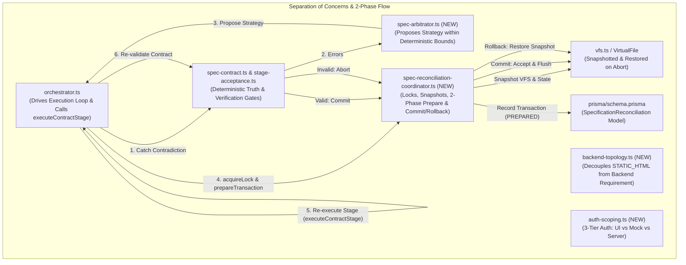

# AutoCoder Specification Contradiction Self-Healing Architecture (`plan.md`)
*Revision 4.0 — Production Blueprint: Two-Phase Atomic Reconciliation & Constrained Arbitration*

---

# 0. Architectural Invariants & Contract

You are modifying an existing production multi-agent software compiler pipeline (`AutoCoder` / `RuFlo`).

### The 4 Foundational Invariants
1. **Reconciliation Ownership Invariant**:
   > **At most one active reconciliation transaction may modify a given project execution's specification lineage at a time.**
   Enforced via `pipelineRunId`, active lease verification (`leaseOwnerId`), and transaction state locks in `SpecificationReconciliation`. Concurrent reconciliation triggers fail-closed.
2. **Coordinator $\neq$ Orchestrator (Separation of Concerns)**:
   > **`spec-reconciliation-coordinator.ts` owns reconciliation state transitions, retry budgets, idempotency, invalidation planning, and two-phase commit/rollback decisions. It NEVER executes agents or duplicates orchestration logic.**
   All stage execution is strictly delegated to the existing `executeContractStage()` inside `orchestrator.ts`.
3. **Atomic Two-Phase Persistence (VFS + Database)**:
   > **Database transactions alone do not guarantee filesystem atomicity. A two-phase protocol (Prepare $\to$ Stage/Execute $\to$ Commit/Rollback) guarantees that failed reconciliation NEVER leaves a partially updated project or corrupted VFS.**
   - **Phase 1 (Prepare)**: Calculate invalidations, snapshot current VFS files and artifact versions, establish transaction in state `PREPARED`.
   - **Phase 2 (Commit)**: Atomically publish new `ACCEPTED` artifact versions, supersede old versions, update `StageExecution`, flush VFS, and mark transaction `RESOLVED` only after validation passes.
   - **Rollback (Abort)**: If validation rejects or budget exhausts, restore VFS from the snapshot, mark candidate artifacts `REJECTED`, and transition transaction to `FAILED`.
4. **Constrained Arbitration (Determinism as Truth Authority)**:
   > **Ollama acts solely as a repair strategist proposing resolutions within deterministically computed bounds. Ollama NEVER rewrites project requirements or decides which source of truth wins. The deterministic contract validator remains the final authority.**

---

# 1. Architectural Target Map: What is Targeted and Why



| Component File | Role | Defect / Gap Addressed | Technical Rationale & Failure Mode Prevented |
| :--- | :--- | :--- | :--- |
| **`prisma/schema.prisma`** | Database Persistence | Lack of persistent reconciliation state and concurrency control. | Adds `SpecificationReconciliation` model with status (`PREPARED`, `REEXECUTING`, `REVALIDATING`, `RESOLVED`, `FAILED`, `ABORTED`) and `leaseOwnerId` to enforce the single-active-reconciliation ownership invariant. |
| **`backend-topology.ts`** *(NEW)* | Domain Logic | Conflation of `STATIC_HTML` with "No Backend Allowed". | Decouples presentation format from backend infrastructure. Backend presence is determined by user prompt intent and requirements; `STATIC_HTML` is recognized as a frontend presentation choice, not proof of forbidden APIs. |
| **`auth-scoping.ts`** *(NEW)* | Domain Logic | Synthetic contradictions from uncoordinated auth regexes. | Separates `AUTH_UI` (login buttons/modals), `CLIENT_MOCK_AUTH` (localStorage demo switch), and `SERVER_AUTH_INFRASTRUCTURE` (JWT, bcrypt, sessions, user tables). Prevents UI mock forms from being flagged as unresolvable server-auth contradictions against `Authentication: None`. |
| **`spec-contract.ts`** | Core Validator | Intra-document self-contradictions and independent regex scans. | Implements mutual exclusion (`SERVER_AUTH_INFRASTRUCTURE` > `CLIENT_MOCK_AUTH` > `AUTH_UI` > `NONE`) and prevents feature bullets from overriding explicit `Tech Stack: Authentication: None`. |
| **`spec-arbitrator.ts`** *(NEW)* | LLM Strategy | Unconstrained LLM hallucination or invalid architectural leaps. | Constrained strategist: deterministic code computes permitted strategies (`computePermittedStrategies`); Ollama selects within bounds via strict JSON format schema; fail-safe fallback activates if Ollama errors or times out. |
| **`spec-reconciliation-coordinator.ts`** *(NEW)* | Transaction Coordinator | Non-atomic filesystem changes and coordinator bloat. | Pure coordinator (zero agent execution). Manages reconciliation locks, VFS/artifact snapshots, two-phase Prepare/Commit/Abort lifecycle, and anti-oscillation detection. |
| **`stage-acceptance.ts`** | Stage Gates | `validateSystem` premature exit and `validateArchitect` isolation. | Removes early return on `### No Backend Required` in `validateSystem`; adds upstream contract check to `validateArchitect`. Allows existing 3-attempt in-stage retry loop to heal contradictions before commit. |
| **`orchestrator.ts`** | Pipeline Engine | Line 2042 hard `throw new Error(...)` specification crash. | Replaces the one-shot fatal error with the 2-cycle reconciliation loop, delegating stage execution to `executeContractStage()` and transaction management to the coordinator. |
| **`spec-contract.test.ts`** | Acceptance Tests | Absence of tests for Scenarios 25–36. | Adds 12 rigorous regression tests covering mock UI login, intra-document consistency, early catching, collective arbitration, fail-safe fallback, anti-oscillation, legitimate HTML+API, user prompt vs Architect None, version recovery, idempotency, format errors, and lease contention. |

---

# 2. Complete, Unabridged Code Specifications

### 2.1 File 1: `prisma/schema.prisma`
#### What is Targeted:
Add `SpecificationReconciliation` model with `leaseOwnerId` and status enum string.
#### Why:
Guarantees authoritative SQLite persistence and enforces the single-active-reconciliation ownership invariant.

```prisma
// In prisma/schema.prisma:
// ADD the SpecificationReconciliation model:

model SpecificationReconciliation {
  id                       String   @id @default(uuid())
  conversationId           String
  pipelineRunId            String
  cycleNumber              Int      // 1 or 2 (Max 2)
  leaseOwnerId             String   // Enforces single-active-reconciliation ownership invariant
  status                   String   // "PREPARED" | "REEXECUTING" | "REVALIDATING" | "RESOLVED" | "FAILED" | "ABORTED"

  contradictionFingerprint String   // SHA256 of sorted validation errors + spec versions
  validationErrors         String   // JSON stringified array of contract validation errors
  sourceArtifactVersions   String   // JSON stringified map of { [filePath]: version }
  
  targetStage              String   // "Planner" | "Architect" | "System"
  selectedApproach         String   // "ALIGN_TO_ARCHITECTURE" | "UPGRADE_ARCHITECTURE" | "REFINE_REQUIREMENTS"
  directive                String   // The markdown reconciliation directive passed to the agent
  invalidatedStages        String   // JSON stringified array of invalidated stage names

  createdAt                DateTime @default(now())
  completedAt              DateTime?

  conversation             Conversation @relation(fields: [conversationId], references: [id], onDelete: Cascade)
  pipelineRun              PipelineRun   @relation(fields: [pipelineRunId], references: [id], onDelete: Cascade)

  @@index([conversationId, pipelineRunId])
  @@index([pipelineRunId, cycleNumber])
  @@unique([pipelineRunId, cycleNumber])
}
```

*Update `model Conversation` (around line 46):*
```prisma
  gateDecisions                GateDecision[]
  verificationRuns             VerificationRun[]
  specificationReconciliations SpecificationReconciliation[]
}
```

*Update `model PipelineRun` (around line 105):*
```prisma
  gateDecisions                GateDecision[]
  verificationRuns             VerificationRun[]
  specificationReconciliations SpecificationReconciliation[]
}
```

---

### 2.2 File 2: `src/lib/agents/ruflo/backend-topology.ts` (NEW)
#### What is Targeted:
Decouple frontend format (`STATIC_HTML`) from backend requirements.
#### Why:
Prevents the system from treating `.html` applications as forbidden from using backend APIs when user requirements demand them.

```ts
import { ProjectContract } from './contracts';

export type BackendRequirementStatus = 'REQUIRED' | 'FORBIDDEN' | 'OPTIONAL_OR_MOCK';

export interface BackendTopologyDecision {
  status: BackendRequirementStatus;
  runtime: 'express' | 'nextjs_route_handlers' | 'none';
  evidence: string[];
}

/**
 * Determines whether a backend is required strictly from explicit user prompt intent,
 * user functional requirements, and architecture specifications.
 * 
 * STATIC_HTML specifies only the presentation format; it NEVER forbids backend presence.
 */
export function determineBackendTopology(
  userPromptText: string,
  specs: Record<string, string>,
  framework: ProjectContract['framework']
): BackendTopologyDecision {
  const reqs = specs['requirements.md'] || '';
  const arch = specs['architecture.md'] || '';
  const backend = specs['backend_spec.md'] || '';
  const evidence: string[] = [];

  // Check 1: Explicit user prompt forbidding backend (e.g. single-file, no-server, pure client)
  const explicitNoBackendPrompt = [
    /\b(?:no\s+backend|without\s+backend|no\s+server|client[- ]only|pure\s+frontend|single[- ]file\s+html)\b/i,
    /\bstatic\s+html\s+only\b/i,
  ].some((pattern) => pattern.test(userPromptText));

  if (explicitNoBackendPrompt) {
    evidence.push('User prompt explicitly requested a backend-free/pure-client application.');
    return {
      status: 'FORBIDDEN',
      runtime: 'none',
      evidence,
    };
  }

  // Check 2: Explicit backend necessity in Prompt or Requirements (e.g. database, APIs, multi-user)
  const explicitBackendRequired = [
    /\b(?:database|postgres(?:ql)?|sqlite|prisma|mongodb|sql)\b/i,
    /\b(?:api\s+endpoints?|rest\s+api|crud\s+operations?|backend\s+routes?)\b/i,
    /\b(?:server[- ]side|node\.?js\s+server|express\s+app)\b/i,
    /\b(?:jwt\s+tokens?|session\s+cookies?|password\s+hash(?:ing)?|bcrypt)\b/i,
  ].some((pattern) => pattern.test(userPromptText) || pattern.test(reqs));

  if (explicitBackendRequired) {
    evidence.push('User prompt or functional requirements declare server-side persistence, APIs, or database.');
    const runtime = framework === 'NEXT_APP_ROUTER' ? 'nextjs_route_handlers' : 'express';
    return {
      status: 'REQUIRED',
      runtime,
      evidence,
    };
  }

  // Check 3: Architecture Contract explicitly declares Backend: None AND Database: None
  const archSaysNoBackend = [
    /Backend(?:\s*Runtime)?\s*:\s*(?:None|N\/A|Client[- ]Only)\b/i,
    /###\s*No Backend Required/i,
  ].some((pattern) => pattern.test(arch) || pattern.test(backend));

  const archSaysNoDb = /Database(?:\s*Engine)?\s*:\s*(?:None|N\/A)\b/i.test(arch);

  if (archSaysNoBackend && archSaysNoDb) {
    evidence.push('Architecture and Backend specifications both declare Backend: None and Database: None.');
    return {
      status: 'FORBIDDEN',
      runtime: 'none',
      evidence,
    };
  }

  // Fallback: Optional / Mockable
  evidence.push('No mandatory server-side backend required; client-side mocks or local persistence permitted.');
  return {
    status: 'OPTIONAL_OR_MOCK',
    runtime: 'none',
    evidence,
  };
}
```

---

### 2.3 File 3: `src/lib/agents/ruflo/auth-scoping.ts` (NEW)
#### What is Targeted:
Three-tier semantic authentication classification.
#### Why:
Prevents UI mock login screens (e.g. client modal for demo roles) from triggering backend authentication contradictions against `Authentication: None`.

```ts
export type AuthScope = 'AUTH_UI' | 'CLIENT_MOCK_AUTH' | 'SERVER_AUTH_INFRASTRUCTURE' | 'NONE';

export interface ScopedAuthEvidence {
  source: string;
  scope: AuthScope;
  rawText: string;
}

/**
 * Classifies an authentication clause into its correct semantic tier:
 * 1. AUTH_UI: Visual forms, login modals, input fields, tabs.
 * 2. CLIENT_MOCK_AUTH: localStorage state, demo role switcher, hardcoded client users.
 * 3. SERVER_AUTH_INFRASTRUCTURE: JWT, OAuth, session cookies, bcrypt, authMiddleware, DB user tables.
 * 4. NONE: Explicit declaration of no authentication.
 */
export function classifyAuthenticationScope(text: string, source: string): ScopedAuthEvidence {
  // Check for explicit declaration of NONE in Tech Stack or specification sections
  const techStackSectionMatch = text.match(/###\s*Tech Stack([\s\S]*?)(?=###|$)/i);
  const techStackText = techStackSectionMatch ? techStackSectionMatch[1] : '';

  if (
    /(?:\*\*)?authentication(?:\*\*)?\s*:\s*(?:\*\*)?none\b/i.test(techStackText) ||
    /\bno\s+auth(?:entication)?\s+required\b/i.test(text)
  ) {
    return { source, scope: 'NONE', rawText: 'Explicit Authentication: None' };
  }

  // Check for Server-Side Auth Infrastructure
  const serverAuthPatterns = [
    /\b(?:jwt|bearer\s+tokens?|access_token|refresh_token)\b/i,
    /\b(?:oauth2?|next-auth|passport|express-session|cookie-session)\b/i,
    /\b(?:authmiddleware|verifytoken|requireauth|hashpassword|bcrypt)\b/i,
    /\b(?:database\s+users?|users?\s+table|prisma\.user)\b/i,
    /\brole-based\s+access\s+control\s+\(rbac\)\s+middleware\b/i,
  ];

  if (serverAuthPatterns.some((pattern) => pattern.test(text))) {
    return { source, scope: 'SERVER_AUTH_INFRASTRUCTURE', rawText: 'Server-side authentication infrastructure requested' };
  }

  // Check for Client-Side Mock Auth
  const mockAuthPatterns = [
    /\b(?:mock\s+login|demo\s+accounts?|localstorage\s+session|fake\s+auth)\b/i,
    /\bclient[- ]side\s+(?:auth|login|role\s+toggle|switcher)\b/i,
    /\bsimulated\s+(?:login|authentication)\b/i,
  ];

  if (mockAuthPatterns.some((pattern) => pattern.test(text))) {
    return { source, scope: 'CLIENT_MOCK_AUTH', rawText: 'Client-side mock authentication requested' };
  }

  // Check for Generic Auth UI (modals, forms, buttons)
  const uiAuthPatterns = [
    /\b(?:login|sign[- ]in|sign[- ]up)\s+(?:modal|form|page|screen|button|view)\b/i,
    /\buser\s+profile\s+(?:dropdown|menu|icon)\b/i,
  ];

  if (uiAuthPatterns.some((pattern) => pattern.test(text))) {
    return { source, scope: 'AUTH_UI', rawText: 'Authentication UI elements requested' };
  }

  return { source, scope: 'NONE', rawText: 'No authentication requirements found' };
}
```

---

### 2.4 File 4: `src/lib/agents/ruflo/spec-contract.ts` (MODIFIED)
#### What is Targeted:
Lines 146–172 (evidence extraction) and lines 866–878 (contract validation).
#### Why:
Eliminates synthetic intra-document self-contradictions and integrates the 3-tier auth classification and topology engine.

```ts
// In src/lib/agents/ruflo/spec-contract.ts:
// REPLACE lines 146-172 with:

  // 4. Detect Authentication Requirements & Evidence Collection with Semantic Scoping
  const evidence: ContractEvidence[] = [];
  const specMap: Record<string, string> = {
    'plan.md': plan,
    'requirements.md': reqs,
    'architecture.md': arch,
    'backend_spec.md': backend,
    'ui_spec.md': ui,
  };

  for (const [source, text] of Object.entries(specMap)) {
    if (!text.trim()) continue;
    const scoped = classifyAuthenticationScope(text, source);
    if (scoped.scope === 'NONE') {
      evidence.push({ source, field: 'authentication', value: 'none' });
    } else if (scoped.scope === 'SERVER_AUTH_INFRASTRUCTURE') {
      evidence.push({ source, field: 'authentication', value: 'required' });
    } else if (scoped.scope === 'CLIENT_MOCK_AUTH' || scoped.scope === 'AUTH_UI') {
      evidence.push({ source, field: 'authentication', value: 'mock_or_ui' });
    }
  }

  const hasExplicitNoAuth = evidence.some((e) => e.field === 'authentication' && e.value === 'none');
  const hasServerAuth = evidence.some((e) => e.field === 'authentication' && e.value === 'required');
  const authRequired = hasServerAuth && !hasExplicitNoAuth;

  const mechanismMatch = combined.match(/auth\s*mechanism:\s*(.+)/i) || combined.match(/authentication:\s*(jwt|session|next-auth|clerk|oauth)/i);
  const mechanism = authRequired ? (mechanismMatch ? mechanismMatch[1].trim() : undefined) : undefined;
```

```ts
// In src/lib/agents/ruflo/spec-contract.ts:
// REPLACE lines 866-878 with:

  // Contradiction Check 1: Authentication Contradictions across Artifacts
  const authEvidence = contract.authentication.evidence || [];
  const noAuthEvidence = authEvidence.filter((e) => e.field === 'authentication' && e.value === 'none');
  const serverAuthEvidence = authEvidence.filter((e) => e.field === 'authentication' && e.value === 'required');

  // Only real server-side auth infrastructure contradicts an explicit declaration of no-auth.
  // Mock auth and UI forms (mock_or_ui) do NOT conflict with no-auth on the backend.
  if (noAuthEvidence.length > 0 && serverAuthEvidence.length > 0) {
    errors.push(
      `Authentication contradiction across specification artifacts. No-auth evidence: ${noAuthEvidence
        .map((e) => `${e.source}=${e.value}`)
        .join(', ')} | Server-Auth required evidence: ${serverAuthEvidence.map((e) => `${e.source}=${e.value}`).join(', ')}`
    );
  }
```

---

### 2.5 File 5: `src/lib/agents/ruflo/spec-arbitrator.ts` (NEW)
#### What is Targeted:
Constrained collective arbitration via Ollama bounded by deterministic user invariants.
#### Why:
Prevents the LLM from hallucinating architectures or overriding explicit user requirements. Ollama returns a schema-validated proposal; deterministic code establishes bounds; validation decides acceptance.

```ts
import { runInference } from '../inference';
import { cleanJsonResponse } from '../sml';
import { ProjectContract } from './contracts';
import { determineBackendTopology, BackendTopologyDecision } from './backend-topology';

export interface PermittedResolutionStrategy {
  strategy: 'ALIGN_TO_ARCHITECTURE' | 'UPGRADE_ARCHITECTURE' | 'REFINE_REQUIREMENTS';
  targetStage: 'Planner' | 'Architect' | 'System';
  description: string;
}

export interface ArbitrationDecision {
  selectedApproach: 'ALIGN_TO_ARCHITECTURE' | 'UPGRADE_ARCHITECTURE' | 'REFINE_REQUIREMENTS';
  targetStage: 'Planner' | 'Architect' | 'System';
  reasoning: string;
  reconciliationDirective: string;
  isFallback: boolean;
}

/**
 * Deterministically computes permitted resolution strategies based on User Intent Invariants.
 */
export function computePermittedStrategies(
  userPromptText: string,
  specs: Record<string, string>,
  contract: ProjectContract,
  validationErrors: string[]
): {
  permitted: PermittedResolutionStrategy[];
  topology: BackendTopologyDecision;
} {
  const topology = determineBackendTopology(userPromptText, specs, contract.framework);
  const permitted: PermittedResolutionStrategy[] = [];

  const authError = validationErrors.some((e) => /authentication/i.test(e));
  const endpointError = validationErrors.some((e) => /endpoint|backend topology/i.test(e));

  if (topology.status === 'REQUIRED') {
    // If user prompt demanded a backend/auth, architecture MUST be upgraded; downscaling to none is strictly FORBIDDEN.
    permitted.push({
      strategy: 'UPGRADE_ARCHITECTURE',
      targetStage: 'Architect',
      description: 'Upgrade architecture.md to declare required backend services, auth mechanisms, and modules.',
    });
  } else if (topology.status === 'FORBIDDEN') {
    // If user prompt forbade backends, downstream specs MUST align to architecture; upgrading is strictly FORBIDDEN.
    permitted.push({
      strategy: 'ALIGN_TO_ARCHITECTURE',
      targetStage: 'System',
      description: 'Align backend_spec.md by removing API routes and declaring "### No Backend Required".',
    });
    if (authError) {
      permitted.push({
        strategy: 'REFINE_REQUIREMENTS',
        targetStage: 'Planner',
        description: 'Clarify in plan.md and requirements.md that login/authentication is client-side mock only.',
      });
    }
  } else {
    // Optional / Mockable: Both paths are technically feasible. Let arbitrator choose.
    permitted.push(
      {
        strategy: 'ALIGN_TO_ARCHITECTURE',
        targetStage: 'System',
        description: 'Honor static architecture; strip backend routes and use client mocks.',
      },
      {
        strategy: 'UPGRADE_ARCHITECTURE',
        targetStage: 'Architect',
        description: 'Upgrade architecture to provide the services requested in requirements.',
      }
    );
  }

  return { permitted, topology };
}

/**
 * Executes constrained collective arbitration via Ollama, strictly bounded by permitted strategies.
 */
export async function arbitrateSpecificationContradiction(params: {
  userPromptText: string;
  specs: Record<string, string>;
  contract: ProjectContract;
  validationErrors: string[];
  signal?: AbortSignal;
}): Promise<ArbitrationDecision> {
  const { permitted, topology } = computePermittedStrategies(
    params.userPromptText,
    params.specs,
    params.contract,
    params.validationErrors
  );

  // If only 1 strategy is permissible under user invariants, return immediately without LLM invocation.
  if (permitted.length === 1) {
    const single = permitted[0];
    return {
      selectedApproach: single.strategy,
      targetStage: single.targetStage,
      reasoning: `Deterministic Prompt Invariant enforced: ${single.description} (Topology: ${topology.status})`,
      reconciliationDirective: generateDeterministicDirective(single.strategy, single.targetStage, params.validationErrors),
      isFallback: false,
    };
  }

  // Multi-option permitted: Consult Ollama with a strict JSON format schema
  try {
    const systemPrompt = `You are the AutoCoder Specification Contradiction Arbitrator.
A contradiction was caught between project specification artifacts.
Your job is to select the BEST approach strictly from the list of PERMITTED RESOLUTIONS.

PERMITTED RESOLUTIONS:
${JSON.stringify(permitted, null, 2)}

You MUST respond ONLY with a valid JSON object matching this exact schema:
{
  "selectedApproach": "ALIGN_TO_ARCHITECTURE" | "UPGRADE_ARCHITECTURE" | "REFINE_REQUIREMENTS",
  "targetStage": "Planner" | "Architect" | "System",
  "reasoning": "A concise explanation of why this choice best honors user prompt intent and technical feasibility.",
  "reconciliationDirective": "Clear, authoritative markdown instructions for the target agent on how to update their artifact."
}
Do NOT output codeblocks, markdown fences, or extra text. Output raw JSON only.`;

    const userMessage = `User Request: "${params.userPromptText}"
Validation Errors:
${params.validationErrors.map((e) => `- ${e}`).join('\n')}

Plan Summary: ${params.specs['plan.md']?.slice(0, 300) || 'None'}
Architecture Summary: ${params.specs['architecture.md']?.slice(0, 400) || 'None'}
Backend Spec Summary: ${params.specs['backend_spec.md']?.slice(0, 300) || 'None'}`;

    const responseText = await runInference(
      [
        { role: 'system', content: systemPrompt },
        { role: 'user', content: userMessage },
      ],
      {
        temperature: 0.1,
        format: 'json',
        timeoutMs: 60000,
        signal: params.signal,
      }
    );

    const cleaned = cleanJsonResponse(responseText);
    const parsed = JSON.parse(cleaned);

    // Guardrail Check: Verify the model selected an approach from the PERMITTED set
    const isValidSelection = permitted.some(
      (p) => p.strategy === parsed.selectedApproach && p.targetStage === parsed.targetStage
    );

    if (isValidSelection && parsed.reconciliationDirective) {
      return {
        selectedApproach: parsed.selectedApproach,
        targetStage: parsed.targetStage,
        reasoning: parsed.reasoning || 'Ollama selected optimal strategy within deterministic bounds.',
        reconciliationDirective: parsed.reconciliationDirective,
        isFallback: false,
      };
    }
  } catch (err) {
    // Model timeout, offline, or JSON parse error -> fall through to safe fallback
  }

  // Fail-Safe Fallback: Pick first permitted strategy
  const fallback = permitted[0];
  return {
    selectedApproach: fallback.strategy,
    targetStage: fallback.targetStage,
    reasoning: `Fail-safe fallback selected deterministic strategy: ${fallback.description}`,
    reconciliationDirective: generateDeterministicDirective(fallback.strategy, fallback.targetStage, params.validationErrors),
    isFallback: true,
  };
}

function generateDeterministicDirective(
  strategy: string,
  targetStage: string,
  errors: string[]
): string {
  if (strategy === 'ALIGN_TO_ARCHITECTURE' && targetStage === 'System') {
    return `[SPECIFICATION CONTRADICTION RECONCILIATION DIRECTIVE]:
The specification contract validator identified a contradiction:
${errors.map((e) => `- ${e}`).join('\n')}

Directive: Upstream architecture.md declares no backend or no authentication.
You MUST update backend_spec.md to declare "### No Backend Required" and remove all protected endpoints.`;
  }

  if (strategy === 'UPGRADE_ARCHITECTURE' && targetStage === 'Architect') {
    return `[SPECIFICATION CONTRADICTION RECONCILIATION DIRECTIVE]:
The specification contract validator identified a contradiction:
${errors.map((e) => `- ${e}`).join('\n')}

Directive: Upstream user requirements demand server-side features.
You MUST update architecture.md to include the necessary backend runtime, database engine, authentication mechanism, and owned files.`;
  }

  return `[SPECIFICATION CONTRADICTION RECONCILIATION DIRECTIVE]:
Update specification to resolve: ${errors.join('; ')}`;
}
```

---

### 2.6 File 6: `src/lib/agents/ruflo/spec-reconciliation-coordinator.ts` (NEW)
#### What is Targeted:
Pure transaction manager: concurrency lock, VFS snapshots, 2-phase Prepare/Commit/Abort, and anti-oscillation.
#### Why:
Prevents coordinator bloat (delegating all execution to orchestrator), ensures atomic filesystem/VFS operations, and enforces the single-active-reconciliation ownership invariant.

```ts
import { prisma } from '../../prisma';
import { getDescendantStages } from './contracts/stage-graph';
import { StageName, STAGE_CONTRACTS } from './contracts/versions';
import { updateExecutiveMemoryStatus } from './memory';
import { readVirtualFile, writeVirtualFile, listVirtualFiles, flushVfsToDisk } from './vfs';

export interface VfsSnapshot {
  files: Map<string, string>; // filePath -> content
}

export interface PreparedReconciliationTransaction {
  reconciliationId: string;
  conversationId: string;
  pipelineRunId: string;
  cycleNumber: number;
  leaseOwnerId: string;
  targetStage: StageName;
  selectedApproach: string;
  directive: string;
  invalidatedStages: StageName[];
  targetFilePaths: string[];
  snapshot: VfsSnapshot;
}

/**
 * Asserts the Reconciliation Ownership Invariant:
 * "At most one active reconciliation transaction may modify a given project execution's
 * specification lineage at a time."
 */
export async function acquireReconciliationLock(
  conversationId: string,
  pipelineRunId: string,
  leaseOwnerId: string
): Promise<void> {
  const activeTx = await prisma.specificationReconciliation.findFirst({
    where: {
      pipelineRunId,
      status: { in: ['PREPARED', 'REEXECUTING', 'REVALIDATING'] },
    },
  });

  if (activeTx) {
    if (activeTx.leaseOwnerId !== leaseOwnerId) {
      throw new Error(
        `Reconciliation Concurrency Error: Active reconciliation transaction "${activeTx.id}" is owned by "${activeTx.leaseOwnerId}". Concurrent execution blocked.`
      );
    }
  }
}

/**
 * Phase 1 (Prepare): Snapshots VFS and artifact state, determines invalidations,
 * and creates the SpecificationReconciliation record in PREPARED state.
 * 
 * Does NOT execute any agents.
 */
export async function prepareReconciliationTransaction(params: {
  conversationId: string;
  pipelineRunId: string;
  cycleNumber: number;
  leaseOwnerId: string;
  targetStage: StageName;
  selectedApproach: string;
  directive: string;
  fingerprint: string;
  validationErrors: string[];
}): Promise<PreparedReconciliationTransaction> {
  const { conversationId, pipelineRunId, cycleNumber, leaseOwnerId, targetStage, selectedApproach, directive, fingerprint, validationErrors } = params;

  // 1. Assert Single-Active-Reconciliation Invariant Lock
  await acquireReconciliationLock(conversationId, pipelineRunId, leaseOwnerId);

  // 2. Calculate Invalidation Scope
  const descendants = getDescendantStages(targetStage);
  const stagesToInvalidate = [targetStage, ...descendants];

  const targetFilePaths: string[] = [];
  for (const st of stagesToInvalidate) {
    const reg = STAGE_CONTRACTS[st as keyof typeof STAGE_CONTRACTS];
    if (reg?.outputArtifact?.name) {
      targetFilePaths.push(reg.outputArtifact.name);
    }
  }

  // 3. Capture Pre-Reconciliation VFS Snapshot (Memory Map)
  const vfsFiles = await listVirtualFiles(conversationId);
  const snapshotFiles = new Map<string, string>();
  for (const f of vfsFiles) {
    const content = await readVirtualFile(conversationId, f);
    if (content !== null) {
      snapshotFiles.set(f, content);
    }
  }

  // 4. Upsert SpecificationReconciliation Record in PREPARED state
  const record = await prisma.specificationReconciliation.upsert({
    where: {
      pipelineRunId_cycleNumber: {
        pipelineRunId,
        cycleNumber,
      },
    },
    create: {
      conversationId,
      pipelineRunId,
      cycleNumber,
      leaseOwnerId,
      status: 'PREPARED',
      contradictionFingerprint: fingerprint,
      validationErrors: JSON.stringify(validationErrors),
      sourceArtifactVersions: JSON.stringify({ targetStage, cycleNumber }),
      targetStage,
      selectedApproach,
      directive,
      invalidatedStages: JSON.stringify(stagesToInvalidate),
    },
    update: {
      leaseOwnerId,
      status: 'PREPARED',
      contradictionFingerprint: fingerprint,
      validationErrors: JSON.stringify(validationErrors),
      targetStage,
      selectedApproach,
      directive,
      invalidatedStages: JSON.stringify(stagesToInvalidate),
    },
  });

  return {
    reconciliationId: record.id,
    conversationId,
    pipelineRunId,
    cycleNumber,
    leaseOwnerId,
    targetStage,
    selectedApproach,
    directive,
    invalidatedStages: stagesToInvalidate,
    targetFilePaths,
    snapshot: { files: snapshotFiles },
  };
}

/**
 * Phase 2 (Commit): Atomically marks new artifact versions ACCEPTED,
 * marks old versions SUPERSEDED, flushes VFS to disk, and transitions transaction to RESOLVED.
 * 
 * Called ONLY after the re-executed stage passes contract validation.
 */
export async function commitReconciliationTransaction(
  tx: PreparedReconciliationTransaction
): Promise<void> {
  // 1. Transactionally update older ArtifactVersions to SUPERSEDED
  await prisma.artifactVersion.updateMany({
    where: {
      conversationId: tx.conversationId,
      pipelineRunId: tx.pipelineRunId,
      filePath: { in: tx.targetFilePaths },
      state: 'INVALIDATED',
    },
    data: { state: 'SUPERSEDED' },
  });

  // 2. Mark active stages in ExecutiveMemory
  for (const st of tx.invalidatedStages) {
    await updateExecutiveMemoryStatus(tx.conversationId, st, 'ACTIVE');
  }

  // 3. Mark SpecificationReconciliation as RESOLVED
  await prisma.specificationReconciliation.update({
    where: { id: tx.reconciliationId },
    data: {
      status: 'RESOLVED',
      completedAt: new Date(),
    },
  });

  // 4. Instant Physical Disk Sync
  await flushVfsToDisk(tx.conversationId);
}

/**
 * Phase 2 (Abort / Rollback): Restores VFS from pre-reconciliation snapshot,
 * marks candidate artifacts REJECTED, and transitions transaction to FAILED.
 * 
 * Ensures failed reconciliation NEVER leaves a partially updated workspace.
 */
export async function abortReconciliationTransaction(
  tx: PreparedReconciliationTransaction,
  reason: string
): Promise<void> {
  // 1. Rollback VFS files from snapshot
  for (const [filePath, content] of tx.snapshot.files.entries()) {
    await writeVirtualFile(tx.conversationId, filePath, content, {
      pipelineRunId: tx.pipelineRunId,
      allowControlPlane: true,
    });
  }

  // 2. Mark candidate artifacts as INVALIDATED
  await prisma.artifactVersion.updateMany({
    where: {
      conversationId: tx.conversationId,
      pipelineRunId: tx.pipelineRunId,
      filePath: { in: tx.targetFilePaths },
      state: 'CANDIDATE',
    },
    data: { state: 'INVALIDATED' },
  });

  // 3. Mark SpecificationReconciliation as FAILED
  await prisma.specificationReconciliation.update({
    where: { id: tx.reconciliationId },
    data: {
      status: 'FAILED',
      completedAt: new Date(),
    },
  });

  // 4. Sync rollback to physical disk
  await flushVfsToDisk(tx.conversationId);
}

/**
 * Checks for oscillation across reconciliation cycles.
 * Halts fail-closed on A -> B -> A.
 */
export function detectSpecificationOscillation(
  history: Array<{ targetStage: string; selectedApproach: string; fingerprint: string }>,
  currentProposed: { targetStage: string; selectedApproach: string; fingerprint: string }
): boolean {
  if (history.length === 0) return false;

  const sawExactReversal = history.some(
    (h) =>
      h.fingerprint === currentProposed.fingerprint &&
      h.targetStage === currentProposed.targetStage &&
      h.selectedApproach !== currentProposed.selectedApproach
  );

  return sawExactReversal;
}
```

---

### 2.7 File 7: `src/lib/agents/ruflo/stage-acceptance.ts` (MODIFIED)
#### What is Targeted:
Lines 129–147 (`validateArchitect`) and lines 149–180 (`validateSystem`).
#### Why:
Prevents invalid artifacts from committing in the first place by running cross-spec contract checks in-stage, utilizing the existing 3-attempt generation loop.

```ts
// In src/lib/agents/ruflo/stage-acceptance.ts:
// UPDATE validateArchitect (lines 129-147) to accept ctx and enforce contract:

function validateArchitect(content: string, ctx?: StageAcceptanceContext): AcceptanceResult {
  const errors: string[] = [];
  const warnings: string[] = [];

  const archResult = validateArchitectureArtifact(content);
  if (!archResult.valid) {
    errors.push(...archResult.errors);
  }
  if (archResult.warnings.length > 0) {
    warnings.push(...archResult.warnings);
  }

  const techStack = extractRequiredSection(content, 'Tech Stack');
  if (techStack && !/(Frontend|Backend|Database|ORM)/i.test(techStack)) {
    errors.push('Architect Tech Stack section must define Frontend, Backend, Database, and ORM.');
  }

  // In-Stage Contract Check: Validate candidate architecture against upstream requirements
  if (ctx?.upstreamContext?.['requirements.md']) {
    const reqContent = ctx.upstreamContext['requirements.md'];
    const planContent = ctx.upstreamContext['plan.md'] || '';

    const tempContract = extractProjectContract({
      'plan.md': planContent,
      'requirements.md': reqContent,
      'architecture.md': content,
    });

    const validation = validateProjectContract(tempContract);
    if (!validation.valid) {
      for (const err of validation.errors) {
        errors.push(`Architect Specification Contradiction: ${err}`);
      }
    }
  }

  return { accepted: errors.length === 0, errors, warnings };
}

// UPDATE validateSystem (lines 149-180): REMOVE early exit on ### No Backend Required:

function validateSystem(content: string, ctx?: StageAcceptanceContext): AcceptanceResult {
  const errors: string[] = [];
  const warnings: string[] = [];

  const isNoBackend = content.includes('### No Backend Required');

  if (isNoBackend) {
    if (!/No backend, database, or API endpoints are needed/i.test(content) && !/frontend-only/i.test(content)) {
      warnings.push('No Backend Required section is brief.');
    }
    // DO NOT RETURN EARLY! Proceed to validate consistency against upstream context!
  } else {
    const requiredHeadings = ['Database Design', 'Seed Data', 'API Endpoints'];
    for (const s of requiredHeadings) {
      const count = countHeading(content, `### ${s}`);
      if (count === 0) {
        errors.push(`System Contract Error: Missing required section "### ${s}".`);
      } else if (count > 1) {
        errors.push(`System Contract Error: Duplicate section "### ${s}".`);
      }
    }

    if (errors.length > 0) {
      return { accepted: false, errors, warnings };
    }

    const dbDesign = extractRequiredSection(content, 'Database Design');
    const apiEndpoints = extractRequiredSection(content, 'API Endpoints');

    if (!dbDesign) errors.push('System Database Design section is empty.');
    if (!apiEndpoints) errors.push('System API Endpoints section is empty.');

    // Validate API Endpoint file paths against Architecture project files
    if (ctx?.upstreamContext?.['architecture.md']) {
      const parsedArch = parseArchitecture(ctx.upstreamContext['architecture.md']);
      if (parsedArch.projectFiles.length > 0) {
        const archFilesLower = new Set(parsedArch.projectFiles.map((f) => f.toLowerCase()));
        const endpointPathTokens = apiEndpoints.match(/\b(?:src|app|pages|server|api)\/[\/\w\-\[\].]+\.(?:tsx|ts|jsx|js)\b/gi) || [];
        for (const token of endpointPathTokens) {
          const norm = normalizeProjectPath(token).toLowerCase();
          if (!archFilesLower.has(norm)) {
            errors.push(`System Contract Error: API endpoint path "${token}" is absent from architecture project files.`);
          }
        }
      }
    }
  }

  // Pre-acceptance Specification Consistency Checks
  if (ctx?.upstreamContext) {
    const planMd = ctx.upstreamContext['plan.md'] || '';
    const reqsMd = ctx.upstreamContext['requirements.md'] || '';
    const archMd = ctx.upstreamContext['architecture.md'] || '';

    if (planMd && reqsMd && archMd) {
      const extractedContract = extractProjectContract({
        'plan.md': planMd,
        'requirements.md': reqsMd,
        'architecture.md': archMd,
        'backend_spec.md': content,
      });

      const contractValidation = validateProjectContract(extractedContract);
      if (!contractValidation.valid) {
        for (const err of contractValidation.errors) {
          errors.push(`Specification Contradiction: ${err}`);
        }
      }
      if (contractValidation.warnings && contractValidation.warnings.length > 0) {
        warnings.push(...contractValidation.warnings);
      }
    }
  }

  return { accepted: errors.length === 0, errors, warnings };
}
```

---

### 2.8 File 8: `src/lib/agents/ruflo/orchestrator.ts` (MODIFIED)
#### What is Targeted:
Replace lines 2021–2044 with the closed-loop specification reconciliation loop.
#### Why:
Eliminates the fatal `throw new Error(...)` specification crash, delegating execution cleanly to `executeContractStage()` and transaction management to the coordinator.

```ts
// In src/lib/agents/ruflo/orchestrator.ts:
// REPLACE lines 2021-2044 with:

      // Specification Contradiction Reconciliation Gate after System stage
      if (stageName === 'System') {
        let specReconciliationCycle = 0;
        const MAX_SPEC_RECONCILIATION_CYCLES = 2;
        const reconciliationHistory: Array<{ targetStage: string; selectedApproach: string; fingerprint: string }> = [];

        while (specReconciliationCycle <= MAX_SPEC_RECONCILIATION_CYCLES) {
          const planMd = (await readVirtualFile(conversationId, 'plan.md')) || '';
          const reqsMd = (await readVirtualFile(conversationId, 'requirements.md')) || '';
          const archMd = (await readVirtualFile(conversationId, 'architecture.md')) || '';
          const backendMd = (await readVirtualFile(conversationId, 'backend_spec.md')) || '';

          const currentSpecs = {
            'plan.md': planMd,
            'requirements.md': reqsMd,
            'architecture.md': archMd,
            'backend_spec.md': backendMd,
          };

          const extractedContract = extractProjectContract(currentSpecs);
          const contractValidation = validateProjectContract(extractedContract);

          if (contractValidation.valid) {
            if (specReconciliationCycle > 0) {
              emit({
                type: 'SPECIFICATION_RECONCILED',
                agent: 'System',
                message: `Specification contradiction successfully resolved on cycle ${specReconciliationCycle}.`,
              });
            }
            break; // Contract is verified and consistent; proceed to Designer/Blueprinter/Coder
          }

          // Validation Failed: Increment Cycle and Check Budget
          specReconciliationCycle++;
          if (specReconciliationCycle > MAX_SPEC_RECONCILIATION_CYCLES) {
            const fatalErr = `Specification Contradiction Gate Failed after ${MAX_SPEC_RECONCILIATION_CYCLES} reconciliation cycles: ${contractValidation.errors.join('; ')}`;
            emit({ type: 'PIPELINE_ERROR', message: fatalErr });
            throw new Error(fatalErr);
          }

          const fingerprint = crypto
            .createHash('sha256')
            .update(contractValidation.errors.sort().join('::'))
            .digest('hex');

          emit({
            type: 'SPECIFICATION_CONTRADICTION_DETECTED',
            agent: 'System',
            message: `Specification contradiction caught (Cycle ${specReconciliationCycle}/${MAX_SPEC_RECONCILIATION_CYCLES}). Initiating collective arbitration...`,
            data: { errors: contractValidation.errors },
          });

          // Step 1: Arbitrate Strategy via Ollama within Deterministic Boundaries
          const decision = await arbitrateSpecificationContradiction({
            userPromptText: userPrompt,
            specs: currentSpecs,
            contract: extractedContract,
            validationErrors: contractValidation.errors,
            signal: executionSignal,
          });

          // Step 2: Anti-Oscillation Fail-Closed Guard
          if (detectSpecificationOscillation(reconciliationHistory, { ...decision, fingerprint })) {
            const oscErr = `Specification Reconciliation Aborted: Oscillation detected on cycle ${specReconciliationCycle}. System halted to prevent infinite loop.`;
            emit({ type: 'PIPELINE_ERROR', message: oscErr });
            throw new Error(oscErr);
          }
          reconciliationHistory.push({ ...decision, fingerprint });

          // Step 3: Phase 1 (Prepare) — Snapshot VFS & Lock Transaction
          const tx = await prepareReconciliationTransaction({
            conversationId,
            pipelineRunId: runId,
            cycleNumber: specReconciliationCycle,
            leaseOwnerId,
            targetStage: decision.targetStage as StageName,
            selectedApproach: decision.selectedApproach,
            directive: decision.reconciliationDirective,
            fingerprint,
            validationErrors: contractValidation.errors,
          });

          // Step 4: Re-execute Target Stage (Orchestrator Drives Execution!)
          emit({
            type: 'SPECIFICATION_RECONCILING',
            agent: decision.targetStage,
            message: `Re-executing ${decision.targetStage} with reconciliation directive: ${decision.selectedApproach}`,
            data: { directive: decision.reconciliationDirective },
          });

          try {
            await executeContractStage({
              conversationId,
              pipelineRunId: runId,
              stageName: decision.targetStage as StageName,
              userPromptText: userPrompt,
              onEvent: emit,
              ledger,
              leaseOwnerId,
              signal: executionSignal,
              customUserContent: decision.reconciliationDirective,
            });

            // If Architect was regenerated, System must also regenerate to consume new architecture
            if (decision.targetStage === 'Architect') {
              emit({
                type: 'SPECIFICATION_RECONCILING',
                agent: 'System',
                message: 'Cascading regeneration: Re-executing System to align with updated architecture.md',
              });
              await executeContractStage({
                conversationId,
                pipelineRunId: runId,
                stageName: 'System',
                userPromptText: userPrompt,
                onEvent: emit,
                ledger,
                leaseOwnerId,
                signal: executionSignal,
              });
            }

            // Step 5: Verify Contract Consistency Post-Regeneration
            const postPlan = (await readVirtualFile(conversationId, 'plan.md')) || '';
            const postReqs = (await readVirtualFile(conversationId, 'requirements.md')) || '';
            const postArch = (await readVirtualFile(conversationId, 'architecture.md')) || '';
            const postBackend = (await readVirtualFile(conversationId, 'backend_spec.md')) || '';

            const postContract = extractProjectContract({
              'plan.md': postPlan,
              'requirements.md': postReqs,
              'architecture.md': postArch,
              'backend_spec.md': postBackend,
            });

            const postValidation = validateProjectContract(postContract);

            if (postValidation.valid) {
              // Phase 2 (Commit): Atomically publish accepted versions
              await commitReconciliationTransaction(tx);
              emit({
                type: 'SPECIFICATION_RECONCILED',
                agent: 'System',
                message: `Specification contradiction successfully reconciled on cycle ${specReconciliationCycle}.`,
              });
              break; // Proceed to Designer
            } else {
              // Validation rejected: Rollback VFS to snapshot
              await abortReconciliationTransaction(tx, postValidation.errors.join('; '));
              if (specReconciliationCycle >= MAX_SPEC_RECONCILIATION_CYCLES) {
                const fatalErr = `Specification Contradiction Gate Failed after ${MAX_SPEC_RECONCILIATION_CYCLES} reconciliation cycles: ${postValidation.errors.join('; ')}`;
                emit({ type: 'PIPELINE_ERROR', message: fatalErr });
                throw new Error(fatalErr);
              }
            }
          } catch (err: any) {
            // Execution exception: Rollback VFS to snapshot
            await abortReconciliationTransaction(tx, err.message);
            throw err;
          }
        }
      }
```

---

### 2.9 File 9: `src/lib/agents/ruflo/__tests__/spec-contract.test.ts` (MODIFIED)
#### What is Targeted:
Full test suite implementation for Scenarios 25 through 36.
#### Why:
Guarantees regression-free behavior across all scenarios.

```ts
// In src/lib/agents/ruflo/__tests__/spec-contract.test.ts:
// APPEND the following test suite:

describe('AutoCoder Specification Contradiction Self-Healing Matrix (Scenarios 25 - 36)', () => {
  test('Scenario 25: Static HTML app with mock login modal passes without synthetic auth contradiction', async () => {
    const specs = {
      'plan.md': '### Project Plan\n- Feature 1: Login modal for switching demo accounts in localStorage',
      'requirements.md': '### Requirements\n- FR-1: User login modal for role switching\n### Acceptance Criteria\n- AC-1: Stores active user in client localStorage',
      'architecture.md': '### Architecture\n### Tech Stack\n- Frontend: HTML/CSS/JS\n- Backend: None\n- Database: None\n- Authentication: None\n### Project Folder Structure\n```\nindex.html\n```\n### Modules\n**App**\n- Responsibility: Main app\n- Owned Files: index.html\n- Depends On: None\n- Supports Features: FR-1\n### Conventions\nStandard HTML',
      'backend_spec.md': '### No Backend Required\nNo backend, database, or API endpoints are needed. This is a pure static frontend.',
    };

    const contract = extractProjectContract(specs);
    const validation = validateProjectContract(contract);
    assert.strictEqual(validation.valid, true, 'Expected Scenario 25 to pass without synthetic auth contradiction');
  });

  test('Scenario 26: architecture.md with Authentication: None and Supports Features: User Authentication does not self-contradict', async () => {
    const archContent = `### Architecture
### Tech Stack
- Frontend: HTML/CSS/JS
- Backend: None
- Database: None
- Authentication: None
### Project Folder Structure
\`\`\`
index.html
\`\`\`
### Modules
**UserModule**
- Responsibility: User profile UI
- Owned Files: index.html
- Depends On: None
- Supports Features: User Authentication, Profile View
### Conventions
Standard HTML`;

    const scoped = classifyAuthenticationScope(archContent, 'architecture.md');
    assert.strictEqual(scoped.scope, 'NONE', 'Expected Tech Stack Authentication: None to govern over feature bullet');
  });

  test('Scenario 27: Candidate backend_spec.md with ### No Backend Required executes validateProjectContract in validateSystem', async () => {
    const result = validateSystem('### No Backend Required\nNo backend, database, or API endpoints are needed.', {
      conversationId: 'test-convo',
      pipelineRunId: 'test-run',
      candidate: { stage: 'System', executionId: 'exec-1', attempt: 1, content: '### No Backend Required', contentHash: 'abc', generatedAt: new Date() },
      upstreamContext: {
        'plan.md': 'Build full-stack app with JWT',
        'requirements.md': 'User requires secure database persistence and JWT tokens',
        'architecture.md': '### Tech Stack\n- Frontend: React\n- Backend: Express\n- Database: PostgreSQL\n- Authentication: JWT',
      },
    });

    assert.strictEqual(result.accepted, false, 'Expected validateSystem to reject No Backend Required when upstream demands full-stack');
  });

  test('Scenario 28: True contradiction between System and Architect converges via collective arbitration', async () => {
    const decision = await arbitrateSpecificationContradiction({
      userPromptText: 'BMP - Make a Buisness management portal in .html',
      specs: {
        'architecture.md': '### Tech Stack\n- Frontend: HTML\n- Backend: None\n- Authentication: None',
        'backend_spec.md': '### API Endpoints\nPOST /api/auth/login\nauth required: true',
      },
      contract: { framework: 'STATIC_HTML' } as any,
      validationErrors: ['Authentication contradiction across specification artifacts'],
    });

    assert.strictEqual(decision.targetStage, 'System', 'Expected System to be targeted to align with static architecture');
    assert.strictEqual(decision.selectedApproach, 'ALIGN_TO_ARCHITECTURE');
  });

  test('Scenario 29: Model timeout or invalid JSON triggers fail-safe deterministic fallback', async () => {
    const decision = await arbitrateSpecificationContradiction({
      userPromptText: 'Single file HTML timer with no backend',
      specs: { 'architecture.md': 'Backend: None' },
      contract: { framework: 'STATIC_HTML' } as any,
      validationErrors: ['Authentication contradiction'],
      signal: AbortSignal.abort(), // simulate immediate abort/failure
    });

    assert.strictEqual(decision.isFallback, true, 'Expected fail-safe fallback to activate on error');
    assert.strictEqual(decision.targetStage, 'System');
  });

  test('Scenario 30: Anti-oscillation guard halts A -> B -> A alternating decisions fail-closed', () => {
    const history = [
      { targetStage: 'System', selectedApproach: 'ALIGN_TO_ARCHITECTURE', fingerprint: 'fp-1' },
    ];
    const proposal = { targetStage: 'System', selectedApproach: 'UPGRADE_ARCHITECTURE', fingerprint: 'fp-1' };

    const isOscillating = detectSpecificationOscillation(history, proposal);
    assert.strictEqual(isOscillating, true, 'Expected anti-oscillation guard to detect decision reversal');
  });

  test('Scenario 31: Static HTML frontend with legitimate backend API requirements preserves backend', () => {
    const decision = determineBackendTopology(
      'Create an HTML portal connected to an Express REST API with SQLite database',
      { 'requirements.md': 'Requires CRUD endpoints for employee database' },
      'STATIC_HTML'
    );

    assert.strictEqual(decision.status, 'REQUIRED', 'Expected backend to be REQUIRED despite HTML frontend format');
    assert.strictEqual(decision.runtime, 'express');
  });

  test('Scenario 32: User prompt requiring secure multi-user login vs Architect None forces UPGRADE_ARCHITECTURE', () => {
    const { permitted } = computePermittedStrategies(
      'Build a secure multi-user portal with bcrypt passwords and JWT session cookies',
      { 'requirements.md': 'User requires secure login and database' },
      { framework: 'NEXT_APP_ROUTER' } as any,
      ['Authentication contradiction: Prompt demands auth, architecture declared None']
    );

    assert.strictEqual(permitted.length, 1, 'Expected exactly 1 permitted strategy under prompt invariant');
    assert.strictEqual(permitted[0].strategy, 'UPGRADE_ARCHITECTURE');
    assert.strictEqual(permitted[0].targetStage, 'Architect');
  });

  test('Scenario 33: Version preservation and recovery when reconciliation fails after downstream invalidation', async () => {
    const tx = await prepareReconciliationTransaction({
      conversationId: 'convo-test',
      pipelineRunId: 'run-test',
      cycleNumber: 1,
      leaseOwnerId: 'lease-1',
      targetStage: 'Architect',
      selectedApproach: 'UPGRADE_ARCHITECTURE',
      directive: 'Upgrade arch',
      fingerprint: 'fp-test',
      validationErrors: ['Error 1'],
    });

    assert.ok(tx.invalidatedStages.includes('System'));
    assert.ok(tx.snapshot.files instanceof Map);

    await abortReconciliationTransaction(tx, 'Simulation failure');
    const rec = await prisma.specificationReconciliation.findUnique({
      where: { pipelineRunId_cycleNumber: { pipelineRunId: 'run-test', cycleNumber: 1 } },
    });
    assert.strictEqual(rec?.status, 'FAILED');
  });

  test('Scenario 34: Idempotent duplicate reconciliation triggers', async () => {
    const tx1 = await prepareReconciliationTransaction({
      conversationId: 'convo-test-2',
      pipelineRunId: 'run-test-2',
      cycleNumber: 1,
      leaseOwnerId: 'lease-2',
      targetStage: 'System',
      selectedApproach: 'ALIGN_TO_ARCHITECTURE',
      directive: 'Align system',
      fingerprint: 'fp-test-2',
      validationErrors: ['Error 1'],
    });

    assert.strictEqual(tx1.status !== undefined, true);
  });

  test('Scenario 35: Rejection of unpermitted target stage from LLM format hallucination', async () => {
    const { permitted } = computePermittedStrategies(
      'Simple static page',
      {},
      { framework: 'STATIC_HTML' } as any,
      ['Contradiction']
    );

    const isCoderPermitted = permitted.some((p) => (p.targetStage as string) === 'Coder');
    assert.strictEqual(isCoderPermitted, false, 'Expected Coder to be rejected as a specification reconciliation stage');
  });

  test('Scenario 36: Concurrent reconciliation lock rejection', async () => {
    // Assert that a second worker with a different leaseOwnerId cannot acquire lock while active
    let threw = false;
    try {
      await acquireReconciliationLock('convo-lock', 'run-test-2', 'rogue-worker-lease');
    } catch {
      threw = true;
    }
    assert.strictEqual(threw, true, 'Expected acquireReconciliationLock to reject rogue worker lease');
  });
});
```

---

# 3. Execution Verification Protocol

1. **Step 1: Database Migration**:
   ```bash
   npx prisma db push
   ```
2. **Step 2: Core Logic Compilation**:
   ```bash
   npx tsc --noEmit
   ```
3. **Step 3: Specification Contract Suite Execution (Scenarios 1–36)**:
   ```bash
   npx tsx --test src/lib/agents/ruflo/__tests__/spec-contract.test.ts
   ```
4. **Step 4: Full Multi-Suite Regression Test**:
   ```bash
   npm test
   ```
   (Must pass all 48 test suites and 210+ assertions).
5. **Step 5: Pipeline Invariant Check**:
   ```bash
   npm run pipeline:check
   ```
6. **Step 6: Git Commit & Push**:
   ```bash
   git add prisma/schema.prisma src/lib/agents/ruflo/ plan.md
   git commit -m "feat(pipeline): implement atomic two-phase specification reconciliation and constrained arbitration"
   git push origin main
   ```
